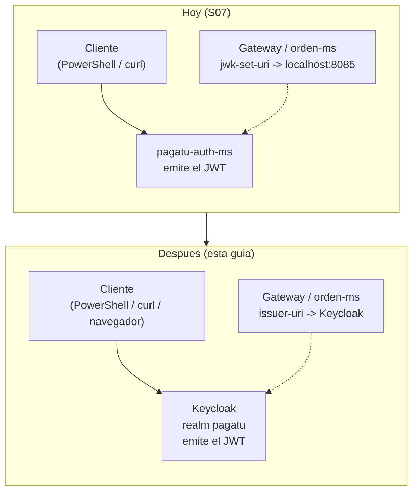

# S07 - Reemplazo de `pagatu-auth-ms` por Keycloak (guía de referencia)

*Por: Angel Sullon Macalupu @asullom - 2026*

## 0. Qué es esta guía y qué no es

Esta guía **no** es una sesión aparte del sílabo: no tiene metodología, caso de motivación, actividad autónoma ni rúbrica propia, y no se evalúa por sí sola. Es la continuación directa de [S07_Seguridad_Distribuida_Control_Acceso.md](S07_Seguridad_Distribuida_Control_Acceso.md) — la sesión real y evaluada —, que construyó `pagatu-auth-ms` deliberadamente temporal y diseñado, desde su primera línea, "para que el reemplazo posterior por Keycloak cambie una propiedad de configuración, no el código del Gateway ni de los microservicios de negocio" (S07, 1.1, Tabla 6). A diferencia de una guía puramente optativa, esta **sí** es prerrequisito de [S11_Integracion_Cliente_Frontend_Angular_Keycloak.md](S11_Integracion_Cliente_Frontend_Angular_Keycloak.md): S07 ya citó a S11 más de diez veces (Tabla 3, Tabla 4, Tabla 5, Figura 6, 2.4, 3.27) dando por hecho que el cliente Angular de esa sesión hablaría con Keycloak, no con `pagatu-auth-ms` — esta guía es el paso intermedio que hace cierta esa expectativa.

**Una divergencia real frente a S07, no solo una ejecución de su Tabla 6**: S07 (3.13) diseñó `idCliente` a propósito como "un dato de negocio que este servicio guarda por comodidad, no un dato de identidad" — distinto del `sub` del token, y por eso exigía un *user attribute* + *protocol mapper* del lado de Keycloak. Esta guía se aparta de eso: `idCliente` pasa a ser literalmente `sub`, igual que `vendedorId` en LP2 (BomERP). La razón es práctica, no cosmética — se explica en la sección 7, donde se construye. Esto **sí** toca código real de `pagatu-orden-ms` (no solo configuración de Keycloak), a diferencia de lo que la Tabla 6 original de S07 prometía.

Constrúyela entre S07 y S11, con tiempo antes de esa clase — no es un trabajo de diez minutos: Parte C (7.3-7.4) recompila `pagatu-orden-ms` y migra una columna real de Postgres, no solo cambia una propiedad. Nunca antes de haber completado S07 por tu cuenta, porque da por hecho que `pagatu-auth-ms`, el Gateway y `pagatu-orden-ms` ya quedaron funcionando con JWT propio exactamente como esa sesión los dejó.

**Requisito:** haber completado S07 (`pagatu-auth-ms` funcional, con usuarios/roles propios, Gateway y `pagatu-orden-ms` validando por `jwk-set-uri`) — esta guía parte de ese estado y lo reemplaza.

La guía está dividida en tres partes, en el orden en que de verdad hace falta tocar cada pieza:

- **Parte A** (secciones 2-6) construye y prueba Keycloak solo — realm, cliente, usuarios, y un token real inspeccionado. **Nada de esto toca el Gateway ni `pagatu-orden-ms`** — ni un archivo, ni un reinicio.
- **Parte B** (7.1-7.2) es el mínimo que deja al Gateway y a `pagatu-orden-ms` **validando** tokens de Keycloak, con los mismos roles de siempre protegiendo las mismas rutas de siempre — una propiedad YAML por archivo, sin tocar ninguna línea de Java, confirmado con tokens reales antes de seguir.
- **Parte C** (7.3-7.4, indispensable; 8-9, profundización) migra `idCliente` a `sub` en el código y en Postgres — sin esto, `pagatu-orden-ms` ni compila —, y después retira `pagatu-auth-ms` y prueba con la matriz completa de roles, usando tokens reales de Keycloak.

## 1. Qué cambia y qué no

**Figura 1. Antes y después del reemplazo**



**Tabla 1. Qué cambia exactamente frente a la Tabla 6 de S07**

| Pieza | Cambia | Nota |
|---|---|---|
| `jwk-set-uri` → `issuer-uri` (Gateway y `pagatu-orden-ms`) | Sí — una propiedad YAML en cada uno (7.1) | Igual que la Tabla 6 de S07 ya prometía. |
| `JwtAuthenticationConverter` (lee `realm_access.roles`) | **No** | Igual que la Tabla 6. |
| Reglas `hasRole`/`hasAnyRole` del Gateway | **No** | Igual que la Tabla 6. |
| Cómo `pagatu-orden-ms` lee `idCliente` del JWT | **Sí** — pasa de `jwt.getClaim("idCliente")` (`Long`) a `jwt.getSubject()` (`String`) (7.4) | **Diverge** de la Tabla 6 de S07, que no exigía esto — ver la sección 0. |
| Columna `id_cliente` de `ordenes` | Sí — de `BIGINT` a `VARCHAR(36)` (7.3) | **Diverge** de la Tabla 6, por la misma razón. |
| Servicio `pagatu-auth-ms` | Se retira (sección 8) | Igual que la Tabla 6. |
| Postgres de `pagatu-auth-ms` (`pagatu-postgres-auth-dev`) | Se retira junto con el servicio | Igual que la Tabla 6. |

## Parte A — Keycloak, sin tocar el Gateway ni `pagatu-orden-ms`

Las secciones 2 a 6 levantan, configuran y prueban Keycloak de punta a punta. En ningún momento se edita, reinicia ni recompila el Gateway ni `pagatu-orden-ms` — todo lo que sigue hasta el final de la sección 6 se verifica contra Keycloak directamente, con el navegador y PowerShell/`curl`.

## 2. Levantar Keycloak

**Producto del paso:** Keycloak corriendo en modo desarrollo, con su propio Postgres, y consola de administración accesible.

**`keycloak/compose-dev.yml`** (archivo nuevo — hermano de `kafka/`/`obs/`, no dentro de `infra/`: igual que ellos, es una imagen de Docker que se consume tal cual, no un servicio propio con su `Dockerfile`, como sí lo son `pagatu-config`/`pagatu-eureka`/`pagatu-gateway` dentro de `infra/`):

```yaml
name: pagatu-keycloak-dev

services:
  keycloak-db:
    image: postgres:17-alpine
    container_name: pagatu-keycloak-db
    restart: unless-stopped
    environment:
      POSTGRES_DB: pagatu_keycloak
      POSTGRES_USER: pagatu_keycloak
      POSTGRES_PASSWORD: pagatu
    ports:
      - "15436:5432"
    volumes:
      - pagatu_keycloak_db_dev_data:/var/lib/postgresql/data
    healthcheck:
      test: ["CMD-SHELL", "pg_isready -U pagatu_keycloak -d pagatu_keycloak"]
      interval: 10s
      timeout: 5s
      retries: 10
      start_period: 15s

  keycloak:
    image: quay.io/keycloak/keycloak:26.8.0
    container_name: pagatu-keycloak
    restart: unless-stopped
    command: start-dev
    environment:
      KC_BOOTSTRAP_ADMIN_USERNAME: admin
      KC_BOOTSTRAP_ADMIN_PASSWORD: admin123
      KC_DB: postgres
      KC_DB_URL: jdbc:postgresql://keycloak-db:5432/pagatu_keycloak
      KC_DB_USERNAME: pagatu_keycloak
      KC_DB_PASSWORD: pagatu
      KC_METRICS_ENABLED: "true"
      KC_HEALTH_ENABLED: "true"
      KC_LOG: console,file
      KC_LOG_FILE: /opt/keycloak/data/log/keycloak.log
      KC_HTTP_MANAGEMENT_PORT: 9000
    ports:
      - "18180:8080"
      - "19000:9000"
    volumes:
      - pagatu_keycloak_dev_data:/opt/keycloak/data
      - ./logs:/opt/keycloak/data/log
    depends_on:
      keycloak-db:
        condition: service_healthy

volumes:
  pagatu_keycloak_db_dev_data:
  pagatu_keycloak_dev_data:
```

El puerto externo `18180` sigue el mismo criterio de prefijo `1`=DEV que ya usan `pagatu-eureka` (`18761`) y `pagatu-gateway` (`18080`) — `18085` queda ocupado por la UI de Kafka (S8), así que Keycloak toma el siguiente libre; `15436` continúa la secuencia de puertos Postgres de los cuatro microservicios (`15431`-`15435`). `start-dev` es el modo rápido de desarrollo — sin TLS ni *hostname* explícito, no apto para producción real (fuera del alcance de esta guía, igual que lo documentó LP2 al construir el mismo contenedor para BomERP).

Las cinco variables nuevas (`KC_METRICS_ENABLED`, `KC_HEALTH_ENABLED`, `KC_LOG`, `KC_LOG_FILE`, `KC_HTTP_MANAGEMENT_PORT`) no hacen falta para nada de lo que esta guía construye — existen para que S10 (Observabilidad) pueda monitorear Keycloak con el mismo criterio que los demás servicios, sin que nadie tenga que volver a tocar este archivo más adelante. Por defecto, Keycloak no expone métricas ni log a archivo — ambos vienen desactivados hasta que se piden explícitamente (verificado contra la documentación oficial de Keycloak 26). `KC_HTTP_MANAGEMENT_PORT: 9000` mueve `/metrics` y `/health` a un servidor HTTP separado del tráfico de autenticación (`18180`), publicado hacia el host en `19000` — el mismo criterio de prefijo `1`=DEV. Exponer estos dos endpoints junto con el tráfico real no es recomendable por seguridad; separarlos en su propio puerto permite que, en un entorno real, el de management quede sin publicar hacia afuera mientras sigue siendo alcanzable para quien sí necesita monitorear (Keycloak, 2026).

Dos volúmenes distintos, para dos cosas distintas — el mismo patrón que ya usó LP2 al construir este mismo contenedor para BomERP (ahí, `keycloak-data`/`keycloak-db-data`; aquí, con el prefijo `pagatu_..._dev_data` que ya usan los cuatro microservicios, `pagatu_keycloak_dev_data`/`pagatu_keycloak_db_dev_data`). `pagatu_keycloak_dev_data:/opt/keycloak/data` es el volumen de Keycloak mismo: persiste **todo** lo que guarda ahí por su cuenta (el `h2` embebido que ya no importa porque `KC_DB` apunta a Postgres, `transaction-logs`, caché de *providers*) — sin él, cualquier recreación del contenedor (`docker compose up` tras un `down`, no solo un `restart`) perdería esos archivos, aunque el realm y los usuarios sigan a salvo en `pagatu_keycloak_db_dev_data` (el volumen de Postgres, sección de arriba). `./logs:/opt/keycloak/data/log` es, además, un *bind mount* a una carpeta nueva dentro de `keycloak/`, anidado **dentro** del volumen de Keycloak — igual en espíritu a `../services/pagatu-auth-ms/logs:/var/log/pagatu-auth-ms:ro` que ya usan los microservicios — S10 monta esa misma carpeta, de solo lectura, en Promtail. Verificado contra la imagen real (`quay.io/keycloak/keycloak:26.8.0`): anidar un *bind mount* dentro de un volumen con nombre funciona sin problema — Keycloak escribe `keycloak.log` ahí y el archivo aparece también en el host, en `keycloak/logs/`.

```bash
cd keycloak
docker compose -f compose-dev.yml up -d
```

Confirma que levantó accediendo a `http://localhost:18180` — debe aparecer la pantalla de bienvenida de Keycloak. Entra a la consola de administración con `admin`/`admin123`.

**Error frecuente**: arrancar el Gateway o `pagatu-orden-ms` (sección 7) antes de que Keycloak termine de iniciar. El *healthcheck* de `keycloak-db` tarda unos segundos; confirma con `docker ps` que diga `healthy`, no solo `Up`, antes de seguir.

## 3. Configurar el realm `pagatu`

**Producto del paso:** un realm propio (no `master`, reservado para administrar Keycloak mismo), con los dos roles que el Gateway ya usa.

1. **Manage realms** → **Create realm** → *Realm name*: `pagatu`. Crear.
2. Con `pagatu` como realm activo (lo confirmas en la esquina superior izquierda): **Realm roles** → **Create role**, crea `CLIENTE` y `ADMIN`, uno por uno.

Estos son **realm roles** (no *client roles*) a propósito: Keycloak los agrega al token bajo el claim `realm_access.roles` — el mismo nombre de claim que `pagatu-auth-ms` ya usaba (S07, 3.17) y que `JwtAuthenticationConverter` ya sabe leer. Es el primer punto donde se confirma la Tabla 1: cero cambios en ese conversor.

## 4. Crear el cliente `pagatu-frontend`

**Producto del paso:** un *client* en el realm `pagatu`, configurado **directamente** para el flujo final — a diferencia de LP2/BomERP, esta guía no pasa por una fase temporal de prueba con *Direct access grants*: S07 (3.27) ya verificó a mano, con datos reales, que el cálculo de PKCE (*Proof Key for Code Exchange*) es correcto, así que no hace falta un atajo adicional antes de configurar el cliente bien desde el principio.

1. **Clients** → **Create client**. *Client type*: `OpenID Connect`. *Client ID*: `pagatu-frontend`. Siguiente.
2. **Capability config**:
    - **Client authentication**: **desactivado** — es un *public client* (una SPA no puede guardar un secreto, S07, 2.4).
    - **Authorization**: desactivado — no aplica a esta guía.
    - **Authentication flow**: deja **Standard flow** activado (viene por defecto). Deja **Direct access grants** **desactivado**.
    - **Require PKCE**: cámbialo a **S256** — a diferencia de dejarlo en su valor por defecto, esto hace que Keycloak **rechace** cualquier intercambio de código sin `code_verifier` válido, sin importar lo que un cliente mal configurado intente.
    - Siguiente.
3. **Login settings**:
    - **Valid redirect URIs**: `http://localhost:4200/*`
    - **Valid post logout redirect URIs**: `http://localhost:4200/*`
    - **Web origins**: `http://localhost:4200`
    - Guardar.

`4200` es el puerto por defecto del servidor de desarrollo de Angular (`ng serve`) — el mismo que S11 usa para `pagatu-frontend`. Si tu equipo decide correrlo en otro puerto, ajusta las tres URLs antes de seguir.

## 5. Crear los usuarios semilla

**Producto del paso:** los mismos dos usuarios de `pagatu-auth-ms` (S07, 3.13), ahora en Keycloak.

A diferencia de lo que un primer vistazo a S07 (3.13) sugeriría, **no hace falta ningún atributo de usuario**: `idCliente` pasa a ser `sub` (7.4), y `sub` es el UUID (*Universally Unique Identifier*) que Keycloak asigna solo a cada usuario, sin que nadie lo configure — exactamente la misma razón por la que LP2 nunca necesitó nada extra para `vendedorId`.

1. **Users** → **Add user**. En los dos, **Username** (*Nombre de usuario*) es el nombre corto, sin dominio (ej. `cliente1`) — distinto de **Email** (*Correo electrónico*), el email completo (ej. `cliente1@pagatu.com`); Keycloak no completa uno a partir del otro, hay que escribir ambos campos.
    - **Username**: `cliente1`. **Email**: `cliente1@pagatu.com`, **Email verified**: activado. Crear usuario, luego **Credentials** → **Set password**: `cliente123`, *Temporary*: **desactivado**. **Role mapping** → **Assign role** → `CLIENTE`.
    - **Username**: `admin`. **Email**: `admin@pagatu.com`. **Credentials**: `admin123`, *Temporary*: **desactivado**. **Role mapping**: `ADMIN`.

**Required user actions**: déjalo vacío en los dos — si marcas algo (ej. *Update Password*), Keycloak lo exige en el primer login y la verificación de la sección 6 falla a mitad de camino.

## 6. Verificar un token real antes de tocar el Gateway

**Producto del paso:** confirmación, con un token real y sin construir todavía ningún cliente Angular, de que `realm_access.roles` y `sub` llegan con el formato esperado — y, repitiendo el mismo procedimiento con el segundo usuario (paso 6), `$tokenCliente`/`$tokenAdmin` ya guardados, listos para 7.2 y para la sección 9.

Sin *Direct access grants* (sección 4), no hay forma de pedir un token con un solo `curl`/`Invoke-RestMethod` — el flujo exige, de verdad, pasar por la pantalla de login de Keycloak en un navegador. Eso es, de hecho, lo que esta sección verifica: el mismo recorrido que el cliente Angular de S11 va a automatizar.

**(Opcional) Confirmar que el rechazo es por ese interruptor, y no por otra causa.** Con `pagatu-frontend` tal como quedó en la sección 4, intenta el mismo atajo que sí funciona en LP2:

```powershell
$login = Invoke-RestMethod -Method Post -Uri "http://localhost:18180/realms/pagatu/protocol/openid-connect/token" `
  -ContentType "application/x-www-form-urlencoded" `
  -Body "grant_type=password&client_id=pagatu-frontend&username=cliente1&password=cliente123"
```

Resultado esperado: `unauthorized_client` / `"Client not allowed for direct access grants"` — Keycloak rechaza la petición **antes** de mirar siquiera si el usuario y la contraseña son correctos. Ahora actívalo temporalmente para ver el contraste: **Clients → `pagatu-frontend` → Capability config → Authentication flow → Direct access grants → Save**. Repite exactamente el mismo `Invoke-RestMethod` de arriba, y revisa el resultado:

```powershell
$login.access_token
```

Verificado contra `pagatu-keycloak`: con el interruptor activado, el mismo comando devuelve un `access_token` real, con `realm_access.roles` incluyendo `CLIENTE` y `sub` como UUID — la prueba directa de que el único cambio entre el rechazo y el éxito fue ese interruptor, nada más.

**Vuelve a desactivarlo antes de seguir** (mismo lugar: **Capability config → Authentication flow → Direct access grants → Save**, ahora desmarcado) — dejarlo activado contradice la decisión de 1.6/sección 4 y le abre a `pagatu-frontend` un camino para pedir tokens que la sección 7 nunca más vuelve a revisar.

1. Calcula un `code_verifier` y su `code_challenge` — el mismo cálculo de S07 (3.27), reproducido aquí para no tener que ir a buscarlo:

PowerShell:

```powershell
function Get-Pkce([string]$verifier) {
    $hash = [System.Security.Cryptography.SHA256]::Create().ComputeHash([System.Text.Encoding]::ASCII.GetBytes($verifier))
    [Convert]::ToBase64String($hash).TrimEnd('=').Replace('+','-').Replace('/','_')
}

$bytes = New-Object byte[] 48
[System.Security.Cryptography.RandomNumberGenerator]::Create().GetBytes($bytes)
$codeVerifier = [Convert]::ToBase64String($bytes).TrimEnd('=').Replace('+','-').Replace('/','_')
$codeChallenge = Get-Pkce $codeVerifier

"code_verifier:  $codeVerifier"
"code_challenge: $codeChallenge"
```

bash macOS/Linux:

```bash
pkce() { printf '%s' "$1" | openssl dgst -sha256 -binary | openssl base64 -A | tr '+/' '-_' | tr -d '='; echo; }

CODE_VERIFIER=$(openssl rand -base64 48 | tr -d '=+/\n' | cut -c1-64)
CODE_CHALLENGE=$(pkce "$CODE_VERIFIER")

echo "code_verifier:  $CODE_VERIFIER"
echo "code_challenge: $CODE_CHALLENGE"
```

`$codeVerifier`/`$CODE_VERIFIER` lo vuelves a necesitar en el paso 4; `$codeChallenge`/`$CODE_CHALLENGE` en el paso 2 — ambos quedan en variables, no hace falta copiar ningún valor a mano.

2. Arma la URL con `$codeChallenge`/`$CODE_CHALLENGE` y ábrela en el navegador:

```powershell
"http://localhost:18180/realms/pagatu/protocol/openid-connect/auth?client_id=pagatu-frontend&response_type=code&redirect_uri=http://localhost:4200/auth/callback&scope=openid+profile&code_challenge=$codeChallenge&code_challenge_method=S256"
```

```bash
echo "http://localhost:18180/realms/pagatu/protocol/openid-connect/auth?client_id=pagatu-frontend&response_type=code&redirect_uri=http://localhost:4200/auth/callback&scope=openid+profile&code_challenge=$CODE_CHALLENGE&code_challenge_method=S256"
```

Copia la URL completa que imprime (ya con el `code_challenge` real, no un *placeholder*) y pégala en el navegador.

3. Inicia sesión con `cliente1@pagatu.com` / `cliente123`. El navegador redirige a `http://localhost:4200/auth/callback?code=...` — como `pagatu-frontend` todavía no existe (llega en S11), la página mostrará un error de conexión; **eso no importa**: el dato que necesitas está en la barra de direcciones. Copia el valor de `code`.
4. Canjea el código por un token — `$codeVerifier`/`$CODE_VERIFIER` siguen en la misma sesión de terminal del paso 1, así que no hace falta volver a copiarlos a mano; solo pega el `code` del paso 3:

```powershell
$code = "<code copiado del navegador>"

$body = @{
  grant_type    = "authorization_code"
  client_id     = "pagatu-frontend"
  redirect_uri  = "http://localhost:4200/auth/callback"
  code          = $code
  code_verifier = $codeVerifier
}
$tokenCliente = (Invoke-RestMethod -Method Post -Uri "http://localhost:18180/realms/pagatu/protocol/openid-connect/token" -Body $body).access_token
$tokenCliente
```

```bash
CODE="<code copiado del navegador>"

tokenCliente=$(curl -s -X POST http://localhost:18180/realms/pagatu/protocol/openid-connect/token \
  -d grant_type=authorization_code \
  -d client_id=pagatu-frontend \
  -d redirect_uri=http://localhost:4200/auth/callback \
  -d code="$CODE" \
  -d code_verifier="$CODE_VERIFIER" \
  | jq -r '.access_token')

echo "$tokenCliente"
```

`-s` silencia la barra de progreso de `curl` (sin ella, se mezcla con el JSON de la respuesta); `jq` (requerido, S07, 3.19) separa `access_token` del resto de la respuesta (`token_type`, `expires_in`, `refresh_token`) — en PowerShell, `.access_token` hace lo mismo sobre el objeto que `Invoke-RestMethod` ya deserializó solo.

5. Pega el `access_token` recibido en [jwt.io](https://jwt.io) (inspección visual, sin verificar firma) y confirma: `realm_access.roles` trae `["CLIENTE"]`, y anota el valor de `sub` (un UUID, ej. `516ef047-ffbc-470f-b397-6d4a3fe8fbfa`) — es el valor que 7.4 va a usar como `idCliente` desde ahora.

**Error frecuente**: pegar un `code` que ya expiró (son de un solo uso y de vida muy corta, segundos) o reusar un `code` ya canjeado una vez. Si el canje falla con `invalid_grant`, repite desde el paso 2 con una URL nueva — nunca reintentes el mismo `code`.

6. Repite los pasos 1 a 5 completos con `admin@pagatu.com` / `admin123`, guardando el resultado en `$tokenAdmin` (bash: `tokenAdmin=...`) en vez de `$tokenCliente` — necesitas los dos tokens, de dos usuarios con roles distintos, para la prueba de 7.2 y de la sección 9.

## Parte B — Integrar el Gateway y `pagatu-orden-ms` con Keycloak

A partir de aquí sí se edita, recompila y reinicia el Gateway y `pagatu-orden-ms` — todo sobre el Keycloak que la Parte A ya dejó funcionando y verificado.

## 7. Migrar el Gateway y `pagatu-orden-ms` a Keycloak

**Producto del paso:** Gateway y `pagatu-orden-ms` validando tokens de Keycloak, con la misma separación de roles confirmada con tokens reales (Parte B, 7.1-7.2); `idCliente` migrado de `Long` (claim propio) a `String` (`sub`), en código y en Postgres (Parte C, 7.3-7.4).

### 7.1 Cambiar la propiedad de validación

**`infra/pagatu-config/config-repo/pagatu-gateway-dev.yml`** y **`infra/pagatu-config/config-repo/pagatu-orden-ms-dev.yml`** — reemplaza la propiedad de validación:

```yaml
spring:
  security:
    oauth2:
      resourceserver:
        jwt:
          issuer-uri: http://localhost:18180/realms/pagatu
          # jwk-set-uri: http://localhost:8085/.well-known/jwks.json
```

Con `issuer-uri`, Spring descubre la ubicación de las claves a partir del documento de descubrimiento OIDC (*OpenID Connect*) que Keycloak publica, y además valida que el claim `iss` del token coincida con ese emisor (S07, 2.4) — algo que `jwk-set-uri` nunca verificaba, porque `pagatu-auth-ms` no implementa ese documento. El `JwtAuthenticationConverter` (S07, 3.17) sigue leyendo exactamente el mismo claim `realm_access.roles`, con el mismo formato — esa pieza **no** cambia.

**Falta la mitad si solo tocas los archivos `-dev.yml`.** `infra/pagatu-config/config-repo/` también tiene un `-prod.yml` por servicio (PROD local, contenedores en la misma red Docker, S8) — y ahí la propiedad apunta igual a `pagatu-auth-ms`, por su nombre de servicio Docker, no por `localhost`:

**`pagatu-gateway-prod.yml`** y **`pagatu-orden-ms-prod.yml`**:

```yaml
spring:
  security:
    oauth2:
      resourceserver:
        jwt:
          issuer-uri: http://pagatu-keycloak:8080/realms/pagatu
          # jwk-set-uri: http://pagatu-auth-ms:8080/.well-known/jwks.json
```

`pagatu-keycloak:8080` es el nombre del servicio Docker y su puerto **interno** (el mismo contenedor que hacia afuera expone `18180`, sección 2) — PROD local resuelve por nombre de servicio dentro de la red de Docker, igual que ya lo hacía con `pagatu-auth-ms:8080`, nunca por `localhost` (el mismo criterio de direcciones `INTERNAL` frente a `EXTERNAL` que S08, 3.3, ya estableció para Kafka).

**`pagatu-pago-ms-dev.yml`/`pagatu-pago-ms-prod.yml`** también traen esta misma propiedad, aunque por una razón distinta: su `SecurityConfig.java` real usa `authorizeHttpRequests(auth -> auth.anyRequest().permitAll())` — ningún endpoint de `pagatu-pago-ms` exige realmente un token válido todavía, así que el valor de esta propiedad no cambia ningún comportamiento observable hoy. Aun así, actualízala igual: dejarla apuntando a un `pagatu-auth-ms` ya retirado (sección 8) es la clase de detalle que confunde a quien lea este archivo más adelante, sin que nada en el día a día lo delate.

### 7.2 Confirmar que los endpoints siguen protegidos por rol

**Producto del paso:** evidencia, con tokens reales de Keycloak y **sin tocar una sola línea de `pagatu-orden-ms`**, de que la separación de roles que el Gateway (S07, 3.18) ya tenía construida sigue intacta después del cambio de 7.1 — antes de meterse con la migración de `idCliente` (7.3-7.4), que es un cambio de un tipo de dato completamente distinto.

Reinicia el Gateway y `pagatu-orden-ms` para que tomen la propiedad nueva de 7.1. Ya tienes `$tokenCliente` y `$tokenAdmin` de la sección 6 (pasos 1-6) — si expiraron (Keycloak los emite con una vida corta por defecto), repítela antes de seguir. Con el token de `cliente1@pagatu.com`, intenta crear un producto — una ruta que el Gateway (S07, 3.18) restringe a `ADMIN`:

```powershell
try {
  Invoke-RestMethod -Method Post -Uri "http://localhost:18080/api/v1/productos" `
    -Headers @{ Authorization = "Bearer $tokenCliente" } `
    -ContentType "application/json" `
    -Body '{"nombre": "Prueba", "precio": 10}'
} catch {
  $_.Exception.Response.StatusCode.value__
}
```

```bash
curl -s -o /dev/null -w "%{http_code}\n" -X POST http://localhost:18080/api/v1/productos \
  -H "Authorization: Bearer $tokenCliente" \
  -H "Content-Type: application/json" \
  -d '{"nombre": "Prueba", "precio": 10}'
```

Resultado esperado: `403` — el token es válido (pasó la firma de Keycloak), pero el rol `CLIENTE` no alcanza para `hasRole("ADMIN")`. Repite la misma petición con `$tokenAdmin` en vez de `$tokenCliente`: `201`. Sin ningún header `Authorization`, la misma ruta responde `401` — Keycloak nunca llegó a confirmar quién eres.

**Error frecuente**: `401` donde esperabas `403`, o viceversa. `401` significa que el token no se validó (expiró, el `issuer-uri` apunta mal, o no se mandó ninguno); `403` significa que sí se validó, pero el rol no alcanza (S07, 2.3) — confundir los dos síntomas suele llevar a revisar la configuración equivocada.

`/api/v1/productos` prueba `pagatu-catalogo-ms` a través del Gateway — pero el servicio que de verdad importa migrar hoy es `pagatu-orden-ms` (7.1 cambió su propiedad también). La regla del Gateway para `/api/v1/ordenes/**` es `hasAnyRole("CLIENTE", "ADMIN")` (S07, 3.18) — los dos únicos roles que existen en este realm — así que aquí **no hay ningún token que dé `403`**; lo que sí hay que confirmar es que la ruta sigue exigiendo *alguno* de los dos:

```powershell
Invoke-RestMethod -Method Get -Uri "http://localhost:18080/api/v1/ordenes" -Headers @{ Authorization = "Bearer $tokenCliente" }

try {
  Invoke-RestMethod -Method Get -Uri "http://localhost:18080/api/v1/ordenes"
} catch {
  $_.Exception.Response.StatusCode.value__
}
```

```bash
curl -s -o /dev/null -w "%{http_code}\n" http://localhost:18080/api/v1/ordenes -H "Authorization: Bearer $tokenCliente"
curl -s -o /dev/null -w "%{http_code}\n" http://localhost:18080/api/v1/ordenes
```

Resultado esperado: `200` con `$tokenCliente` (o `$tokenAdmin`, cualquiera de los dos pasa), y `401` sin ningún header — confirma que `pagatu-orden-ms`, no solo `pagatu-catalogo-ms`, ya valida tokens de Keycloak a través del Gateway. Repite con `$tokenAdmin`: también `200` — ambos roles están permitidos aquí a propósito, así que ver `200` dos veces seguidas no es un error, es la regla funcionando como se diseñó.

Con `403`/`201`/`401`/`200` confirmados en las dos rutas, Parte B queda cerrada: el Gateway, `pagatu-catalogo-ms` y `pagatu-orden-ms` ya validan por Keycloak, y los mismos roles de siempre siguen protegiendo las mismas rutas de siempre, sin haber tocado ni una línea de Java todavía.

## Parte C — Profundizar: migrar `idCliente` a `sub`, retirar `pagatu-auth-ms` y probar de punta a punta

Lo construido hasta 7.2 deja al Gateway y a `pagatu-orden-ms` validando tokens de Keycloak, con la separación de roles ya confirmada — pero `pagatu-orden-ms` todavía espera un claim `idCliente` que ya no existe en el token (S07, 3.13 lo diseñó como *user attribute*; esta guía decidió no construirlo, sección 0). **7.3 y 7.4 son indispensables juntas**: sin la migración de la columna (7.3), el código nuevo de 7.4 no tiene dónde guardar un `String`; sin el código de 7.4, `OrdenController.crear` sigue leyendo un claim que ya no existe y falla con `IllegalArgumentException` en cuanto alguien intente crear una orden real. De la sección 8 en adelante, en cambio, es la profundización que retira lo que ya sobra y prueba con la matriz completa.

### 7.3 Migrar la columna `id_cliente` en Postgres

**Por qué la base de datos primero, y no el código**: si recompilas `pagatu-orden-ms` con `idCliente` ya como `String` mientras la columna real sigue siendo `BIGINT`, Hibernate intenta mapear un campo de texto contra una columna numérica desde el primer `SELECT` — falla en caliente, no al arrancar. Migrar el esquema primero deja la base de datos lista para el tipo nuevo antes de que exista ningún código que lo espere.

`pagatu-orden-ms` ya usa Flyway (S02) para versionar su esquema — `V1__create_orden_tables.sql` es la única migración hasta ahora. Este cambio sigue el mismo patrón, en vez de un `ALTER TABLE` suelto por fuera del control de versiones.

**Detén `pagatu-orden-ms` (`Ctrl+C`) antes de crear el archivo — no lo dejes corriendo con DevTools activo.** Flyway corre al arrancar, no al guardar un archivo — pero *Spring Boot DevTools* reinicia la aplicación solo con que cree un archivo nuevo dentro de `src/`, incluso vacío. Si creas `V2__....sql` primero y le pegas el contenido real después, DevTools puede disparar un reinicio justo en el medio: Flyway ve un archivo `.sql` vacío, lo aplica (no hace nada, pero lo registra como éxito, con el *checksum* de un archivo vacío), y cuando el archivo ya tiene el `ALTER TABLE` real, el siguiente arranque falla con `Migration checksum mismatch` — el *checksum* que Flyway ya guardó no coincide con el del archivo que ahora sí tiene contenido. Escribe el archivo completo **con el servidor detenido**, y recién ahí vuelve a arrancarlo.

**`services/pagatu-orden-ms/src/main/resources/db/migration/V2__alter_id_cliente_varchar.sql`** (archivo nuevo):

```sql
ALTER TABLE ordenes ALTER COLUMN id_cliente TYPE VARCHAR(36) USING id_cliente::text;
```

A diferencia de Oracle (que LP2 tuvo que resolver con una columna temporal, por el error `ORA-01439` al cambiar el tipo de una columna con datos), Postgres permite este cambio en una sola instrucción, incluso con filas existentes — `USING id_cliente::text` le dice exactamente cómo convertir cada valor numérico ya guardado a su representación en texto. Flyway la aplica sola, en orden, la próxima vez que `pagatu-orden-ms` arranque (verás `Current version of schema: 2` en su log, donde hoy dice `1`) — no hace falta correr nada a mano contra el contenedor de Postgres.

**Verificar el esquema, antes y después** — el equivalente en Postgres de `DESC` en Oracle es `\d` (o `\d+` para más detalle), dentro de `psql`:

```bash
docker exec -i pagatu-postgres-orden-dev psql -U pagatu -d pagatu_orden_db -c "\d ordenes"
```

Antes de que `pagatu-orden-ms` reinicie con esta migración, `id_cliente` aparece como `bigint`. Después de reiniciar (al final de 7.4, junto con el código), repite el mismo comando y confirma `character varying(36)`.

**Nota honesta sobre los datos viejos**: las órdenes creadas bajo `pagatu-auth-ms` quedan con `id_cliente` igual al `id` numérico-como-texto que ese módulo usaba (ej. `"1"`) — no al `sub` nuevo de Keycloak (un UUID). Hoy eso no rompe nada: `OrdenServiceImpl.listar()` nunca filtra por `idCliente` (es un hueco ya documentado en S11, 2.7, resuelto solo del lado de la interfaz, no del servidor) — si en el futuro ese filtrado se construye del lado del servidor, esas órdenes viejas van a necesitar la misma migración de datos que LP2 hizo en su S10b (7.5): buscar el `id` viejo, cruzarlo con el `sub` nuevo del mismo usuario en `keycloak-db`, y actualizar cada fila.

### 7.4 Migrar `idCliente` a `sub`: código de `pagatu-orden-ms`

**Por qué cambiar esto, si S07 (Tabla 6) nunca lo pidió**: un *user attribute* manual (lo que S07, 3.13, y la primera versión de esta guía usaban) exige que alguien asigne a mano un `idCliente` único por cada usuario nuevo que se cree en Keycloak — sin automatizarlo, dos administradores podrían asignar el mismo valor a dos clientes distintos sin que Keycloak lo impida, porque un *user attribute* no tiene ninguna restricción de unicidad. `sub` sí la tiene: Keycloak lo genera él mismo, siempre distinto, para cualquier usuario que exista. Usarlo es exactamente lo que LP2 (BomERP) ya hace con `vendedorId` — y la razón de fondo por la que `vendedorId` **sí** pudo ser simplemente `sub` desde el diseño de S10 de esa guía.

**`services/pagatu-orden-ms/src/main/java/pe/edu/upeu/orden/entity/Orden.java`** — cambia el tipo del campo (ya coincide con la columna que 7.3 deja lista):

```java
@Column(name = "id_cliente", length = 36)
private String idCliente;
```

**`services/pagatu-orden-ms/src/main/java/pe/edu/upeu/orden/dto/OrdenResponse.java`** — mismo cambio:

```java
private String idCliente;
```

**`services/pagatu-orden-ms/src/main/java/pe/edu/upeu/orden/controller/OrdenController.java`** — reemplaza cómo se lee el claim en `crear`:

```java
@PostMapping
@ResponseStatus(HttpStatus.CREATED)
public OrdenResponse crear(@Valid @RequestBody OrdenRequest request,
                            @AuthenticationPrincipal Jwt jwt) {
    String idCliente = jwt.getSubject();
    return ordenService.crear(request, idCliente);
}
```

Ya no hace falta el chequeo manual de `claimIdCliente == null` ni el `IllegalArgumentException` que S07 (3.22) agregó para ese caso — `jwt.getSubject()` siempre trae un valor mientras el token sea válido, Spring Security ya lo garantizó antes de que este método se ejecute.

**`OrdenService.java`** y **`OrdenServiceImpl.java`** — actualiza la firma de `crear`:

```java
OrdenResponse crear(OrdenRequest request, String idCliente);
```

El resto de `OrdenServiceImpl.crear` (validar stock, calcular el total) no tiene ninguna relación con el tipo de `idCliente` y queda intacto — el campo solo se asigna, nunca se interpreta como número en ningún punto del servicio. La única pieza que sí exige otro cambio es el evento que `crear` publica:

**`services/pagatu-orden-ms/src/main/java/pe/edu/upeu/orden/event/OrdenCreadaEvento.java`** — mismo cambio de tipo:

```java
private String idCliente;
```

Sin este cambio, `OrdenServiceImpl.crear` ni compila: `OrdenCreadaEvento.builder().idCliente(guardada.getIdCliente())` pasa un `String` a un *builder* que todavía espera un `Long`.

**`services/pagatu-pago-ms/src/main/java/pe/edu/upeu/pago/event/OrdenCreadaEvento.java`** — el mismo cambio, en la copia local que vive en `pagatu-pago-ms` (cada servicio tiene la suya propia, sin librería compartida entre los dos, S8):

```java
private String idCliente;
```

`PagoServiceImpl.procesar` nunca lee `idCliente` (solo usa `ordenId`, `monto`, `metodoPago`) — pero igual hay que cambiarlo: Kafka transporta el evento como JSON, y si `pagatu-orden-ms` empieza a enviar `"idCliente": "516ef047-..."` mientras `pagatu-pago-ms` todavía espera un número en ese campo, la deserialización falla y el consumidor se cae, aunque el valor nunca se use.

Recompila `pagatu-orden-ms` **y** `pagatu-pago-ms` desde cero (`.\mvnw.cmd spring-boot:run` en cada uno — los dos tienen su propia copia de `OrdenCreadaEvento.java`). Al arrancar, `pagatu-orden-ms` aplica la migración de 7.3 sola (confírmalo en su log: `Successfully applied 1 migration`, `Current version of schema: 2`) y, con el código ya leyendo `jwt.getSubject()`, los dos quedan sincronizados en el mismo reinicio — nunca hay una ventana donde uno espera el tipo viejo y el otro ya mandó el nuevo. Reinicia también el Gateway, que solo necesita la propiedad de 7.1. Con el `$tokenCliente` de la sección 6 (repítela si ya expiró), prueba contra el Gateway:

```powershell
Invoke-RestMethod -Method Get -Uri "http://localhost:18080/api/v1/ordenes" -Headers @{ Authorization = "Bearer $tokenCliente" }
```

Resultado esperado: `200`, con la lista de órdenes (vacía si todavía no creaste ninguna) — confirma que el Gateway y `pagatu-orden-ms` ya validan tokens de Keycloak, no de `pagatu-auth-ms`.

**Error frecuente**: reiniciar el Gateway o `pagatu-orden-ms` antes de confirmar que Keycloak ya respondió al menos una vez en `http://localhost:18180/realms/pagatu/.well-known/openid-configuration`. Si el documento de descubrimiento todavía no existe cuando el *resource server* arranca, falla al iniciar con un error de conexión, no con un `401` silencioso.

Con 7.3 y 7.4 ya aplicados, el Gateway y `pagatu-orden-ms` funcionan contra Keycloak de punta a punta, con `idCliente` migrado. De aquí en adelante, la profundización: retirar lo que ya sobra (`pagatu-auth-ms`) y confirmar, con tokens reales, que los roles de Keycloak siguen separando lo que cada uno puede hacer, exactamente como lo hacían los de `pagatu-auth-ms`.

## 8. Retirar `pagatu-auth-ms`

**Producto del paso:** `pagatu-auth-ms` y su Postgres fuera de servicio — ya nadie los necesita.

```powershell
# Ctrl+C en la terminal donde corre pagatu-auth-ms
```

```bash
cd services/pagatu-auth-ms
docker compose -f compose-dev.yml down -v
```

El paquete `pagatu-auth-ms` en sí (el código fuente del servicio) **no** se borra — queda en el repositorio como referencia de cómo se construye un servidor de autorización mínimo desde cero (S07), simplemente deja de arrancar en el día a día. `down -v` también borra el volumen de su Postgres (`pagatu_auth_dev_data`) — ya no hay ningún dato ahí que valga la pena conservar, los usuarios reales ahora viven en Keycloak.

## 9. Probar de punta a punta

**Producto del paso:** confirmación, con `pagatu-auth-ms` ya retirado (sección 8) y un token nuevo de Keycloak, de que `idCliente` llega como `sub` en una orden real — lo único que faltaba verificar; la separación de roles ya quedó confirmada en 7.2, antes de retirar nada.

1. Los `$tokenCliente`/`$tokenAdmin` de la sección 6 (y de 7.2) ya expiraron a esta altura (Keycloak los emite con una vida corta por defecto) — repite los pasos 1-5 de la sección 6 con `cliente1@pagatu.com` para conseguir un `$tokenCliente` nuevo.
2. Crea una orden real a través del Gateway:

```powershell
Invoke-RestMethod -Method Post -Uri "http://localhost:18080/api/v1/ordenes" `
  -Headers @{ Authorization = "Bearer $tokenCliente" } `
  -ContentType "application/json" `
  -Body '{"metodoPago": "YAPE_PLIN", "detalles": [{"idProducto": 1, "cantidad": 1}]}'
```

```bash
curl -s -X POST http://localhost:18080/api/v1/ordenes \
  -H "Authorization: Bearer $tokenCliente" \
  -H "Content-Type: application/json" \
  -d '{"metodoPago": "YAPE_PLIN", "detalles": [{"idProducto": 1, "cantidad": 1}]}'
```

Resultado esperado: `201`, con `idCliente` en la respuesta igual al `sub` que anotaste en la sección 6 (un UUID, no `1`) — la prueba directa de que 7.4 funcionó, con `pagatu-auth-ms` ya fuera de servicio.

**Error frecuente**: `401` en vez de `201`. `pagatu-auth-ms` ya no corre (sección 8) — si tu token viene de un `$tokenCliente` guardado de antes, probablemente expiró; repite el paso 1 con un token recién emitido.

## 10. Qué queda pendiente

- **S11** construye el cliente Angular real: el mismo flujo *Authorization Code* + PKCE que la sección 6 acaba de verificar a mano, ahora automatizado en TypeScript, con el token en memoria (nunca en `localStorage`, S07, 2.4) y el refresco automático antes de que expire.
- **CORS en el Gateway** no se configuró aquí — esta guía solo reemplaza quién emite y quién valida el token; S11 (3.2 de esa guía) agrega la política de CORS, porque es una necesidad del cliente Angular, no del cambio de proveedor de identidad.
- **Migrar las órdenes viejas al `sub` nuevo**: documentado como nota honesta en 7.3 — no es indispensable hoy (nada filtra por `idCliente` del lado del servidor todavía), pero queda pendiente si esa validación se construye más adelante.
- **Producción real**: el motor de base de datos de Keycloak ya queda resuelto (Postgres, sección 2). Lo que falta es `start-dev` en sí — no es apto para producción, exige modo `start` y TLS (*Transport Layer Security*), ninguno de los dos configurado aquí.

## Bibliografía

1. Keycloak. (2026). *Configuring the Management Interface*. https://www.keycloak.org/server/management-interface
