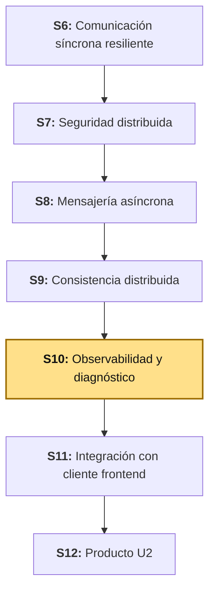
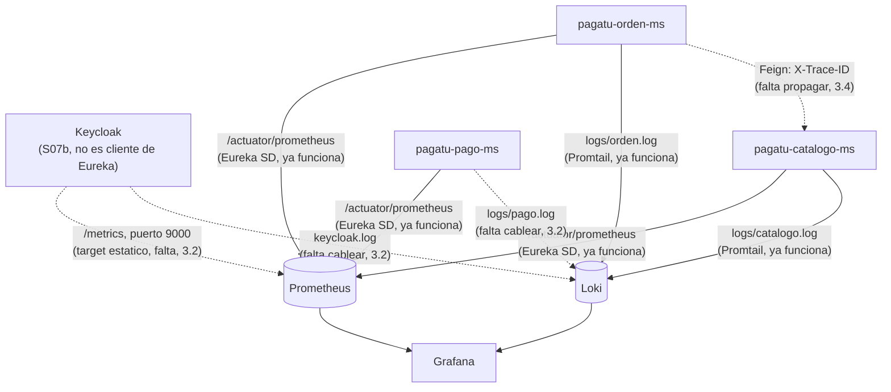

# S10 - Observabilidad y Diagnóstico de Sistemas Distribuidos

*Por: Angel Sullon Macalupu @asullom - 2026*

## 1. Introducción

Tiempo: 20 min.

### 1.1 Presentación de la sesión

`obs/` (Prometheus, Loki, Promtail, Grafana) existe desde S3-S4, y Prometheus ya descubre solo, por Eureka, a cualquier microservicio que exponga `/actuator/prometheus` — ningún microservicio nuevo de S6-S9 tuvo que tocar ese archivo para aparecer. Pero la observabilidad de `pagatu` quedó con huecos reales, documentados en `obs/README.md` desde antes de esta sesión: Promtail solo tiene cableados `pagatu-catalogo-ms` y `pagatu-orden-ms` — `pagatu-pago-ms` (S8) nunca llegó a Loki ni a Grafana, y Keycloak (S07b), que desde esa guía es la única pieza que emite y valida identidad en todo el sistema, nunca llegó a ninguno de los dos: ni a Loki, ni a Prometheus, porque —a diferencia de los microservicios propios— no es cliente de Eureka, así que el *service discovery* automático nunca lo va a encontrar solo. Y el `X-Trace-ID` que `CorrelationIdFilter` genera desde S7 (cada servicio, al recibir una petición HTTP) nunca se propaga hacia adelante: cuando `pagatu-orden-ms` llama por Feign a `pagatu-catalogo-ms`, el segundo genera su **propio** `traceId` nuevo — seguir una venta de punta a punta por los logs de los dos servicios, hoy, es imposible. Esta sesión cierra esos huecos, agrega *health groups* explícitos (*liveness*/*readiness*), y construye el primer tablero de Grafana con paneles de diagnóstico reales — la pieza que faltaba para responder "¿está sano el sistema, ahora mismo?" sin tener que leer el código de ningún servicio.

### 1.2 Índice

1. *Health checks*: *liveness* y *readiness*.
2. Métricas con Micrometer y Prometheus (ya construido, S3-S4).
3. Logs centralizados y correlación entre servicios.
4. Paneles de diagnóstico en Grafana.

### 1.3 Propósito de aprendizaje

Al concluir la clase, estarás en condiciones de:

- **Configurar** *health groups* de *liveness*/*readiness*, **cerrar** la brecha de centralización de logs y de propagación de *trace ID* entre servicios, y **construir** un tablero de Grafana que combine métricas, logs y estado de salud para diagnosticar un fallo real sin leer código.

### 1.4 Producto de sesión

`management.endpoint.health.group.liveness`/`.readiness` configurados en los tres microservicios; `obs/prometheus` con un *target* estático nuevo para Keycloak (su métricas no pasan por Eureka); `obs/promtail` cableado también para Keycloak y `pagatu-pago-ms` (las cuatro piezas, en Loki); un `RequestInterceptor` en `pagatu-orden-ms` que propaga `X-Trace-ID` hacia `pagatu-catalogo-ms`, verificado con el mismo `traceId` apareciendo en los logs de ambos; y un tablero de Grafana con paneles reales de salud, tasa de peticiones, tasa de errores y logs filtrados por `traceId` — probado de punta a punta simulando la caída de un servicio.

### 1.5 Metodología

**Tabla 1. Metodología de la sesión**

| Actividades a Realizar en el Periodo | Orientaciones generales (Orientaciones Metodológicas) | Material de estudio recomendado |
|---|---|---|
| Revisión previa individual | Repasar `CorrelationIdFilter` (S7), `obs/README.md` (estado actual de Promtail) y S07b (Keycloak ya reemplazó a `pagatu-auth-ms`). Confirmar que `obs/`, los tres microservicios y Keycloak siguen arrancando. Trabajo individual, antes de clase. | S7 (3.9), S07b, `obs/README.md`. |
| Clase presencial | Configuración guiada de *health groups*, cierre de la brecha de Promtail y Prometheus (incluido Keycloak), propagación de `X-Trace-ID` por Feign, y construcción del tablero de Grafana. Trabajo individual en la propia laptop, siguiendo al docente paso a paso. | Contenedor `obs/`, los tres microservicios y Keycloak corriendo, Pasos 3.1 a 3.8 de esta guía. |
| Evaluación formativa | Revisión en clase del tablero de Grafana con datos reales de las cuatro piezas, y de la prueba de propagación de `traceId`. La evidencia se completa y sustenta de forma individual, fuera del aula, según los criterios mínimos de la sección 4.4. | Indicaciones de entrega (4.3), rúbrica de evaluación (4.6). |

### 1.6 Motivación de la sesión

#### 1.6.1 Caso: la métrica que decía "todo bien" mientras Knight Capital perdía dinero cada segundo

El caso de Knight Capital (S9, 1.6) ya mostró qué pasa cuando un sistema no tiene ninguna noción de "esto ya lo procesé". Hay un ángulo del mismo incidente que no se desarrolló ahí: durante los 45 minutos de la falla, los sistemas de monitoreo de Knight Capital **sí** mostraban actividad — órdenes ejecutándose, el sistema "arriba", respondiendo. Lo que ningún panel mostraba era la pregunta correcta: no "¿está vivo el sistema?", sino "¿está haciendo lo correcto?". Un *health check* que solo confirma que el proceso responde (*liveness*) no es lo mismo que uno que confirma que el proceso está listo para operar de forma correcta (*readiness*) — y ninguno de los dos reemplaza una métrica de negocio real.

Fuente: U.S. Securities and Exchange Commission. (2013). *In the Matter of Knight Capital Americas LLC* (Release No. 34-70694). https://www.sec.gov/litigation/admin/2013/34-70694.pdf

**Preguntas de análisis**

**Activación de conocimientos previos**

1. Si tuvieras que diagnosticar, hoy, por qué una venta de `pagatu` falló, ¿qué pasos seguirías con las herramientas que ya tienes desde S7-S9?

**Comprensión de observabilidad distribuida**

1. ¿Qué diferencia hay entre que un servicio esté "arriba" (el proceso responde) y que esté "sano" (listo para operar correctamente)?
2. Si `pagatu-orden-ms` nunca propaga su `traceId` a `pagatu-catalogo-ms`, ¿qué efecto concreto tiene eso al buscar una venta específica en Grafana/Loki?

### 1.7 Ubicación en el curso

- Unidad: U2 - Sistema distribuido robusto.
- Producto del curso: sistema distribuido de microservicios end-to-end, configurable, escalable, seguro, resiliente, consistente, observable, integrado con frontend y defendido técnicamente.
- Producto de unidad: sistema distribuido seguro, resiliente, consistente, observable e integrado con cliente frontend.
- Avance del producto en esta sesión: *health groups*, logs y métricas centralizados de los tres microservicios y Keycloak, propagación de `traceId` entre servicios, y el primer tablero de Grafana con paneles de diagnóstico.

**Figura 1. Roadmap del producto de la unidad**



## 2. Explica

Tiempo: 30 min.

### 2.1 Arquitectura de la sesión

**Figura 2. Dos caminos hacia Grafana, y el hueco que cierra esta sesión**



Lectura del diagrama: el camino de **métricas** (línea sólida hacia Prometheus) ya funciona para los tres microservicios, por *service discovery* de Eureka (S3-S4) — nada que arreglar ahí. Keycloak es distinto: nunca se registra en Eureka (no es un cliente de Spring Cloud, es un contenedor aparte, S07b), así que el *service discovery* automático nunca lo va a encontrar — necesita un *target* estático, el mismo mecanismo que `pagatu-config`/`pagatu-eureka` ya usan desde S3 por la misma razón. El camino de **logs** (hacia Loki) solo funciona para dos de las cuatro piezas — las líneas punteadas son exactamente lo que 3.2 cierra. Y la flecha entre `pagatu-orden-ms` y `pagatu-catalogo-ms` (`X-Trace-ID`) todavía no existe — 3.4 la agrega. Cada apartado siguiente desarrolla una pieza, en el mismo orden del Índice (1.2).

### 2.2 *Health checks*: *liveness* y *readiness*

Spring Boot Actuator expone `/actuator/health` desde que `spring-boot-starter-actuator` está en el classpath (ya lo está en los tres microservicios, desde su creación) — pero por defecto responde una sola cosa: `UP` o `DOWN`, sin distinguir **por qué**. Los grupos de *health* de Kubernetes que Actuator ya trae listos (Spring Boot, 2026) responden dos preguntas distintas, no una:

**Tabla 2. *Liveness* frente a *readiness***

| | *Liveness* (`/actuator/health/liveness`) | *Readiness* (`/actuator/health/readiness`) |
|---|---|---|
| Pregunta que responde | ¿Sigue vivo el proceso, o hay que reiniciarlo? | ¿Puede aceptar tráfico **ahora mismo**? |
| Qué revisa | Que la JVM (*Java Virtual Machine*) no esté bloqueada/colgada | Dependencias externas: base de datos, Kafka, otros servicios |
| Qué pasa si falla | El orquestador **reinicia** el contenedor | El orquestador **deja de enviarle tráfico**, sin reiniciarlo |
| Ejemplo en `pagatu` | El proceso de `pagatu-pago-ms` sigue corriendo | `pagatu-pago-ms` corre, pero no puede conectarse a su Postgres |

La diferencia importa porque la respuesta correcta es distinta: si Postgres está caído, reiniciar `pagatu-pago-ms` (acción de *liveness*) no soluciona nada — el problema no es el proceso, es su dependencia. Sacarlo de la rotación de tráfico (acción de *readiness*) sí es correcto: evita que seseen peticiones a un servicio que sabe que va a fallar.

**Keycloak ya trae lo mismo, sin que nadie lo configure.** `/health/live` y `/health/ready` (puerto 9000, S07b) son la misma distinción de esta tabla, ya resuelta por el producto — la diferencia es que aquí (3.3) se construye a mano, en código propio, y en Keycloak viene lista de fábrica, detrás de una variable de entorno (`KC_HEALTH_ENABLED`).

### 2.3 Métricas con Micrometer y Prometheus (ya construido, S3-S4)

Los tres microservicios ya exponen `/actuator/prometheus` (`micrometer-registry-prometheus`, en el `pom.xml` de cada uno desde su creación), y `obs/prometheus/prometheus-dev.yml` ya los descubre por Eureka (`eureka_sd_configs`) — esta sesión no construye el mecanismo, lo **usa** para diagnosticar (y lo extiende a Keycloak, 3.2, que no pasa por Eureka).

**Tabla 3. Métricas de Micrometer más útiles para diagnóstico (Micrometer, 2026)**

| Métrica | Qué mide | Pregunta que responde |
|---|---|---|
| `http_server_requests_seconds_count` | Cuántas peticiones HTTP recibió el servicio, por `status` y `uri` | ¿Cuántas peticiones, y cuántas fallaron (`status=5xx`)? |
| `http_server_requests_seconds_sum` / `_count` | Tiempo total entre peticiones | Latencia promedio por endpoint |
| `process_uptime_seconds` | Hace cuánto arrancó el proceso | ¿Se reinició recientemente, sin que lo esperaras? |
| `up{job="pagatu-microservicios"}` | Si el último *scrape* de Prometheus tuvo éxito (métrica propia de Prometheus, no de Micrometer) | ¿Está el *target* arriba, visto desde afuera? |

`up` es la misma métrica que lambda26 (BigData) usa para `kafka-exporter` — Prometheus la genera para **cualquier** *target*, sin importar qué exponga: es la señal más básica y más confiable de todas, porque no depende de que el propio servicio reporte bien su estado.

### 2.4 Logs centralizados y correlación entre servicios

Cada microservicio ya escribe a `logs/<nombre>.log` (`logback-spring.xml`, con el patrón `%X{traceId}`) y Promtail ya sube esos archivos a Loki — para dos de las cuatro piezas (2.1). Keycloak no tiene `logback-spring.xml` ni `traceId` propio (no es una aplicación Spring Boot): S07b ya lo dejó escribiendo también a archivo (`KC_LOG=console,file`), así que el cableado de 3.2 es el mismo mecanismo de Promtail que los microservicios, aunque el formato de cada línea de log sea el de Keycloak, no el de `logback`. `CorrelationIdFilter` (S7, 3.9) pone ese `traceId` en el MDC (*Mapped Diagnostic Context*) de SLF4J al recibir cada petición HTTP: si ya trae el header `X-Trace-ID`, lo reutiliza; si no, genera uno nuevo con `UUID.randomUUID()`.

**El hueco real**: `CorrelationIdFilter` **recibe** el header, pero ningún cliente HTTP de `pagatu` lo **envía** hacia adelante. Cuando `pagatu-orden-ms` llama a `pagatu-catalogo-ms` por Feign (S6, 3.13), esa llamada sale sin el header `X-Trace-ID` — `pagatu-catalogo-ms` nunca lo recibe, así que `CorrelationIdFilter` de ese lado genera un `traceId` **completamente nuevo**, sin relación con el de `pagatu-orden-ms`. El resultado: una sola venta, en los logs, aparece con dos `traceId` distintos según en qué servicio la busques — seguirla de punta a punta por Loki es imposible hoy. 3.4 cierra esto con un `RequestInterceptor` de Feign (OpenFeign, 2026), el mismo mecanismo con el que Spring propaga cualquier *header* saliente.

### 2.5 Paneles de diagnóstico en Grafana

Un panel de diagnóstico útil combina más de una fuente — ninguna métrica sola cuenta la historia completa (el mismo principio que lambda26 S09, 2.2, aplicado aquí a microservicios en vez de a un pipeline de streaming):

**Tabla 4. Paneles mínimos de un tablero de diagnóstico, con el panel de logs en LogQL (Grafana Labs, 2026)**

| Panel | Fuente | Qué responde |
|---|---|---|
| Servicios arriba | Prometheus, `up{job=~"pagatu-.*"}` | ¿Cuáles de las cuatro piezas responden ahora mismo? |
| Tasa de peticiones | Prometheus, `rate(http_server_requests_seconds_count[1m])` | ¿Cuánto tráfico recibe cada servicio? |
| Tasa de errores | Prometheus, `rate(http_server_requests_seconds_count{status=~"5.."}[1m])` | ¿Está fallando algo, y en cuál servicio? |
| Logs por `traceId` | Loki, `{application=~"pagatu-.*"} \| json \| traceId="..."` | Dado un error, ¿qué pasó en cada servicio, en orden? |

Los primeros tres paneles dicen **que** algo está mal; el cuarto dice **por qué** — es la razón por la que esta sesión no se conforma con un tablero de solo métricas: sin el panel de logs correlacionados, confirmar una hipótesis exige volver a la terminal a buscar archivo por archivo.

## 3. Aplica: actividad práctica guiada

Tiempo: 3h.

**Actividad:** configuración de *health groups*, cierre de la brecha de Promtail y Prometheus para las cuatro piezas (tres microservicios y Keycloak), propagación de `X-Trace-ID` por Feign, y construcción de un tablero de Grafana con paneles de diagnóstico, probado simulando una falla real (Producto de la sesión en 1.4).

**Propósito de la actividad:** que cada estudiante deje el sistema en condiciones de diagnosticarse solo — con métricas, logs correlacionados y estado de salud combinados en un único lugar, no repartidos entre cuatro terminales distintas.

**Orientaciones metodológicas:** el docente cierra primero la brecha de Promtail y la propagación de `traceId` frente a la clase, después construye el tablero; los estudiantes replican cada paso en su propio entorno y provocan ellos mismos la falla simulada de 3.7 para ver el diagnóstico completo en su propia consola.

**Actividades para realizar:**

- **3.1** Verificar el punto de partida.
- **3.2** Agregar Keycloak a Prometheus y cablear Keycloak/`pagatu-pago-ms` a Promtail.
- **3.3** Configurar *health groups* de *liveness*/*readiness*.
- **3.4** Propagar `X-Trace-ID` en las llamadas Feign de `pagatu-orden-ms`.
- **3.5** Probar la propagación de punta a punta.
- **3.6** Armar el tablero de Grafana.
- **3.7** Simular una falla y diagnosticarla con el tablero.
- **3.8** Relacionar con ADS y BD2.

### 3.1 Verificar el punto de partida

**Producto del paso:** confirmación de que los tres microservicios, Keycloak y `obs/` siguen corriendo.

Todo el equipo debe comenzar exactamente desde donde quedó S07b (Keycloak reemplazando a `pagatu-auth-ms`), no desde donde quedó S9 por sí sola. Clona la rama `s07b-keycloak` si tu equipo la congeló (o `s09-consistencia-distribuida` y completa S07b tú mismo antes de seguir):

```bash
git clone --branch s07b-keycloak https://github.com/262dist/pagatu.git
```

Levanta, si no están arriba, `pagatu-config`, `pagatu-eureka`, `pagatu-catalogo-ms`, `pagatu-orden-ms` y `pagatu-pago-ms` (S1-S9) — `pagatu-auth-ms` ya no existe, S07b lo retiró —, Keycloak (`keycloak/`, S07b), y luego `obs/`:

```powershell
cd obs
docker compose -f compose-dev.yml up -d
```

Confirma en Prometheus (`http://localhost:19090/targets`) que los tres microservicios aparecen `UP` bajo el *job* `pagatu-microservicios` — esto ya funcionaba antes de hoy (2.3), solo lo estás verificando. Keycloak **no** aparece todavía en ningún *job* — 3.2 lo agrega.

### 3.2 Agregar Keycloak a Prometheus y cablear Keycloak/`pagatu-pago-ms`/Gateway a Promtail

**Producto del paso:** las cuatro piezas (tres microservicios y Keycloak) con sus métricas y sus logs llegando a Prometheus y Loki, y el Gateway —hasta hoy sin ningún log a archivo— sumado también a Loki.

**El Gateway nunca tuvo `logback-spring.xml`.** A diferencia de `pagatu-pago-ms` (que sí escribía a `logs/pago.log` desde que se creó en S8, y solo le faltaba el cableado de Promtail), el Gateway jamás tuvo un *appender* de archivo — todo su log se queda en la consola. Agrégalo ahora, con el mismo patrón que ya usan los demás, pero **sin** `%X{traceId}`: el Gateway corre sobre *WebFlux* (reactivo), y el `CorrelationIdFilter` que los microservicios ya tienen (S7, 3.9) es un `OncePerRequestFilter` — específico de Servlet, no se ejecuta en un *stack* reactivo. Agregar la propagación de `traceId` al Gateway exigiría un filtro reactivo propio (`GlobalFilter`), fuera del alcance de esta sesión — hoy el Gateway suma sus logs a Grafana, sin *traceId* correlacionado.

**`infra/pagatu-gateway/src/main/resources/logback-spring.xml`** (archivo nuevo):

```xml
<?xml version="1.0" encoding="UTF-8"?>
<configuration>
    <include resource="org/springframework/boot/logging/logback/defaults.xml"/>

    <property name="LOG_PATTERN" value="%d{yyyy-MM-dd HH:mm:ss.SSS} %-5level %logger{36} - %msg%n"/>

    <appender name="CONSOLE" class="ch.qos.logback.core.ConsoleAppender">
        <encoder>
            <pattern>${LOG_PATTERN}</pattern>
        </encoder>
    </appender>

    <appender name="FILE" class="ch.qos.logback.core.rolling.RollingFileAppender">
        <file>logs/gateway.log</file>
        <encoder>
            <pattern>${LOG_PATTERN}</pattern>
        </encoder>
        <rollingPolicy class="ch.qos.logback.core.rolling.TimeBasedRollingPolicy">
            <fileNamePattern>logs/gateway-%d{yyyy-MM-dd}.log</fileNamePattern>
            <maxHistory>7</maxHistory>
        </rollingPolicy>
    </appender>

    <root level="INFO">
        <appender-ref ref="CONSOLE"/>
        <appender-ref ref="FILE"/>
    </root>
</configuration>
```

**Prometheus — Keycloak necesita un *target* estático**, porque no es cliente de Eureka (2.1): el mismo mecanismo que `pagatu-config`/`pagatu-eureka` ya usan desde S3. **`obs/prometheus/prometheus-dev.yml`** — agrega el *job* nuevo, junto a los que ya existen:

```yaml
  - job_name: "pagatu-keycloak"
    metrics_path: "/metrics"
    static_configs:
      - targets: ["host.docker.internal:19000"]
        labels:
          application: pagatu-keycloak
```

`metrics_path: "/metrics"` (no `/actuator/prometheus`) y el puerto `19000` (no el `18180` de autenticación) son las dos diferencias reales frente a cualquier otro *target*: Keycloak no es una aplicación Spring Boot, así que ni el formato por defecto de su endpoint de métricas ni el puerto donde vive coinciden con los de los microservicios — ambos ya quedaron fijados en S07b (`KC_METRICS_ENABLED`, `KC_HTTP_MANAGEMENT_PORT`), esta sesión solo le dice a Prometheus dónde buscarlos.

**Promtail — logs de Keycloak y del Gateway.** `pagatu-pago-ms` ya estaba cableado en DEV desde antes de esta sesión (mismo commit que agregó los *health groups* de 3.3) — confírmalo antes de agregar nada: si ya ves `pagatu-pago-ms` en `obs/compose-dev.yml` y en `obs/promtail/promtail-config-dev.yml`, no lo repitas, solo agrega lo que de verdad falta.

**`obs/compose-dev.yml`** — agrega los dos volúmenes que faltan, junto a los que ya existen en `pagatu-promtail`:

```yaml
      - ../keycloak/logs:/var/log/pagatu-keycloak:ro
      - ../infra/pagatu-gateway/logs:/var/log/pagatu-gateway:ro
```

**`obs/promtail/promtail-config-dev.yml`** — agrega los dos *jobs* que faltan, con el mismo patrón que los que ya existen:

```yaml
  - job_name: pagatu-keycloak
    static_configs:
      - targets: [localhost]
        labels:
          application: pagatu-keycloak
          __path__: /var/log/pagatu-keycloak/*.log
  - job_name: pagatu-gateway
    static_configs:
      - targets: [localhost]
        labels:
          application: pagatu-gateway
          __path__: /var/log/pagatu-gateway/*.log
```

**PROD local** son los mismos tres archivos — `obs/compose.yml` ya tenía el volumen de `pagatu-pago-ms` (quedó resuelto antes que el de DEV); solo faltan Keycloak y el Gateway:

**`obs/compose.yml`** — agrega, junto a los tres volúmenes que ya existen en `pagatu-promtail`:

```yaml
      - ../keycloak/logs:/var/log/pagatu-keycloak:ro
      - ../infra/pagatu-gateway/logs:/var/log/pagatu-gateway:ro
```

**`obs/promtail/promtail-config.yml`** — mismo patrón, `pagatu-pago-ms` ya estaba; agrega los dos *jobs* que faltan:

```yaml
  - job_name: pagatu-keycloak
    static_configs:
      - targets: [localhost]
        labels:
          application: pagatu-keycloak
          __path__: /var/log/pagatu-keycloak/*.log
  - job_name: pagatu-gateway
    static_configs:
      - targets: [localhost]
        labels:
          application: pagatu-gateway
          __path__: /var/log/pagatu-gateway/*.log
```

**`obs/prometheus/prometheus.yml`** — agrega el *job* nuevo, junto a los que ya existen (`pagatu-config`/`pagatu-eureka`):

```yaml
  - job_name: "pagatu-keycloak"
    metrics_path: "/metrics"
    static_configs:
      - targets: ["pagatu-keycloak:9000"]
        labels:
          application: pagatu-keycloak
```

`pagatu-keycloak:9000` (el nombre del servicio Docker y su puerto **interno** de *management*, no `host.docker.internal:29000`) — PROD local resuelve por nombre de servicio dentro de la misma red de Docker, el mismo criterio que ya usan `pagatu-config:8888`/`pagatu-eureka:8761` arriba, y que S07b (7.1) ya aplicó al `issuer-uri` del Gateway y `pagatu-orden-ms`. El Gateway no necesita ningún *job* de Prometheus nuevo aquí tampoco — sigue llegando por `eureka_sd_configs`, igual que en DEV.

Reinicia Prometheus y Promtail para que relean la configuración nueva — **`restart`, no `up -d`**: los dos archivos (`prometheus-dev.yml`, `promtail-config-dev.yml`) llegan al contenedor por volumen montado, y Docker Compose no recrea ni reinicia un contenedor solo porque cambió el contenido de un archivo montado, únicamente si cambia la definición del servicio en el propio `compose-dev.yml`. Si ya corriste `up -d` antes y el *job* nuevo no aparece, es exactamente por esto — el contenedor sigue corriendo con la configuración de cuando arrancó:

```powershell
cd obs
docker compose -f compose-dev.yml restart pagatu-prometheus pagatu-promtail
```

Confirma en `http://localhost:19090/targets` que `pagatu-keycloak` aparece como un *job* nuevo, `UP`.

Reinicia el Gateway (`.\mvnw.cmd spring-boot:run`) para que tome el `logback-spring.xml` nuevo — a diferencia de Prometheus/Promtail, que recargan su configuración al reiniciar el contenedor, Logback se lee una sola vez, al arrancar la JVM.

**Error frecuente**: agregar el `job_name` en `promtail-config-dev.yml` pero olvidar el volumen en `compose-dev.yml` (o al revés). Promtail necesita las dos cosas: el volumen monta el archivo real dentro del contenedor, y el `job_name` le dice dónde buscarlo (`__path__`) — sin el volumen, el `__path__` apunta a una carpeta vacía dentro del contenedor, y Promtail no encuentra nada que subir, sin ningún error visible. Para Keycloak hay un segundo error posible: que `KC_LOG` no incluyera `file` en S07b — sin eso, Keycloak nunca escribe `keycloak.log`, y el volumen monta una carpeta que se queda vacía para siempre, no solo hasta el primer log. Para el Gateway, el error equivalente es reiniciarlo **antes** de crear `logs/` o de que Promtail tenga el volumen listo — la carpeta `infra/pagatu-gateway/logs/` la crea Logback solo, al escribir el primer archivo; si Promtail arrancó antes, puede quedarse con un volumen vacío montado hasta su próximo reinicio.

### 3.3 Configurar *health groups* de *liveness*/*readiness*

**Producto del paso:** `/actuator/health/liveness` y `/actuator/health/readiness` respondiendo en `pagatu-catalogo-ms`, `pagatu-orden-ms` y `pagatu-pago-ms` — los tres microservicios de negocio que siguen corriendo (`pagatu-auth-ms` ya está retirado, S07b, sección 8) — Keycloak ya trae los suyos, sin que nadie los configure (2.2).

En `infra/pagatu-config/config-repo/pagatu-catalogo-ms-dev.yml`, `pagatu-orden-ms-dev.yml` y `pagatu-pago-ms-dev.yml` (los tres archivos, uno por uno — **no** `pagatu-auth-ms-dev.yml`, ese servicio ya no arranca), agrega el mismo bloque en cada uno:

```yaml
management:
  endpoint:
    health:
      probes:
        enabled: true
      group:
        liveness:
          include: livenessState
        readiness:
          include: readinessState, db
```

`probes.enabled: true` habilita los dos grupos (Spring Boot los trae listos desde que detecta que corre en un entorno que los soporta, pero no los expone por defecto en todos los casos — esta propiedad lo fuerza siempre). El grupo `readiness` de cada servicio con base de datos agrega `db` al chequeo: si la conexión a Postgres (o a Oracle, para los que persisten ahí) falla, `/actuator/health/readiness` responde `DOWN` aunque el proceso (*liveness*) siga perfectamente vivo.

Confirma, con los tres servicios corriendo — `8080` (`pagatu-catalogo-ms`), `8082` (`pagatu-orden-ms`), `8086` (`pagatu-pago-ms`), no `8085` (el puerto de `pagatu-auth-ms`, ya retirado):

```powershell
Invoke-RestMethod -Method Get -Uri "http://localhost:8080/actuator/health/liveness"
Invoke-RestMethod -Method Get -Uri "http://localhost:8080/actuator/health/readiness"

Invoke-RestMethod -Method Get -Uri "http://localhost:8082/actuator/health/liveness"
Invoke-RestMethod -Method Get -Uri "http://localhost:8082/actuator/health/readiness"

Invoke-RestMethod -Method Get -Uri "http://localhost:8086/actuator/health/liveness"
Invoke-RestMethod -Method Get -Uri "http://localhost:8086/actuator/health/readiness"
```

Resultado esperado: `{"status": "UP"}` en los dos, en cada uno de los tres puertos. Confirma también los de Keycloak, ya listos desde S07b, sin configurar nada aquí:

```powershell
Invoke-RestMethod -Method Get -Uri "http://localhost:19000/health/live"
Invoke-RestMethod -Method Get -Uri "http://localhost:19000/health/ready"
```

Mismo resultado esperado (`status: UP`), en el puerto de *management* (`19000`, S07b) en vez del de autenticación (`18180`) — la misma separación entre tráfico de negocio y tráfico de diagnóstico que Keycloak aplica por diseño.

### 3.4 Propagar `X-Trace-ID` en las llamadas Feign de `pagatu-orden-ms`

**Producto del paso:** cada llamada de `pagatu-orden-ms` a `pagatu-catalogo-ms` (vía Feign, S6) sale con el mismo `X-Trace-ID` que `CorrelationIdFilter` ya puso en el MDC de la petición entrante.

**`services/pagatu-orden-ms/src/main/java/pe/edu/upeu/orden/config/FeignTraceConfig.java`** (nuevo):

```java
package pe.edu.upeu.orden.config;

import feign.RequestInterceptor;
import org.slf4j.MDC;
import org.springframework.context.annotation.Bean;
import org.springframework.context.annotation.Configuration;
import pe.edu.upeu.orden.filter.CorrelationIdFilter;

@Configuration
public class FeignTraceConfig {

    @Bean
    public RequestInterceptor traceIdInterceptor() {
        return template -> {
            String traceId = MDC.get(CorrelationIdFilter.MDC_KEY);
            if (traceId != null) {
                template.header(CorrelationIdFilter.TRACE_ID_HEADER, traceId);
            }
        };
    }
}
```

`RequestInterceptor` es el mecanismo estándar de OpenFeign para agregar algo a **todas** las peticiones salientes de un cliente Feign, sin tocar ninguna interfaz `@FeignClient` existente (`ProductoClient`, S6) — se aplica solo con que este *bean* exista en el contexto de Spring. `MDC.get(...)` lee el mismo `traceId` que `CorrelationIdFilter` (S7) ya puso ahí para la petición HTTP entrante actual — es la misma variable, leída desde un punto distinto del código, no una copia.

**Error frecuente**: esperar que esto funcione para las llamadas asíncronas de Kafka (S8). `MDC` es **por hilo** (*thread-local*): el `@KafkaListener` que consume `orden.creada` en `pagatu-pago-ms` corre en un hilo completamente distinto al que procesó la petición HTTP original en `pagatu-orden-ms` — no hay ningún `traceId` en el MDC de ese hilo nuevo, con o sin este interceptor. Propagar correlación a través de eventos Kafka es un problema distinto (agregar el `traceId` como parte del *payload* del evento, no como un *header* HTTP) y queda fuera del alcance de esta sesión.

### 3.5 Probar la propagación de punta a punta

**Producto del paso:** evidencia real de un mismo `traceId` apareciendo en los logs de `pagatu-orden-ms` **y** `pagatu-catalogo-ms`, para la misma petición.

Reinicia `pagatu-orden-ms` (para que tome el *bean* nuevo) y crea una orden con el token de `CLIENTE` (S7, 3.19):

```powershell
Invoke-RestMethod -Method Post -Uri "http://localhost:18080/api/v1/ordenes" `
  -Headers @{ Authorization = "Bearer $tokenCliente" } `
  -ContentType "application/json" `
  -Body '{"metodoPago": "YAPE_PLIN", "detalles": [{"idProducto": 1, "cantidad": 1}]}'
```

Busca, en `logs/orden.log` y en `logs/catalogo.log` (de sus respectivas carpetas `services/`), la línea de esa petición. Antes de 3.4, cada archivo mostraba un `[traceId]` distinto entre corchetes al inicio de cada línea (el patrón de `logback-spring.xml`, 2.4); ahora, el mismo `traceId` debe aparecer en ambos — confirma copiando el valor de una línea de `orden.log` y buscándolo con `findstr`/`grep` directo en `catalogo.log`.

**Error frecuente**: seguir viendo `traceId` distintos después de 3.4. Confirma que reiniciaste `pagatu-orden-ms` (los *beans* de Spring no se recargan solos), y que `FeignTraceConfig` está en un paquete que el `@SpringBootApplication` de `pagatu-orden-ms` sí escanea (dentro de `pe.edu.upeu.orden`, no fuera de ese árbol de paquetes).

### 3.6 Armar el tablero de Grafana

**Producto del paso:** un tablero con los cuatro paneles de la Tabla 4, con datos reales de las cuatro piezas.

Abre `http://localhost:13000` (`admin`/`admin`). Mismo flujo que ya conoces de cualquier *dashboard* de Grafana (**Dashboards → New → New dashboard → + Add visualization**, un panel a la vez):

**Tabla 5. Paneles del tablero, con su consulta**

| Panel | *Datasource* | Consulta | Visualización |
|---|---|---|---|
| Servicios arriba | Prometheus | `up{job=~"pagatu-.*"}` | Table |
| Tasa de peticiones | Prometheus | `sum by (application) (rate(http_server_requests_seconds_count[1m]))` | Time series |
| Tasa de errores | Prometheus | `sum by (application) (rate(http_server_requests_seconds_count{status=~"5.."}[1m]))` | Time series |
| Logs recientes | Loki | `{application=~"pagatu-.*"}` | Logs |

Para el panel de **Logs**, elige explícitamente el *datasource* **Loki** (no Prometheus) al crearlo — es el único panel de los cuatro que no viene de una métrica. Guarda el *dashboard* como `S10 - Diagnóstico de pagatu`.

**Buscar un texto concreto dentro del panel de Logs.** `{application=~"pagatu-.*"}` trae todo — para encontrar un error específico, agrega un filtro de LogQL con `|=` ("la línea contiene este texto", sensible a mayúsculas/minúsculas), en la pestaña **Code** del editor de consultas:

```
{application=~"pagatu-.*"} |= "No se pudo descontar stock"
```

**Error frecuente**: buscar el mensaje de una excepción directamente en el servicio que la *lanza*, y no encontrar nada. `StockInsuficienteException` ("Stock insuficiente para el producto: ...") la lanza `pagatu-catalogo-ms`, pero su `GlobalExceptionHandler` solo la devuelve en el cuerpo de la respuesta HTTP — **nunca la loguea**. El mensaje sí queda en un log real, pero en `pagatu-orden-ms`: su *fallback* de Feign (`ProductoConsultaService`, el *circuit breaker* de S6) sí lo registra con `log.warn("[CATALOGO] No se pudo descontar stock de {}. Motivo: {}", ...)` cuando la llamada a `pagatu-catalogo-ms` falla. Antes de asumir que el panel o la consulta están mal, confirma primero **cuál servicio** de verdad escribe la línea que buscas.

**Otro error frecuente**: el interruptor **Table view** (arriba del panel, al editarlo) muestra el log crudo en columnas (`labels`, `Time`, `Line`, `tsNs`, `id`) — la columna `Line` trunca la línea completa al ancho de la celda, dando la impresión de que el mensaje no llegó. Apágalo para ver la vista nativa de **Logs** de Grafana (línea completa, coloreada por nivel), o ensancha la columna `Line` si prefieres quedarte en la tabla.

### 3.7 Simular una falla y diagnosticarla con el tablero

**Producto del paso:** un fallo real, detectado y diagnosticado de punta a punta usando solo el tablero — sin leer ningún log a mano desde la terminal.

Detén `pagatu-pago-ms`:

```powershell
# Ctrl+C en la terminal donde corre pagatu-pago-ms
```

En el tablero: el panel **Servicios arriba** debe mostrar a `pagatu-pago-ms` ausente (o su `up` en `0`, según el momento del *scrape*) en menos de `scrape_interval` (15s). Crea una orden nueva (3.5) — el evento `orden.creada` queda publicado en Kafka, pero nadie lo consume (S8, 2.2): el panel **Tasa de peticiones** de `pagatu-pago-ms` se queda plano en `0`, mientras el de `pagatu-orden-ms` sigue mostrando actividad.

Levanta `pagatu-pago-ms` de nuevo. Usa el panel de **Logs**, filtrando por el `traceId` de la orden que acabas de crear (3.5), para confirmar en qué momento el evento finalmente se consumió — el mismo patrón de diagnóstico de S8 (2.6), ahora sin salir de Grafana.

**Tabla 6. Qué mostró cada panel durante la falla simulada**

| Panel | Durante la falla | Después de levantar `pagatu-pago-ms` |
|---|---|---|
| Servicios arriba | `pagatu-pago-ms` ausente/`0` | Vuelve a aparecer |
| Tasa de peticiones | Plana en `pagatu-pago-ms` | Sube cuando procesa el evento pendiente |
| Tasa de errores | Sin cambio (nadie llamó a `pagatu-pago-ms` por HTTP, el fallo fue async) | — |
| Logs | Sin líneas nuevas de `pagatu-pago-ms` | Línea de consumo del evento, con el `traceId` de la orden |

### 3.8 Relacionar con ADS y BD2

Sesión equivalente en los otros dos cursos, misma semana (BD2, S9 de esa guía — administración del almacenamiento y seguridad): la auditoría de Oracle (`UNIFIED_AUDIT_TRAIL`) responde "quién hizo qué, y cuándo" dentro de una sola base de datos; el tablero de hoy responde la misma pregunta, pero a través de **cuatro** procesos distintos que no comparten memoria ni base de datos — el mismo problema de fondo (reconstruir una historia completa a partir de evidencia parcial), resuelto con herramientas distintas porque el alcance es distinto. ADS no tiene sesión de observabilidad propia en el sílabo — la arquitectura que ADS diseña (Figura 6 de cada sesión) es exactamente lo que el tablero de hoy termina verificando en producción: que los módulos se comunican como el diseño dijo que lo harían.

**Evidencia de aprendizaje:**

- *Health groups* de *liveness*/*readiness* respondiendo en los tres microservicios, y los de Keycloak confirmados sin configurar nada.
- Keycloak agregado como *target* estático de Prometheus; Keycloak y `pagatu-pago-ms` cableados a Promtail, junto a los dos que ya estaban.
- `RequestInterceptor` de Feign propagando `X-Trace-ID`, con evidencia real del mismo `traceId` en dos servicios distintos.
- Tablero de Grafana con los cuatro paneles de la Tabla 5, con datos reales.
- Diagnóstico de una falla simulada usando solo el tablero, con la Tabla 6 completada con valores reales.

## 4. Crea: actividad autónoma

Tiempo: 2h fuera del aula.

### 4.1 Actividad

Extensión de la observabilidad del Proyecto Sello propio del equipo, documentada en evidencia individual.

Completa y evidencia estas tareas:

1. Configura *health groups* de *liveness*/*readiness* en al menos un servicio de tu propio proyecto, con al menos una dependencia externa real (base de datos, broker de mensajería) incluida en el grupo `readiness`.
2. Si tu proyecto tiene más de un servicio comunicándose por HTTP, propaga un identificador de correlación entre ellos (el mismo patrón de 3.4, u otro mecanismo equivalente si tu *stack* no usa Feign).
3. Construye un tablero de Grafana propio con al menos tres paneles: uno de disponibilidad, uno de tasa de peticiones o errores, y uno de logs.
4. Simula una falla real en tu propio sistema y documenta, con capturas del tablero, cómo la detectaste y diagnosticaste.

### 4.2 Propósito

Que cada estudiante demuestre, de forma individual y fuera del aula, que puede instrumentar un sistema distribuido propio con *health checks*, correlación entre servicios y un tablero de diagnóstico real, y usarlo para diagnosticar una falla sin depender de leer código.

### 4.3 Indicaciones

Entrega un PDF con el siguiente nombre:

```text
S10_Equipo##_ApellidoNombre.pdf
```

Cada captura de pantalla del informe debe mostrar, sin recortar, el reloj del sistema (fecha y hora) y tu usuario o foto de perfil (Windows, VS Code o navegador) visibles en pantalla — es lo que permite verificar que la evidencia es tuya y que corresponde al momento real de tu trabajo.

#### 4.3.1 Estructura del informe

**Datos del estudiante**

- Nombre:
- Equipo:
- Sesión: S10 - Observabilidad y diagnóstico de sistemas distribuidos
- Rol o aporte realizado:
- Link de GitHub:

**Evidencia técnica**

Incluye capturas con una breve explicación debajo de cada una, organizadas en los mismos 4 bloques de la rúbrica (4.6):

1. *Health groups*
    - `/actuator/health/liveness` y `/actuator/health/readiness` respondiendo, con al menos una dependencia real en el grupo `readiness`.
2. *Logs centralizados y correlación*
    - Las cuatro piezas (o todas las de tu propio proyecto) visibles en Loki/Grafana, y evidencia del mismo `traceId` en dos servicios distintos.
3. *Tablero de Grafana*
    - Los paneles del tablero (Tabla 5), con datos reales.
4. *Diagnóstico de una falla*
    - La Tabla 6 completada con tus propios valores, de tu propia prueba.

**Error o hallazgo**

Describe un error real: un `job_name` de Promtail sin su volumen correspondiente, un `traceId` que seguía sin propagarse por un paquete fuera del escaneo de Spring, o un panel de Grafana que mostraba "No data" por un *datasource* equivocado.

**Reflexión técnica breve**

Responde en 5 a 8 líneas:

```text
¿Por qué un sistema puede estar "arriba" (liveness) y aun así no
poder atender una petición correctamente? Relaciona tu respuesta
con el caso de Knight Capital (1.6) y con tu propia prueba de falla
simulada (3.7 o 4.1.4).
```

**Anexo: Feedback de la sesión**

Pega esta página como la última hoja del PDF, con tus respuestas.

1. ¿Cuál es el aprendizaje más importante que te llevas de la clase de hoy?
2. ¿Qué punto de la clase te resultó más confuso o te dejó con dudas?
3. ¿Tienes alguna pregunta que te gustaría que sea respondida la siguiente clase?
4. Sobre tu nivel de comprensión de la clase de hoy, marca una opción:
    - ¡Entendido! - Lo domino y podría explicarlo.
    - Más o menos. - Entendí la idea general, pero tengo dudas.
    - Necesito ayuda. - Me siento perdido/a con este tema.
5. ¿Cómo puedo ayudarte a comprender mejor el tema?
6. Pensando en tu participación y esfuerzo en la clase de hoy, ¿cómo te autoevaluarías? Marca una opción:
    - Muy Comprometido/a: Me esforcé al máximo.
    - Comprometido/a: Sé que podría haberme esforzado un poco más.
    - Poco Comprometido/a: Hoy no di mi mejor esfuerzo.
7. Mi satisfacción con la clase fue... (califica del 1 al 10, donde 1 es insatisfecho y 10 es muy satisfecho).

### 4.4 Criterios mínimos de aceptación

- El archivo respeta el nombre solicitado.
- *Health groups* de *liveness*/*readiness* configurados y verificados, con al menos una dependencia real en `readiness`.
- Logs centralizados de todos los servicios relevantes del proyecto propio, en Loki/Grafana.
- Evidencia real de un identificador de correlación propagado entre al menos dos servicios.
- Tablero de Grafana con al menos tres paneles, con datos reales.
- Una falla real simulada y diagnosticada usando el tablero, documentada con capturas.
- Cada captura de la evidencia técnica muestra el reloj del sistema y el usuario/perfil visible, sin recortar.
- Las fechas y horas de las capturas son coherentes con el historial de commits de su repositorio en GitHub.
- Incluye un error o hallazgo técnico diagnosticado.
- Incluye la reflexión técnica breve solicitada.
- Incluye el Anexo de feedback de la sesión respondido, como última página del PDF.

### 4.5 Preguntas de defensa

1. ¿Por qué un orquestador necesita distinguir *liveness* de *readiness*, en vez de un solo *health check*?
2. ¿Por qué `MDC` no propaga el `traceId` solo, y qué mecanismo hizo falta agregar para que sí viajara entre servicios?
3. ¿Por qué el `RequestInterceptor` de 3.4 no sirve para correlacionar eventos de Kafka, y qué cambiaría si quisieras lograrlo?
4. ¿Qué diferencia de fondo hay entre el panel "Servicios arriba" (Prometheus) y el panel de "Logs" (Loki) — qué pregunta responde cada uno que el otro no puede?
5. En tu prueba de falla simulada, ¿qué panel mostró el problema primero, y por qué ese y no otro?

### 4.6 Rúbrica de evaluación

**Tabla 7. Rúbrica de evaluación**

| Criterio | Peso (%) | A (20 pts) | B (15 pts) | C (10 pts) | D (5 pts) | Nivel obtenido |
|---|---:|---|---|---|---|---:|
| 1. *Health groups** | 25 | *Liveness*/*readiness* configurados y verificados, con dependencia real en `readiness`. | Configurados, con alguna verificación incompleta. | Solo uno de los dos grupos configurado. | No presenta *health groups*. | |
| 2. Logs y correlación* | 25 | Todos los servicios relevantes en Loki, con evidencia real de `traceId` propagado entre al menos dos. | Logs centralizados, con la propagación de `traceId` incompleta o sin evidencia clara. | Solo logs centralizados, sin correlación. | No presenta ninguno de los dos. | |
| 3. Tablero de Grafana* | 25 | Al menos tres paneles con datos reales, incluido uno de logs. | Tablero funcional, con algún panel sin datos reales. | Tablero parcial (uno o dos paneles). | No presenta tablero. | |
| 4. Diagnóstico de falla* | 25 | Falla real simulada y diagnosticada con el tablero, con evidencia clara de causa y efecto. | Falla simulada, con el diagnóstico incompleto. | Falla simulada sin usar el tablero para diagnosticarla. | No presenta falla simulada. | |

\* Agregado manual.

Nota final = suma de (`Peso` / 100 × `Puntos del nivel obtenido`) = ____ / 20.

Para usar la rúbrica con IA (inteligencia artificial), solicita:

```text
Evalúa el PDF usando la rúbrica de la sesión.
Para cada criterio selecciona el nivel obtenido usando la escala A=20, B=15, C=10, D=5 puntos.
Justifica brevemente cada nivel asignado.
Verifica que cada captura muestre reloj del sistema y usuario/perfil visible, y que las fechas sean coherentes con el historial de commits de GitHub. Si falta esta evidencia o hay inconsistencias, indícalo explícitamente antes de calificar.
Calcula la nota final con la fórmula: suma de (Peso/100 × Puntos del nivel obtenido), directamente sobre 20.
Indica 2 fortalezas y 2 recomendaciones.
```

## 5. Cierre

Tiempo: 5 min.

**Resumen breve:** hoy `pagatu` dejó de depender de leer código o de revisar varias terminales distintas para saber si el sistema está sano. Los tres microservicios ganaron *health groups* explícitos (*liveness* distinto de *readiness*), Keycloak confirmó que ya traía los suyos desde S07b, los dos que faltaban en Loki (Keycloak, `pagatu-pago-ms`) se cablearon, Keycloak también se agregó a Prometheus como *target* estático (no es cliente de Eureka), y el `traceId` que ya existía desde S7 por fin viaja entre servicios gracias a un interceptor de Feign — cerrando una brecha documentada desde antes de esta sesión. El resultado es un tablero de Grafana que combina métricas, logs y estado de salud de las cuatro piezas en un solo lugar, probado contra una falla real simulada, no solo contra el caso feliz.

**Dinámica participativa:** en una ronda rápida, cada estudiante comparte en una frase qué panel del tablero mostró primero su falla simulada, y por qué cree que fue ese.

**Metacognición:** ¿qué te costó más entender hoy: por qué `MDC` es por hilo y no se propaga solo entre servicios, o por qué *liveness* y *readiness* necesitan ser preguntas separadas?

**Proyección:** S11 conecta el cliente frontend al sistema a través del Gateway — con la observabilidad de hoy ya en pie, cualquier fallo que la integración frontend-backend introduzca va a ser visible en el mismo tablero, sin tener que construir nada nuevo para verlo.

## Bibliografía

1. U.S. Securities and Exchange Commission. (2013). *In the Matter of Knight Capital Americas LLC* (Release No. 34-70694). https://www.sec.gov/litigation/admin/2013/34-70694.pdf
2. Spring Boot. (2026). *Kubernetes Probes*. Actuator Reference. https://docs.spring.io/spring-boot/reference/actuator/endpoints.html#actuator.endpoints.kubernetes-probes
3. Micrometer. (2026). *Micrometer Documentation*. https://docs.micrometer.io/micrometer/reference/
4. OpenFeign. (2026). *Customization: RequestInterceptor*. https://docs.spring.io/spring-cloud-openfeign/reference/spring-cloud-openfeign.html
5. Grafana Labs. (2026). *Loki Query Language (LogQL)*. https://grafana.com/docs/loki/latest/query/
