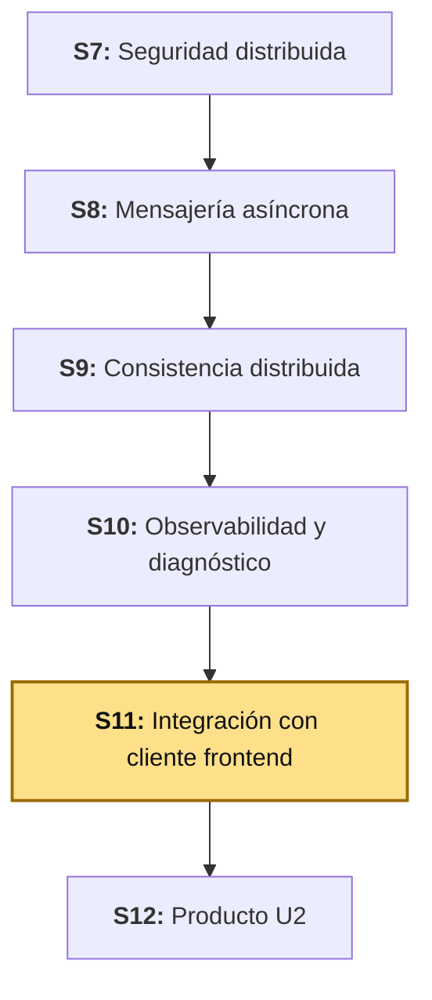
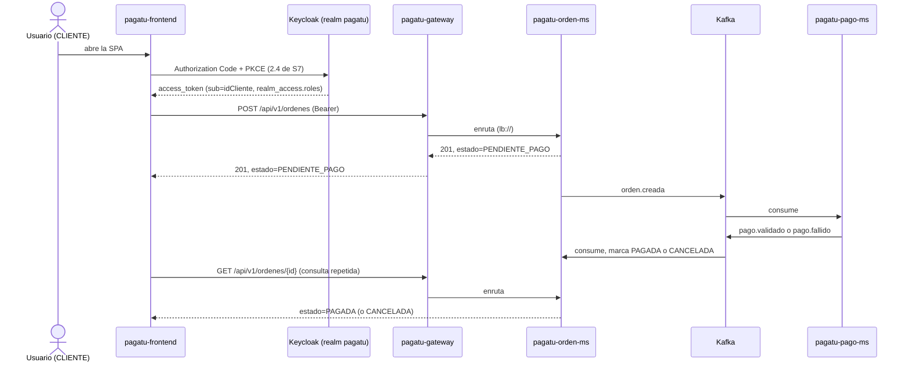

# S11 - Integración con Cliente Frontend: Angular 22 sobre el Gateway, con Keycloak

*Por: Angel Sullon Macalupu @asullom - 2026*

## 1. Introducción

Tiempo: 20 min.

### 1.1 Presentación de la sesión

S7 construyó `pagatu-auth-ms` **a propósito como una pieza temporal** — la Tabla 6 de esa sesión ya dejó escrito, celda por celda, qué reemplaza Keycloak y qué no cambia en el Gateway ni en `pagatu-orden-ms`; la Figura 6 de esa misma sesión ya dibujó el flujo *Authorization Code* + PKCE (*Proof Key for Code Exchange*) "del cliente Angular con Keycloak (S11)"; y 3.27 ya hizo, a mano, el cálculo de `code_challenge` que "reproduce el cálculo que hará el cliente Angular en S11". Ninguna de esas tres cosas era retórica: [S07b](S07b_Seguridad_Distribuida_Keycloak.md) ya ejecutó ese reemplazo —`pagatu-auth-ms` retirado, Keycloak con el realm `pagatu` validado por el Gateway y `pagatu-orden-ms` mediante `issuer-uri`— como paso intermedio entre S7 y esta sesión. Hoy se construye lo que faltaba: el **primer y único cliente frontend del curso** — hasta ahora, `pagatu` solo se probó desde PowerShell, `curl` y Swagger.

**Requisito:** haber completado [S07b](S07b_Seguridad_Distribuida_Keycloak.md) **completa, incluida la sección 7** (Keycloak corriendo, realm `pagatu`, `pagatu-auth-ms` retirado, Gateway/`pagatu-orden-ms` validando por `issuer-uri`, y `idCliente` ya migrado a `sub` — código de `pagatu-orden-ms` y columna de Postgres, 7.3-7.4) — esta sesión parte de ese estado. Sin la migración de 7.3-7.4, `OrdenController.crear` espera un claim `idCliente` que ya no existe (S07b retiró el *protocol mapper* que lo generaba) y falla con `IllegalArgumentException` en cualquier intento de crear una orden.

El reto real no es solo "hacer un login y mostrar una tabla": `pagatu-orden-ms` y `pagatu-pago-ms` se comunican de forma **asíncrona** desde S8 (mensajería con Kafka) y S9 (consistencia distribuida con el patrón Saga) — crear una orden no deja pagada la orden en la misma respuesta HTTP. El cliente Angular tiene que mostrarle a un usuario real una orden que queda `PENDIENTE_PAGO` al crearse, y que **en algún momento posterior**, sin que nadie recargue la página a mano, pasa a `PAGADA` o a `CANCELADA` — la consistencia eventual que S9 resolvió del lado del backend ahora tiene que resolverse también del lado de la interfaz.

### 1.2 Índice

1. Punto de partida: qué dejó S07b, y qué le toca a esta sesión.
2. CORS en el Gateway: el primer cliente que llama desde un origen distinto.
3. Arquitectura mínima de la SPA y login con *Authorization Code* + PKCE.
4. Consistencia eventual en la interfaz: de "pendiente" a "pagada" sin que el usuario recargue nada.

### 1.3 Propósito de aprendizaje

Al concluir la clase, estarás en condiciones de:

- **Ejecutar** el reemplazo de un servidor de autorización propio por Keycloak sin tocar el código de los *resource servers*, **construir** un cliente Angular con *Authorization Code* + PKCE a través de un API Gateway, y **diseñar** una interfaz que refleje con honestidad un estado que todavía no se resolvió, en vez de asumir que una respuesta HTTP exitosa significa que el proceso de negocio completo ya terminó.

### 1.4 Producto de sesión

`pagatu-frontend` (Angular 22), el primer cliente del curso: CORS habilitado en el Gateway, login real con *Authorization Code* + PKCE contra el Keycloak que [S07b](S07b_Seguridad_Distribuida_Keycloak.md) ya dejó corriendo, catálogo de productos, creación de una orden y una pantalla de "Mis pedidos" que muestra el estado real de cada orden — incluida la transición de `PENDIENTE_PAGO` a `PAGADA`/`CANCELADA`, verificada de punta a punta sin recargar la página a mano.

### 1.5 Metodología

**Tabla 1. Metodología de la sesión**

| Actividades a Realizar en el Periodo | Orientaciones generales (Orientaciones Metodológicas) | Material de estudio recomendado |
|---|---|---|
| Revisión previa individual | Completar [S07b](S07b_Seguridad_Distribuida_Keycloak.md) si tu equipo todavía no lo hizo — es prerrequisito, no parte de la clase de hoy. Repasar S7 (2.4 completa, Tabla 6, Figura 6, 3.27) y S9 (el patrón Saga y los estados de `EstadoOrden`). Confirmar que Keycloak, el Gateway, `pagatu-orden-ms`/`pagatu-pago-ms` y Kafka siguen corriendo (`obs/` no hace falta para esta sesión). Trabajo individual, antes de clase. | S07b completa, S7 (2.4, Tabla 6), S9 (2.2-2.4). |
| Clase presencial | Construcción guiada del cliente Angular, login con PKCE, catálogo, creación de orden y la pantalla de consistencia eventual. Trabajo individual en la propia laptop, siguiendo al docente paso a paso. | Contenedores y servicios corriendo, Pasos 3.1 a 3.8 de esta guía. |
| Evaluación formativa | Revisión en clase del login real, la creación de una orden y su transición observada de `PENDIENTE_PAGO` a su estado final. La evidencia se completa y sustenta de forma individual, fuera del aula, según los criterios mínimos de la sección 4.4. | Indicaciones de entrega (4.3), rúbrica de evaluación (4.6). |

### 1.6 Motivación de la sesión

#### 1.6.1 Caso: dos pestañas, la misma tarjeta, y una condición de carrera que Starbucks tardó más de un mes en admitir

En marzo de 2015, el investigador Egor Homakov encontró que el sistema de recarga y transferencia de saldo entre tarjetas de regalo de Starbucks no serializaba correctamente dos operaciones simultáneas sobre la misma cuenta. Abrió dos sesiones distintas (dos navegadores, dos *cookies* de sesión) y disparó, casi al mismo instante, dos transferencias idénticas desde la misma tarjeta de origen. El sistema procesó **las dos** como válidas — el saldo de la tarjeta de destino terminó duplicado, como si la validación de "hay saldo suficiente" hubiera revisado el mismo número dos veces antes de que la primera transferencia alcanzara a descontarlo. Homakov reportó el hallazgo el 23 de marzo; Starbucks no respondió hasta el 29 de abril (Schneier, 2015).

Fuente: Schneier, B. (2015, 27 de mayo). *Race Condition Exploit in Starbucks Gift Cards*. Schneier on Security. https://www.schneier.com/blog/archives/2015/05/race_condition_.html

El paralelo con `pagatu` no es decorativo: `PagoServiceImpl.procesar` (S8) ya se defiende exactamente de este problema — revisa si el `ordenId` ya tiene un pago registrado **antes** de procesar, y además atrapa `DataIntegrityViolationException` como una segunda línea de defensa para una condición de carrera real (dos eventos casi simultáneos intentando crear el mismo pago). Esa protección existe desde S8 precisamente porque un sistema distribuido con mensajería asíncrona puede entregar —o un cliente puede, sin querer, provocar— el mismo evento más de una vez. Hoy, el lado que todavía no se construyó es el opuesto: la **interfaz** que un usuario ve. Si el cliente Angular asumiera que la respuesta de `POST /api/v1/ordenes` ya significa "pagado", o si volviera a enviar la misma orden porque el usuario, ansioso, hizo doble clic sin ver confirmación, el problema de Starbucks —confiar en que una operación ya terminó cuando en realidad sigue en curso— se repetiría del lado del cliente, no del servidor.

**Preguntas de análisis**

**Activación de conocimientos previos**

1. ¿Qué tendría que haber hecho el sistema de Starbucks para que las dos transferencias simultáneas no se procesaran ambas como válidas?

**Comprensión de consistencia eventual en la interfaz**

1. Si `pagatu-frontend` mostrara "Pedido confirmado" apenas recibe la respuesta `201` de `POST /api/v1/ordenes`, ¿qué información real todavía no tiene en ese momento?
2. ¿Por qué `PagoServiceImpl.procesar` (S8) revisa si el pago ya existe **antes** de crearlo, en vez de confiar en que Kafka nunca entrega un evento duplicado?

### 1.7 Ubicación en el curso

- Unidad: U2 - Sistema distribuido robusto.
- Producto del curso: sistema distribuido de microservicios end-to-end, configurable, escalable, seguro, resiliente, consistente, observable, integrado con frontend y defendido técnicamente.
- Producto de unidad: sistema distribuido seguro, resiliente, consistente, observable e integrado con cliente frontend.
- Avance del producto en esta sesión: el primer cliente Angular del curso, con login real contra Keycloak (ya migrado en S07b), catálogo, creación de orden y consistencia eventual en la interfaz.

**Figura 1. Roadmap del producto de la unidad**



## 2. Explica

Tiempo: 30 min.

### 2.1 Arquitectura de la sesión

**Figura 2. Del login a una orden que todavía no sabe si está pagada**



Lectura del diagrama: hay un instante —entre la respuesta `201` y el momento en que `pagatu-orden-ms` consume el evento de vuelta— en el que la orden existe, tiene un `id`, y **nadie en el sistema sabe todavía si se va a pagar**. Ese instante no es un error ni un caso raro: es el costo normal de la consistencia eventual que S9 ya construyó del lado del backend. 2.5 desarrolla cómo la interfaz debe comportarse durante ese instante, en vez de ignorarlo.

### 2.2 Punto de partida: qué dejó S07b, y qué le toca a esta sesión

[S07b](S07b_Seguridad_Distribuida_Keycloak.md) ya ejecutó, fila por fila, la Tabla 1 de esa guía: `pagatu-auth-ms` retirado, Keycloak con el realm `pagatu`, los roles `CLIENTE`/`ADMIN`, y `idCliente` migrado a `sub` — a diferencia de lo que S7 (3.13) diseñó originalmente (un *user attribute* + *protocol mapper* propios, porque ahí `idCliente` todavía era "un dato de negocio que no coincide por definición con quién inició sesión"), S07b (7.4) cambió de criterio: `idCliente` pasó a ser literalmente `sub`, el mismo patrón que `vendedorId` ya usaba en LP2 (BomERP), evitando que alguien tenga que asignar a mano un identificador único por cada cliente nuevo. El Gateway y `pagatu-orden-ms` ya validan por `issuer-uri`, sin que el conversor de roles ni ninguna regla `hasRole` hayan cambiado una línea.

Lo que **no** dejó resuelto S07b, a propósito —porque es una necesidad del cliente de hoy, no del cambio de proveedor de identidad—, es CORS (2.3) y, por supuesto, el cliente Angular en sí (2.4 en adelante).

### 2.3 CORS en el Gateway: el primer cliente que llama desde un origen distinto

Hasta hoy, cada petición a `pagatu` salió de PowerShell, `curl` o Swagger — ninguno de los tres es un navegador ejecutando JavaScript desde un origen (*origin*: protocolo + dominio + puerto) distinto al del servidor. `pagatu-frontend` sí lo es: corre en `http://localhost:4200` (el puerto por defecto de Angular), y llama a `pagatu-gateway` en `http://localhost:18080` — dos orígenes distintos, por definición (CORS, *Cross-Origin Resource Sharing*, compara los tres componentes, y el puerto ya es suficiente para que difieran). Sin configurar CORS en el Gateway, el navegador bloquea la respuesta **antes** de que el código de Angular la vea, con un error que nunca aparece en Postman/`curl` porque esa política la aplica el navegador, no el servidor ni ninguna herramienta de línea de comandos.

El Gateway es el lugar correcto para esta configuración — no cada microservicio por separado: es el único componente por el que pasa cualquier petición del cliente, y configurarlo ahí una sola vez cubre `pagatu-catalogo-ms`, `pagatu-orden-ms` y `pagatu-pago-ms` a la vez, sin tocar ninguno de los tres. 3.3 lo construye.

### 2.4 Arquitectura mínima de la SPA y login con PKCE

`pagatu-frontend` reutiliza exactamente el mismo mecanismo que S7 (2.4, Figura 6) ya diagramó y que 3.27 de esa sesión ya calculó a mano: generar un `code_verifier`, derivar su `code_challenge` con SHA-256, redirigir a Keycloak, recibir un `code` de un solo uso, y canjearlo por tokens presentando el `code_verifier` original. Esta sesión no repite esa explicación — la ejecuta en TypeScript en vez de en PowerShell/bash.

**Tabla 2. Dónde vive cada pieza de la sesión, según S7 (2.4, línea de "Errores de diseño más comunes")**

| Pieza | Decisión de esta sesión | Por qué (S7, 2.4) |
|---|---|---|
| `access_token`/`refresh_token` | En memoria (un campo privado de un servicio Angular, nunca en `localStorage`) | S7 ya lo advirtió: *"Guardar access tokens en localStorage, vulnerable a XSS"* — es uno de los "errores de diseño más comunes" que esa misma sesión lista para cuando llegara el cliente Angular. |
| `code_verifier` | `sessionStorage`, solo durante la ida y vuelta a Keycloak, borrado tras usarse una vez | La redirección completa recarga la página — el JavaScript en memoria se pierde; el `code_verifier` por sí solo, sin el `code` de esa sesión de login específica, no sirve para nada. |
| `state` (parámetro anti-CSRF) | Generado junto al `code_verifier`, verificado al volver | S7 ya lo advirtió: *"No validar el parámetro state en el redirect, que protege contra CSRF"* — es el segundo "error de diseño común" de esa misma lista. |

La fila de `refresh_token` en una cookie `httpOnly` —la alternativa que S7 (2.4) menciona como "la habitual"— exige un *Backend-for-Frontend* que gestione esa cookie, una pieza que ningún servicio de `pagatu` construye hoy; esta sesión documenta esa limitación con la misma honestidad que S10 documentó el límite de licencia de AWR (*Automatic Workload Repository*) en Oracle Database Free — no es que no se conozca la opción mejor, es que queda fuera del alcance de esta sesión.

### 2.5 Consistencia eventual en la interfaz: de "pendiente" a "pagada" sin recargar

La Figura 2 (2.1) ya mostró el instante en el que una orden existe pero su pago todavía no se resolvió. Una interfaz honesta tiene tres opciones reales frente a ese instante — ninguna de las tres es "asumir que ya terminó":

**Tabla 3. Tres formas de reflejar un estado que todavía no se resolvió**

| Estrategia | Cómo funciona | Costo |
|---|---|---|
| *Polling* (sondeo periódico) | El cliente vuelve a pedir `GET /api/v1/ordenes/{id}` cada pocos segundos, mientras el estado siga `PENDIENTE_PAGO`. | Tráfico adicional, mientras la respuesta no cambie; simple de construir, sin infraestructura nueva. |
| *WebSocket*/*Server-Sent Events* | El servidor empuja la actualización al cliente apenas cambia el estado, sin que el cliente pregunte. | Elimina el tráfico redundante del *polling*, pero exige una conexión persistente y código nuevo en cada microservicio involucrado. |
| Recarga manual | El usuario mismo refresca la pantalla para ver si ya cambió. | El mínimo esfuerzo de construcción, pero traslada el trabajo de "darse cuenta" al usuario — la peor experiencia de las tres. |

Esta sesión construye **polling** (3.7) — no porque sea la opción ideal en términos absolutos (*WebSocket* evita tráfico redundante, y una arquitectura orientada a eventos con `Server-Sent Events` es el camino natural para un sistema que ya es 100% asíncrono del lado del backend), sino porque es la que se puede construir y verificar de punta a punta en una sesión, sin agregar infraestructura nueva a `pagatu-orden-ms`. Queda documentado, igual que el *Backend-for-Frontend* de 2.4, como un límite honesto de alcance, no como una decisión de que *polling* sea la respuesta correcta para cualquier sistema.

## 3. Aplica: actividad práctica guiada

Tiempo: 100 min.

**Actividad:** construcción del primer cliente Angular del curso, en el mismo orden incremental que LP2 ya usó (S7 de esa guía): primero una pantalla real sin ninguna seguridad, directo contra un microservicio, para confirmar que el proyecto en sí funciona; recién después el Gateway, CORS y Keycloak; y solo al final, con el login ya resuelto, todo lo que depende de saber quién inició sesión (órdenes, pagos, consistencia eventual) (Producto de la sesión en 1.4).

**Propósito de la actividad:** que cada estudiante vea, de punta a punta, que todo lo diseñado en S7 sobre papel (Tabla 6, Figura 6) se ejecuta sin sorpresas cuando llega el momento, y que una interfaz real puede mostrar honestamente un estado que el propio sistema todavía no resolvió — sin tener que depurar Angular y PKCE al mismo tiempo, desde el primer minuto.

**Orientaciones metodológicas:** el docente construye la SPA paso a paso frente a la clase, probando cada pieza contra el sistema real (ya migrado a Keycloak en S07b) antes de avanzar; los estudiantes replican cada paso en su propia instancia y provocan ellos mismos el caso de un método de pago rechazado (3.8) para ver la transición a `CANCELADA` en su propia pantalla.

**Actividades para realizar:**

- **3.1** Verificar el punto de partida.
- **3.2** Crear el proyecto Angular 22 y una pantalla de categorías, sin seguridad.
- **3.3** Cambiar al Gateway y habilitar CORS ahí.
- **3.4** Login con *Authorization Code* + PKCE.
- **3.5** Crear una orden.
- **3.6** Agregar la consulta de pago por orden en `pagatu-pago-ms`.
- **3.7** "Mis pedidos": consistencia eventual con *polling*.
- **3.8** Probar de punta a punta, incluido un pago rechazado.

### 3.1 Verificar el punto de partida

**Producto del paso:** confirmación de que [S07b](S07b_Seguridad_Distribuida_Keycloak.md) ya quedó completa, y de que todo el sistema sigue corriendo sobre Keycloak.

```bash
git clone --branch s07b-keycloak https://github.com/262dist/pagatu.git
```

Si tu equipo no congeló esa rama, clona `s07-seguridad-jwt` y completa [S07b](S07b_Seguridad_Distribuida_Keycloak.md) tú mismo antes de seguir — no continúes con `pagatu-auth-ms` todavía corriendo, ni con `Orden.idCliente` todavía como `Long` (S07b, 7.3-7.4). Levanta `pagatu-config`, `pagatu-eureka`, `pagatu-gateway`, Keycloak (`keycloak/`), los tres microservicios que quedan activos (`pagatu-catalogo-ms`, `pagatu-orden-ms`, `pagatu-pago-ms` — `pagatu-auth-ms` ya está retirado, S07b, sección 8) y `kafka/` — **`obs/` no hace falta para esta sesión** (README raíz): nada de lo que construyes hoy depende de Prometheus/Grafana/Loki, y Docker ya va suficientemente cargado con lo anterior. Confirma en `http://localhost:18761` (Eureka) que los tres microservicios y el Gateway aparecen registrados, que `http://localhost:19000/health/ready` (Keycloak) responde `{"status": "UP"}`, y que una petición con un token de Keycloak (el mismo procedimiento de S07b, 7.4) sigue devolviendo `200` contra `http://localhost:18080/api/v1/ordenes`.

## Parte A — Angular sin seguridad, directo contra un microservicio

Las secciones 3.2 solas construyen `pagatu-frontend` desde cero y confirman que el proyecto en sí funciona, llamando directo a `pagatu-catalogo-ms`, sin Gateway, sin Keycloak. Nada de esto se vuelve a tocar en la Parte B — lo que cambia ahí es dónde apunta la aplicación, no cómo está construida.

### 3.2 Crear el proyecto Angular 22 y una pantalla de categorías, sin seguridad

**Producto del paso:** `pagatu-frontend` corriendo en el navegador, con un CRUD completo de categorías (listar, crear, editar, eliminar) — **sin Gateway, sin CORS centralizado, sin Keycloak** — para confirmar que el proyecto en sí funciona antes de sumarle seguridad: si algo falla más adelante, esta pantalla ya deja descartado que el problema sea Angular o el backend.

**Instalar Node.js y la CLI de Angular.** Si nunca instalaste Angular en esta laptop, hace falta esto primero:

Instala [Node.js LTS](https://nodejs.org/) (incluye `npm`, el instalador de paquetes de Node). Verifica la instalación:

```bash
node --version
npm --version
```

**Solo en Windows.** `npm` y `ng` se instalan como *scripts* de PowerShell (`.ps1`), y PowerShell bloquea por defecto la ejecución de cualquier *script* local — sin este permiso, el siguiente comando (o cualquier `ng` que corras después) falla con `no se puede cargar el archivo ... porque la ejecución de scripts está deshabilitada en este sistema`. Habilítalo una sola vez por usuario:

```powershell
Set-ExecutionPolicy -ExecutionPolicy RemoteSigned -Scope CurrentUser
```

`-Scope CurrentUser` limita el cambio a tu propio usuario, no a toda la máquina — no hace falta ser administrador. En macOS/Linux este paso no aplica: la terminal no restringe ejecutar *scripts* por defecto.

Instala la CLI de Angular de forma global, fijando la versión 22:

```bash
npm install -g @angular/cli@22
```

Verifica:

```bash
ng version
```

Debe mostrar `Angular CLI: 22.x.x`. Si aparece una versión distinta (de otro curso, por ejemplo), no hace falta desinstalarla primero: vuelve a correr el mismo comando — `npm` sobrescribe en el mismo lugar la versión global que ya tengas.

**Crear el proyecto**, dentro de `clients/` — ese directorio ya existe reservado en la raíz del repositorio (README) precisamente porque `pagatu-frontend` no tiene por qué ser el único cliente: mañana puede sumarse una app móvil u otro frontend web, cada uno en su propia carpeta junto a este:

```bash
mkdir clients
cd clients
ng new pagatu-frontend --routing --style=css --ssr=false
cd pagatu-frontend
```

La CLI hace un par de preguntas interactivas antes de generar el proyecto:

- **"Which AI tools should Angular integrate with?"** — elige **None**. Cada opción agrega archivos de configuración que no son parte de lo que esta sesión enseña.
- **Motor de pruebas *end-to-end*** — elige **No** (no es tema de esta sesión).

```bash
ng serve
```

Abre `http://localhost:4200` — debe mostrarse la página de bienvenida por defecto de Angular.

**Recorrer la estructura generada**, antes de tocar nada: dentro de `src/app/`, `ng new` ya dejó `app.ts` (componente raíz), `app.html`, `app.config.ts` (los *providers* de la aplicación) y `app.routes.ts` — este último empieza **vacío** (`export const routes: Routes = [];`), sin ninguna ruta todavía. Zoneless (sin `Zone.js`) ya es el comportamiento por defecto de Angular 22, sin necesidad de ninguna bandera ni *provider* adicional — por eso el comando de arriba no lleva ninguna opción relacionada.

Reemplaza `app.html` (todavía trae la página de bienvenida de la CLI, que nunca es parte de `pagatu-frontend`) por algo vacío por ahora:

```html
<router-outlet />
```

Guarda y mira `http://localhost:4200`: la página queda **en blanco**. Es lo esperado, no un error — `app.routes.ts` todavía no tiene ninguna ruta, así que `<router-outlet />` no tiene nada que mostrar todavía.

**Crear el *layout*: encabezado y menú.** Esta pantalla ya no va a ser la única — en este mismo paso vas a tener `categorias`, `categorias/nueva` y `categorias/:id/editar`, y más adelante (3.5, 3.7) se suman las de órdenes — así que, a diferencia de un ejemplo de una sola pantalla, sí hace falta un lugar fijo para el menú que no se repita dentro de cada componente. En Angular, eso se resuelve con una **ruta padre**: un componente de *layout* con su propio `<router-outlet />`, y las pantallas de cada funcionalidad como rutas hijas que se renderizan ahí dentro (mismo patrón de LP2 S07, 2.4/3.5).

De aquí hasta el final de este paso, todo es Angular puro — ningún archivo todavía llama al backend. La idea es ir viendo en el navegador, paso a paso, lo que cada pieza nueva agrega (el *router*, el *layout*, la navegación) antes de sumarle la comunicación con `pagatu-catalogo-ms`.

**El comando de la CLI es opcional** — en esta guía (y en el resto de la sesión) cada paso ya muestra el contenido completo de cada archivo, así que crear `layout.ts`/`layout.html`/`layout.css` a mano, con ese mismo contenido, funciona exactamente igual. Si vienes de React, donde no es costumbre generar archivos por un comando, puedes saltarte esto y solo crear los tres archivos directamente en `src/app/core/layout/`. Si prefieres que la CLI cree el andamiaje (incluye un `layout.spec.ts` de pruebas que esta sesión no usa):

```bash
ng generate component core/layout
```

**`src/app/core/layout/layout.ts`**:

```typescript
import { Component } from '@angular/core';
import { RouterOutlet, RouterLink, RouterLinkActive } from '@angular/router';

@Component({
  selector: 'app-layout',
  imports: [RouterOutlet, RouterLink, RouterLinkActive],
  templateUrl: './layout.html',
  styleUrl: './layout.css',
})
export class Layout {}
```

**`src/app/core/layout/layout.html`**:

```html
<header class="header">
  <a routerLink="/" class="home-link">pagatu</a>
</header>

<div class="body">
  <nav class="sidebar" aria-label="Menú principal">
    <a routerLink="/categorias" routerLinkActive="active">Categorías</a>
  </nav>

  <main class="content">
    <router-outlet />
  </main>
</div>
```

**`src/app/core/layout/layout.css`**:

```css
:host {
  display: flex;
  flex-direction: column;
  min-height: 100dvh;
}

.header {
  padding: 0.75rem 1rem;
  background-color: #1f2937;
  color: white;
}

.home-link {
  color: inherit;
  text-decoration: none;
  font-weight: 600;
}

.body {
  display: flex;
  flex: 1;
}

.sidebar {
  display: flex;
  flex-direction: column;
  width: 180px;
  padding: 1rem;
  border-right: 1px solid #e5e7eb;
}

.sidebar a {
  padding: 0.5rem;
  color: inherit;
  text-decoration: none;
  border-radius: 0.25rem;
}

.sidebar a.active {
  font-weight: bold;
  background-color: #e5e7eb;
}

.content {
  flex: 1;
  padding: 1rem;
}
```

`routerLinkActive="active"` resalta el enlace de la pantalla activa — así quien usa la aplicación sabe en qué sección está sin leer la URL. `app.html`/`app.ts` no se tocan: siguen siendo el `<router-outlet />` de arriba.

**Montar `Layout` en el *router*, antes de seguir.** Todavía sin ninguna pantalla hija — la idea es confirmar que el *layout* en sí ya se ve, antes de sumarle nada más encima. Reemplaza **`src/app/app.routes.ts`** (hoy vacío):

```typescript
import { Routes } from '@angular/router';

export const routes: Routes = [
  {
    path: '',
    loadComponent: () => import('./core/layout/layout').then((m) => m.Layout),
  },
];
```

Guarda y mira `http://localhost:4200`: ya se ve el encabezado ("pagatu") y el menú con **Categorías** — aunque el área de contenido quede vacía. Es lo esperado, no un error: `Layout` todavía no tiene ninguna ruta hija que mostrar dentro de su propio `<router-outlet />` (eso llega en el siguiente paso). `loadComponent` (en vez de un `import` normal arriba del archivo) carga el componente de forma perezosa — recién cuando el *router* necesita mostrarlo, no antes.

**Crear una página de inicio**, la primera ruta hija de `Layout` — sin lógica ni estilos propios: un *redirect* automático hacia `categorias` forzaría esa pantalla como si fuera la única posible, en vez de dejar que quien entra a la aplicación elija desde el menú (mismo criterio de LP2 S07, 3.6). De nuevo, la CLI es opcional — crear `inicio.ts`/`inicio.html` a mano en `src/app/core/inicio/` funciona igual:

```bash
ng generate component core/inicio
```

`core/inicio/inicio.ts` no necesita ningún cambio: la CLI ya genera una clase vacía (`export class Inicio {}`), y esta pantalla no tiene ningún estado propio — solo texto. Reemplaza **`src/app/core/inicio/inicio.html`**:

```html
<h2>Bienvenido a pagatu</h2>
<p>Usa el menú de la izquierda para navegar entre las pantallas disponibles.</p>
```

Agrega `Inicio` como hija de `Layout`, en **`src/app/app.routes.ts`**:

```typescript
import { Routes } from '@angular/router';

export const routes: Routes = [
  {
    path: '',
    loadComponent: () => import('./core/layout/layout').then((m) => m.Layout),
    children: [
      {
        path: '',
        loadComponent: () => import('./core/inicio/inicio').then((m) => m.Inicio),
      },
    ],
  },
];
```

Guarda y vuelve a `http://localhost:4200`: ahora el área de contenido ya no está vacía — muestra el mensaje de bienvenida de `Inicio`, dentro del *layout*. Con el *router* y la navegación ya confirmados en el navegador, recién ahora tiene sentido sumarle a Angular la comunicación con el backend.

**`src/environments/environment.ts`** — por ahora, apunta directo a `pagatu-catalogo-ms`, no al Gateway:

```typescript
export const environment = {
  apiBaseUrl: 'http://localhost:8080',
};
```

**`services/pagatu-catalogo-ms/src/main/java/pe/edu/upeu/catalogo/CorsConfig.java`** (archivo nuevo) — el mismo patrón que ya usaste en LP2 (un único `WebMvcConfigurer`, el origen permitido externalizado en `application-dev.yml`), con una diferencia a propósito: `@ConditionalOnProperty` hace que todo este bean **solo exista si `pagatu.cors.enabled=true`** — así, cuando en 3.3 ya no haga falta, apagarlo es cambiar una línea del YAML y reiniciar, sin tocar ni recompilar este `.java` (que puede quedarse en el repositorio, igual que `pagatu-auth-ms` quedó como referencia en S07b):

```java
package pe.edu.upeu.catalogo;

import org.springframework.beans.factory.annotation.Value;
import org.springframework.boot.autoconfigure.condition.ConditionalOnProperty;
import org.springframework.context.annotation.Configuration;
import org.springframework.web.servlet.config.annotation.CorsRegistry;
import org.springframework.web.servlet.config.annotation.WebMvcConfigurer;
import java.util.Arrays;

@Configuration
@ConditionalOnProperty(name = "pagatu.cors.enabled", havingValue = "true")
public class CorsConfig implements WebMvcConfigurer {

    @Value("${pagatu.cors.allowed-origins}")
    private String allowedOrigins;

    @Override
    public void addCorsMappings(CorsRegistry registry) {
        String[] origins = Arrays.stream(allowedOrigins.split(","))
                .map(String::trim)
                .toArray(String[]::new);
        registry.addMapping("/api/**")
                .allowedOrigins(origins)
                .allowedMethods("GET", "POST", "PUT", "PATCH", "DELETE")
                .allowedHeaders("*");
    }
}
```

**`infra/pagatu-config/config-repo/pagatu-catalogo-ms-dev.yml`** — agrega las dos propiedades que el `CorsConfig` espera:

```yaml
pagatu:
  cors:
    enabled: true
    allowed-origins: http://localhost:4200
```

`pagatu-catalogo-ms` no tiene Spring Security (S11 ya lo confirmó: nada le impide responder) — pero el *navegador* sí bloquea la respuesta sin este header, aunque el servidor la haya enviado sin problema (S07, 2.3).

**`src/app/features/catalogo/categoria.model.ts`** (archivo nuevo) — `id` y `descripcion` quedan opcionales porque una categoría nueva, antes de crearse, todavía no tiene ninguno de los dos (el backend asigna `id`; `descripcion` no es obligatoria, `CategoriaRequest` solo exige `nombre`):

```typescript
export interface Categoria {
  id?: number;
  nombre: string;
  descripcion?: string;
}
```

**`src/app/features/catalogo/categoria-service.ts`** (archivo nuevo) — solo **listar**, no hace falta el CRUD completo: el objetivo de este paso es confirmar que Angular, CORS y el backend se hablan, no construir la pantalla final de categorías:

```typescript
import { Injectable, inject } from '@angular/core';
import { HttpClient } from '@angular/common/http';
import { Observable } from 'rxjs';
import { environment } from '../../../environments/environment';
import { Categoria } from './categoria.model';

@Injectable({ providedIn: 'root' })
export class CategoriaService {
  private readonly http = inject(HttpClient);

  listar(): Observable<Categoria[]> {
    return this.http.get<Categoria[]>(`${environment.apiBaseUrl}/api/v1/categorias`);
  }
}
```

Igual que con `Layout`: este comando es opcional, `--flat` evita el subdirectorio extra que la CLI crearía por defecto (`categoria-list/categoria-list.ts`) — si prefieres, crea `categoria-list.ts`/`categoria-list.html` a mano, directo en `features/catalogo/`:

```bash
ng generate component features/catalogo/categoria-list --flat
```

**`src/app/features/catalogo/categoria-list.ts`**:

```typescript
import { Component, OnInit, inject, signal } from '@angular/core';
import { CategoriaService } from './categoria-service';
import { Categoria } from './categoria.model';

@Component({
  selector: 'app-categoria-list',
  templateUrl: './categoria-list.html',
})
export class CategoriaList implements OnInit {
  private readonly categoriaService = inject(CategoriaService);
  protected readonly categorias = signal<Categoria[]>([]);
  protected readonly cargando = signal(true);
  protected readonly error = signal<string | null>(null);

  ngOnInit(): void {
    this.categoriaService.listar().subscribe({
      next: (data) => {
        this.categorias.set(data);
        this.cargando.set(false);
      },
      error: () => {
        this.error.set('No se pudo cargar la lista de categorias.');
        this.cargando.set(false);
      },
    });
  }
}
```

**`src/app/features/catalogo/categoria-list.html`**:

```html
@if (cargando()) {
  <p>Cargando categorias...</p>
} @else if (error()) {
  <p>{{ error() }}</p>
} @else {
  <table>
    <thead>
      <tr><th>Nombre</th><th>Descripcion</th></tr>
    </thead>
    <tbody>
      @for (categoria of categorias(); track categoria.id) {
        <tr>
          <td>{{ categoria.nombre }}</td>
          <td>{{ categoria.descripcion }}</td>
        </tr>
      } @empty {
        <tr><td colspan="2">No hay categorias registradas.</td></tr>
      }
    </tbody>
  </table>
}
```

Agrega `categorias` como segunda hija de `Layout`, junto a `Inicio`, en **`src/app/app.routes.ts`**:

```typescript
import { Routes } from '@angular/router';

export const routes: Routes = [
  {
    path: '',
    loadComponent: () => import('./core/layout/layout').then((m) => m.Layout),
    children: [
      {
        path: '',
        loadComponent: () => import('./core/inicio/inicio').then((m) => m.Inicio),
      },
      {
        path: 'categorias',
        loadComponent: () => import('./features/catalogo/categoria-list').then((m) => m.CategoriaList),
      },
    ],
  },
];
```

Confirma en el navegador: haz clic en **Categorías** (menú) y confirma que la lista aparece — **sin ningún token, sin ningún login**. Si ves un error de CORS en la consola del navegador (no en la terminal de Angular), revisa que `CorsConfig.java` quedó creado y que `pagatu-catalogo-ms` se reinició para tomarlo.

**Completa el CRUD: crear, editar y eliminar.** Con la lista ya confirmada, agrega a `categoria-service.ts` los cuatro métodos que todavía faltan, junto a `listar()`:

```typescript
  obtener(id: number): Observable<Categoria> {
    return this.http.get<Categoria>(`${environment.apiBaseUrl}/api/v1/categorias/${id}`);
  }

  crear(categoria: Categoria): Observable<Categoria> {
    return this.http.post<Categoria>(`${environment.apiBaseUrl}/api/v1/categorias`, categoria);
  }

  actualizar(id: number, categoria: Categoria): Observable<Categoria> {
    return this.http.put<Categoria>(`${environment.apiBaseUrl}/api/v1/categorias/${id}`, categoria);
  }

  eliminar(id: number): Observable<void> {
    return this.http.delete<void>(`${environment.apiBaseUrl}/api/v1/categorias/${id}`);
  }
```

`obtener` hace falta porque crear y editar van a vivir en una **pantalla separada** de la lista (mismo patrón de LP2 S07: `CategoriaList` solo lista y elimina; `CategoriaForm` crea y edita, navegando entre una y otra por *routing*, no con un formulario escondido dentro de la tabla) — al entrar a "editar", esa pantalla nueva necesita poder pedir los datos de una categoría puntual.

En `categoria-list.ts`, saca la carga de la lista de `ngOnInit` a un método propio `cargar()` — vas a necesitar repetirla después de eliminar, no solo al entrar a la pantalla — y agrega `eliminar`, con una confirmación antes de borrar y un mensaje distinto si el backend rechaza el borrado porque la categoría tiene productos asociados:

```typescript
import { Component, OnInit, inject, signal } from '@angular/core';
import { HttpErrorResponse } from '@angular/common/http';
import { RouterLink } from '@angular/router';
import { CategoriaService } from './categoria-service';
import { Categoria } from './categoria.model';

@Component({
  selector: 'app-categoria-list',
  imports: [RouterLink],
  templateUrl: './categoria-list.html',
})
export class CategoriaList implements OnInit {
  private readonly categoriaService = inject(CategoriaService);
  protected readonly categorias = signal<Categoria[]>([]);
  protected readonly cargando = signal(true);
  protected readonly error = signal<string | null>(null);
  protected readonly errorAccion = signal<string | null>(null);

  ngOnInit(): void {
    this.cargar();
  }

  private cargar(): void {
    this.cargando.set(true);
    this.categoriaService.listar().subscribe({
      next: (data) => {
        this.categorias.set(data);
        this.cargando.set(false);
      },
      error: () => {
        this.error.set('No se pudo cargar la lista de categorias.');
        this.cargando.set(false);
      },
    });
  }

  eliminar(id: number): void {
    if (!confirm(`¿Seguro que quieres eliminar la categoría ${id}?`)) {
      return;
    }
    this.errorAccion.set(null);
    this.categoriaService.eliminar(id).subscribe({
      next: () => this.cargar(),
      error: (err: HttpErrorResponse) => {
        if (err.status === 500) {
          this.errorAccion.set('No se puede eliminar: la categoría tiene productos asociados.');
        } else {
          this.errorAccion.set('No se pudo eliminar la categoría.');
        }
      },
    });
  }
}
```

`errorAccion` es una señal **distinta** de `error`: `error` significa "no se pudo traer la lista, no hay nada que mostrar" (3.2) — `errorAccion` significa "la lista sí está, pero esta acción puntual falló", y la lista debe seguir visible para que el usuario pueda intentar de nuevo o elegir otra fila. Reusar `error` para los dos casos es el bug que ibas a encontrar al probar: un `eliminar` fallido dejaría la pantalla entera reemplazada por el mensaje de error (ver más abajo, el `@else` que envuelve toda la tabla), sin ninguna forma de volver a verla sin salir de la ruta y volver a entrar.

`confirm(...)` es un diálogo nativo del navegador (sin librerías) — alcanza para esta confirmación puntual; `err.status === 500` distingue el caso real que vas a poder reproducir en 3.8 (`Producto` depende de `Categoria`, S1/S3): el backend rechaza el `DELETE` con un error de integridad referencial, y ese `catch` evita mostrar un mensaje genérico para un problema que sí tiene una explicación concreta.

En `categoria-list.html`, reemplaza el contenido por el enlace a "nueva categoría" y las acciones de cada fila — `errorAccion()` se muestra **dentro** del `@else` (junto a la tabla), nunca en lugar de ella:

```html
@if (cargando()) {
  <p>Cargando categorias...</p>
} @else if (error()) {
  <p>{{ error() }}</p>
} @else {
  <a routerLink="/categorias/nueva">Nueva categoría</a>

  @if (errorAccion()) {
    <p class="error">{{ errorAccion() }}</p>
  }

  <table>
    <thead>
      <tr><th>Nombre</th><th>Descripcion</th><th></th></tr>
    </thead>
    <tbody>
      @for (categoria of categorias(); track categoria.id) {
        <tr>
          <td>{{ categoria.nombre }}</td>
          <td>{{ categoria.descripcion }}</td>
          <td>
            <a [routerLink]="['/categorias', categoria.id, 'editar']">Editar</a>
            <button (click)="eliminar(categoria.id!)">Eliminar</button>
          </td>
        </tr>
      } @empty {
        <tr><td colspan="3">No hay categorias registradas.</td></tr>
      }
    </tbody>
  </table>
}
```

**Error frecuente**: después de un `eliminar` fallido, el enlace **Categorías** del menú "no responde" — en realidad sí responde, pero el *router* ya está parado en `/categorias`, así que un clic sobre el mismo enlace no dispara ninguna navegación nueva (no hay ruta que cambiar) y el componente no se vuelve a crear. Si la pantalla quedó reemplazada por un mensaje de error en vez de la tabla, parece que el menú dejó de funcionar. Con `errorAccion` separado de `error` (arriba), esto ya no debería pasar: la tabla queda visible incluso con la acción fallida, así que no hace falta salir de la ruta para recuperar el control.

`categoria.id!` (con `!`) le confirma a TypeScript que, para una categoría que ya vino del backend y aparece en esta tabla, `id` nunca es `undefined` — solo es opcional (3.2, `categoria.model.ts`) para el caso de una categoría que todavía no se crea.

**Crear `CategoriaForm`, el formulario separado de crear/editar** (la CLI es opcional, igual que en los pasos anteriores — `--flat` evita el subdirectorio extra):

```bash
ng generate component features/catalogo/categoria-form --flat
```

**`src/app/features/catalogo/categoria-form.ts`** — usa *Reactive Forms* (`FormBuilder`, `Validators`), no `[(ngModel)]`: valida en el propio formulario antes de llamar al backend, con reglas que calzan con las de `CategoriaRequest` (`@NotBlank`, `@Size(max = 100)` en `nombre`; `@Size(max = 255)` en `descripcion`, S3) — la validación real y definitiva sigue siendo la del backend, esto solo evita mandar una petición que ya se sabe que va a fallar. Si la ruta trae un `id` (editar), el constructor pide esa categoría y precarga el formulario; si no (crear), el formulario arranca vacío:

```typescript
import { Component, inject, signal } from '@angular/core';
import { ActivatedRoute, Router } from '@angular/router';
import { FormBuilder, ReactiveFormsModule, Validators } from '@angular/forms';
import { CategoriaService } from './categoria-service';

@Component({
  selector: 'app-categoria-form',
  imports: [ReactiveFormsModule],
  templateUrl: './categoria-form.html',
})
export class CategoriaForm {
  private readonly fb = inject(FormBuilder);
  private readonly categoriaService = inject(CategoriaService);
  private readonly route = inject(ActivatedRoute);
  private readonly router = inject(Router);

  protected readonly id = signal<number | null>(null);
  protected readonly cargando = signal(false);
  protected readonly error = signal<string | null>(null);

  protected readonly form = this.fb.nonNullable.group({
    nombre: ['', [Validators.required, Validators.maxLength(100)]],
    descripcion: ['', [Validators.maxLength(255)]],
  });

  constructor() {
    const idParam = this.route.snapshot.paramMap.get('id');
    if (idParam) {
      const id = Number(idParam);
      this.id.set(id);
      this.cargando.set(true);
      this.categoriaService.obtener(id).subscribe({
        next: (categoria) => {
          this.form.patchValue(categoria);
          this.cargando.set(false);
        },
        error: () => {
          this.error.set('No se pudo cargar la categoría.');
          this.cargando.set(false);
        },
      });
    }
  }

  guardar(): void {
    if (this.form.invalid) {
      this.form.markAllAsTouched();
      return;
    }
    const valor = this.form.getRawValue();
    const id = this.id();
    const peticion = id ? this.categoriaService.actualizar(id, valor) : this.categoriaService.crear(valor);

    peticion.subscribe({
      next: () => this.router.navigate(['/categorias']),
      error: () => this.error.set('No se pudo guardar la categoría.'),
    });
  }

  cancelar(): void {
    this.router.navigate(['/categorias']);
  }

  protected mensajeValidacion(campo: 'nombre' | 'descripcion'): string {
    const control = this.form.controls[campo];

    if (!control.touched) return '';
    if (control.hasError('required')) return 'Este campo es obligatorio.';
    if (control.hasError('maxlength')) {
      return `Máximo ${control.getError('maxlength').requiredLength} caracteres.`;
    }
    return '';
  }
}
```

`this.route.snapshot.paramMap.get('id')` lee el segmento `:id` de la URL (la ruta que falta agregar más abajo, `categorias/:id/editar`) — `snapshot` alcanza porque este componente se vuelve a crear desde cero cada vez que cambias de categoría a editar (nunca navegas de un `editar` a otro sin pasar por la lista), así que no hace falta reaccionar a un cambio de parámetro sin recrear el componente.

`mensajeValidacion` solo devuelve texto una vez que el campo está `touched` — un campo queda `touched` cuando el usuario hace clic dentro y sale de él, no al apretar "Guardar" directamente; por eso `guardar()` llama a `this.form.markAllAsTouched()` antes de salir si el formulario es inválido: sin eso, alguien que nunca tocó ningún campo y aprieta "Guardar" vería que "no pasa nada", sin ningún mensaje que lo explique.

**`src/app/features/catalogo/categoria-form.html`**:

```html
<form [formGroup]="form" (ngSubmit)="guardar()">
  @if (cargando()) {
    <p>Cargando...</p>
  }

  <label>
    Nombre
    <input type="text" formControlName="nombre" />
  </label>
  @if (mensajeValidacion('nombre'); as mensaje) {
    <p class="error">{{ mensaje }}</p>
  }

  <label>
    Descripcion
    <textarea formControlName="descripcion"></textarea>
  </label>
  @if (mensajeValidacion('descripcion'); as mensaje) {
    <p class="error">{{ mensaje }}</p>
  }

  @if (error()) {
    <p class="error">{{ error() }}</p>
  }

  <button type="submit" [disabled]="cargando()">Guardar</button>
  <button type="button" (click)="cancelar()">Cancelar</button>
</form>
```

`type="button"` en **Cancelar** no es opcional: sin él, heredaría el tipo por defecto de cualquier `<button>` dentro de un `<form>` (`submit`), y un clic en "Cancelar" dispararía igual el `(ngSubmit)="guardar()"` — justo lo que se quiere evitar.

Agrega las dos rutas que faltan, como hijas de `Layout`, junto a `categorias`:

```typescript
import { Routes } from '@angular/router';

export const routes: Routes = [
  {
    path: '',
    loadComponent: () => import('./core/layout/layout').then((m) => m.Layout),
    children: [
      {
        path: '',
        loadComponent: () => import('./core/inicio/inicio').then((m) => m.Inicio),
      },
      {
        path: 'categorias',
        loadComponent: () => import('./features/catalogo/categoria-list').then((m) => m.CategoriaList),
      },
      {
        path: 'categorias/nueva',
        loadComponent: () => import('./features/catalogo/categoria-form').then((m) => m.CategoriaForm),
      },
      {
        path: 'categorias/:id/editar',
        loadComponent: () => import('./features/catalogo/categoria-form').then((m) => m.CategoriaForm),
      },
    ],
  },
];
```

Las dos rutas nuevas apuntan al mismo componente, `CategoriaForm` — es el propio componente el que decide, leyendo `:id`, si está creando o editando (arriba, en su constructor).

Confirma de nuevo en el navegador: crea una categoría nueva, edítala, y elimínala — las tres acciones deben reflejarse en la lista sin recargar la página a mano.

## Parte B — El mismo proyecto, a través del Gateway y con CORS centralizado

### 3.3 Cambiar al Gateway y habilitar CORS ahí

**Producto del paso:** la misma pantalla de categorías de 3.2, ahora a través de `pagatu-gateway`, con CORS centralizado — y `pagatu-catalogo-ms` ya sin necesidad de su propio `CorsConfig`.

**Importante:** `pagatu-gateway` corre sobre `spring.cloud.gateway.server.webmvc` (la variante servlet de Spring Cloud Gateway, no la reactiva/WebFlux) — la propiedad `spring.cloud.gateway.globalcors`, que sí existe para la variante reactiva, **no aplica aquí**. En esta variante, el Gateway es, por debajo, una aplicación Spring MVC normal — CORS se configura exactamente igual que en cualquier otro microservicio Spring MVC (2.3), con un bean, no con YAML.

**`infra/pagatu-gateway/src/main/java/pe/edu/upeu/gateway/config/CorsConfig.java`** (archivo nuevo):

```java
package pe.edu.upeu.gateway.config;

import org.springframework.beans.factory.annotation.Value;
import org.springframework.context.annotation.Bean;
import org.springframework.context.annotation.Configuration;
import org.springframework.web.cors.CorsConfiguration;
import org.springframework.web.cors.CorsConfigurationSource;
import org.springframework.web.cors.UrlBasedCorsConfigurationSource;

import java.util.Arrays;
import java.util.List;

@Configuration
public class CorsConfig {

    @Value("${pagatu.cors.allowed-origins}")
    private String allowedOrigins;

    @Bean
    public CorsConfigurationSource corsConfigurationSource() {
        CorsConfiguration configuracion = new CorsConfiguration();
        configuracion.setAllowedOrigins(Arrays.stream(allowedOrigins.split(","))
                .map(String::trim)
                .toList());
        configuracion.setAllowedMethods(List.of("GET", "POST", "PUT", "PATCH", "DELETE"));
        configuracion.setAllowedHeaders(List.of("*"));
        configuracion.setAllowCredentials(true);

        UrlBasedCorsConfigurationSource source = new UrlBasedCorsConfigurationSource();
        source.registerCorsConfiguration("/**", configuracion);
        return source;
    }
}
```

**`infra/pagatu-config/config-repo/pagatu-gateway-dev.yml`** — agrega la propiedad que el bean espera (mismo nombre de propiedad que ya usaste en `pagatu-catalogo-ms-dev.yml`, 3.2, aunque viva en un archivo distinto):

```yaml
pagatu:
  cors:
    allowed-origins: http://localhost:4200
```

Esto por sí solo **no alcanza**. Esta aplicación tiene Spring Security activo (`SecurityConfig.java`, S07b) con sus propias reglas de autorización — y esas reglas corren **antes** de que cualquier bean de CORS tenga oportunidad de responder. El navegador, antes de un `PUT`/`DELETE` (no antes de un `GET` simple), manda primero una petición de verificación (`OPTIONS`, el *preflight* del estándar CORS) — y esa petición nunca lleva el header `Authorization`, porque todavía no es la petición real. Si ninguna regla de `SecurityConfig.java` permite explícitamente ese `OPTIONS`, cae en `anyRequest().authenticated()` y Spring Security la rechaza con `401` **antes** de que el bean de CORS de arriba pueda agregarle el header `Access-Control-Allow-Origin` — exactamente el error que ves en la consola, aunque el problema real no es de CORS, es de autorización.

**`infra/pagatu-gateway/src/main/java/pe/edu/upeu/gateway/config/SecurityConfig.java`** — agrega `.cors(...)` a la cadena, **antes** de `.csrf(...)`, para que Spring Security use el bean que acabas de crear y deje pasar el *preflight* sin exigirle sesión:

```java
http
        .cors(cors -> {})
        .csrf(csrf -> csrf.disable())
        .authorizeHttpRequests(auth -> auth
                // ... las reglas que ya existen, sin cambios
        )
        .oauth2ResourceServer(oauth2 -> oauth2
                .jwt(jwt -> jwt.jwtAuthenticationConverter(jwtAuthenticationConverter))
        );
```

`.cors(cors -> {})` le dice a Spring Security "toma el `CorsConfigurationSource` que ya está registrado como *bean*" (el de `CorsConfig.java`) — con eso habilitado, Spring Security reconoce un `OPTIONS` de *preflight* y lo deja pasar automáticamente, sin pedirle que calce con ninguna regla de `authorizeHttpRequests`, porque el *preflight* en sí nunca va a transportar un token.

**Apaga el `CorsConfig` de `pagatu-catalogo-ms`** (3.2) — ya no hace falta, y gracias al `@ConditionalOnProperty` no hay que tocar ni recompilar el `.java`. En **`infra/pagatu-config/config-repo/pagatu-catalogo-ms-dev.yml`**:

```yaml
pagatu:
  cors:
    enabled: false
    allowed-origins: http://localhost:4200
```

Reinicia **`pagatu-catalogo-ms`** después del cambio — no hace falta reiniciar `pagatu-config`, que solo sirve el archivo tal cual; quien necesita volver a pedirlo es el propio `pagatu-catalogo-ms`. Esta es exactamente la razón por la que el Gateway es el lugar correcto para configurar CORS y no cada microservicio por separado (2.3) — imagina mantener ese mismo `CorsConfig` encendido en `pagatu-catalogo-ms`, `pagatu-orden-ms` **y** `pagatu-pago-ms` por separado, uno por uno, cada vez que cambie el origen permitido.

**Error frecuente**: `Access-Control-Allow-Origin` header contains multiple values 'http://localhost:4200, http://localhost:4200'. Significa que `pagatu.cors.enabled` se quedó en `true` (arriba) mientras `pagatu-catalogo-ms` seguía corriendo — su respuesta ya trae el header, el Gateway reenvía esa respuesta y le agrega el suyo encima, y el navegador recibe el mismo valor **dos veces** (algo que el estándar CORS no permite, aunque ambos valores sean idénticos). Confirma que el YAML quedó en `false` y que reiniciaste `pagatu-catalogo-ms` después del cambio, no solo el Gateway.

**`src/environments/environment.ts`** — agrega la configuración de Keycloak, y cambia **solo el valor** de `apiBaseUrl`, no su nombre (la variable queda igual, para no tener que salir a cambiarla en cada servicio que ya la use):

```typescript
export const environment = {
  apiBaseUrl: 'http://localhost:18080',
  keycloak: {
    issuer: 'http://localhost:18180/realms/pagatu',
    clientId: 'pagatu-frontend',
    redirectUri: 'http://localhost:4200/auth/callback',
    postLogoutRedirectUri: 'http://localhost:4200/',
  },
};
```

`categoria-service.ts` no necesita ningún cambio de código — sigue leyendo `environment.apiBaseUrl`, que ahora vale `18080` en vez de `8080` (misma ruta, `/api/v1/categorias` — el Gateway la enruta igual, S4). Confirma que la pantalla de 3.2 **sigue funcionando** con ese único cambio de valor — todavía sin login, porque `GET /api/v1/categorias` es pública incluso a través del Gateway (S07, `permitAll` en las reglas `hasRole`/`hasAnyRole` del Gateway). Aprovecha y agrega también `ProductoService` (mismo patrón, `/api/v1/productos`, también pública para `GET`) — lo vas a necesitar en 3.5.

**Crear, editar y eliminar todavía van a fallar — y está bien que fallen.** `POST`/`PUT`/`DELETE` de `/categorias/**` exigen rol `ADMIN` en `SecurityConfig.java` del Gateway, y a esta altura (3.3) todavía no existe ningún login: sin un token que probar, esas tres operaciones responden `401 (Unauthorized)`, no un error de CORS. Es exactamente la confirmación de que la seguridad del Gateway sigue intacta a través de la pantalla nueva — recién en 3.4, con Keycloak, esas tres acciones empiezan a funcionar.

Todas las llamadas de negocio apuntan a `apiBaseUrl` de aquí en adelante — ningún componente ni servicio de `pagatu-frontend` conoce la dirección de `pagatu-catalogo-ms`, `pagatu-orden-ms` ni `pagatu-pago-ms` por separado (2.1): el Gateway es el único punto de entrada, exactamente como ya lo es para PowerShell/`curl`/Swagger desde S4.

### 3.4 Login con *Authorization Code* + PKCE

**Producto del paso:** `AuthService`, con el mismo mecanismo de PKCE que S7 (3.27) ya calculó a mano, ahora en TypeScript — token en memoria (Tabla 2, 2.4).

**`src/app/core/auth/pkce.ts`**:

```typescript
function base64UrlEncode(bytes: Uint8Array): string {
  let binario = '';
  bytes.forEach((byte) => (binario += String.fromCharCode(byte)));
  return btoa(binario).replace(/\+/g, '-').replace(/\//g, '_').replace(/=+$/, '');
}

export function generarCodeVerifier(): string {
  return base64UrlEncode(crypto.getRandomValues(new Uint8Array(32)));
}

export async function generarCodeChallenge(verifier: string): Promise<string> {
  const hash = await crypto.subtle.digest('SHA-256', new TextEncoder().encode(verifier));
  return base64UrlEncode(new Uint8Array(hash));
}

export function generarState(): string {
  return base64UrlEncode(crypto.getRandomValues(new Uint8Array(16)));
}
```

Compara este resultado contra el de S7 (3.27): el `Get-Pkce`/`pkce` que calculaste ahí a mano con `[System.Security.Cryptography.SHA256]`/`openssl dgst -sha256` es exactamente el mismo algoritmo que `generarCodeChallenge` ejecuta aquí con la Web Crypto API del navegador — mismo SHA-256, misma codificación Base64 apta para URL, ninguna sorpresa de cálculo.

**`src/app/core/auth/auth-service.ts`** (login + estado en memoria):

```typescript
import { Injectable, computed, signal } from '@angular/core';
import { environment } from '../../../environments/environment';
import { generarCodeChallenge, generarCodeVerifier, generarState } from './pkce';
import { decodeJwtPayload } from './jwt';

interface SesionKeycloak {
  accessToken: string;
  refreshToken: string;
  idToken: string;
  expiraEn: number;
}

const CLAVE_VERIFIER = 'pagatu_pkce_verifier';
const CLAVE_STATE = 'pagatu_pkce_state';
const CLAVE_DESTINO = 'pagatu_pkce_destino';

@Injectable({ providedIn: 'root' })
export class AuthService {
  private readonly sesion = signal<SesionKeycloak | null>(null);

  readonly autenticado = computed(() => {
    const actual = this.sesion();
    return actual !== null && actual.expiraEn > Date.now();
  });

  readonly roles = computed<string[]>(
    () => decodeJwtPayload(this.sesion()?.accessToken ?? '')?.realm_access?.roles ?? [],
  );

  readonly idCliente = computed<string | null>(
    () => decodeJwtPayload(this.sesion()?.accessToken ?? '')?.sub ?? null,
  );

  tieneRol(...rolesPermitidos: string[]): boolean {
    return rolesPermitidos.some((rol) => this.roles().includes(rol));
  }

  accessToken(): string | null {
    return this.sesion()?.accessToken ?? null;
  }

  async iniciarLogin(destino = location.pathname): Promise<void> {
    const verifier = generarCodeVerifier();
    const state = generarState();
    sessionStorage.setItem(CLAVE_VERIFIER, verifier);
    sessionStorage.setItem(CLAVE_STATE, state);
    sessionStorage.setItem(CLAVE_DESTINO, destino);

    const parametros = new URLSearchParams({
      client_id: environment.keycloak.clientId,
      response_type: 'code',
      redirect_uri: environment.keycloak.redirectUri,
      scope: 'openid profile',
      state,
      code_challenge: await generarCodeChallenge(verifier),
      code_challenge_method: 'S256',
    });
    location.href = `${environment.keycloak.issuer}/protocol/openid-connect/auth?${parametros}`;
  }

  async completarLogin(code: string, stateRecibido: string): Promise<void> {
    const stateEsperado = sessionStorage.getItem(CLAVE_STATE);
    const verifier = sessionStorage.getItem(CLAVE_VERIFIER);
    sessionStorage.removeItem(CLAVE_STATE);
    sessionStorage.removeItem(CLAVE_VERIFIER);

    if (!verifier || stateRecibido !== stateEsperado) {
      throw new Error('state o code_verifier invalido: posible CSRF, reinicia el login');
    }

    const cuerpo = new URLSearchParams({
      grant_type: 'authorization_code',
      client_id: environment.keycloak.clientId,
      redirect_uri: environment.keycloak.redirectUri,
      code,
      code_verifier: verifier,
    });
    const respuesta = await fetch(`${environment.keycloak.issuer}/protocol/openid-connect/token`, {
      method: 'POST',
      headers: { 'Content-Type': 'application/x-www-form-urlencoded' },
      body: cuerpo,
    });
    if (!respuesta.ok) throw new Error('No se pudo intercambiar el codigo por un token');

    const datos = await respuesta.json();
    this.sesion.set({
      accessToken: datos.access_token,
      refreshToken: datos.refresh_token,
      idToken: datos.id_token,
      expiraEn: Date.now() + datos.expires_in * 1000,
    });
  }

  destinoPendiente(): string {
    const destino = sessionStorage.getItem(CLAVE_DESTINO) ?? '/';
    sessionStorage.removeItem(CLAVE_DESTINO);
    return destino;
  }

  cerrarSesion(): void {
    const idToken = this.sesion()?.idToken;
    this.sesion.set(null);
    const parametros = new URLSearchParams({
      post_logout_redirect_uri: environment.keycloak.postLogoutRedirectUri,
      ...(idToken ? { id_token_hint: idToken } : {}),
    });
    location.href = `${environment.keycloak.issuer}/protocol/openid-connect/logout?${parametros}`;
  }
}
```

A diferencia de un cliente que solo valida PKCE, este `AuthService` también genera y verifica `state` (Tabla 2) — el segundo "error de diseño común" que S7 (2.4) ya advirtió. `completarLogin` revisa `state` **antes** de confiar en el `code_verifier`: si no coinciden, lanza un error en vez de intentar el intercambio, sin importar si el `code_verifier` guardado era correcto.

`idCliente` lee el claim `sub`, no uno propio (S07b, 7.4 — `idCliente` ya **es** `sub`, el mismo patrón que `vendedorId` en LP2): por eso no hace falta ningún campo extra en `JwtPayload`, ni ninguna configuración adicional de Keycloak para que viaje en el token.

**`src/app/core/auth/jwt.ts`** (decodificación, sin validar firma — la SPA nunca valida un token, eso lo hace el Gateway como *resource server*, S07; solo lee los *claims* que ya confió en Keycloak):

```typescript
export interface JwtPayload {
  sub: string;
  exp: number;
  realm_access?: { roles: string[] };
}

export function decodeJwtPayload(token: string): JwtPayload | null {
  const partes = token.split('.');
  if (partes.length !== 3) return null;
  try {
    const base64 = partes[1].replace(/-/g, '+').replace(/_/g, '/');
    const json = decodeURIComponent(
      atob(base64).split('').map((c) => '%' + c.charCodeAt(0).toString(16).padStart(2, '0')).join(''),
    );
    return JSON.parse(json) as JwtPayload;
  } catch {
    return null;
  }
}
```

**`src/app/core/auth/auth-callback.ts`** (componente de retorno, verifica `state` antes de completar el login):

```typescript
import { Component, inject } from '@angular/core';
import { ActivatedRoute, Router } from '@angular/router';
import { AuthService } from './auth-service';

@Component({
  selector: 'app-auth-callback',
  template: `<p>Completando inicio de sesion...</p>`,
})
export class AuthCallback {
  constructor() {
    const route = inject(ActivatedRoute);
    const router = inject(Router);
    const auth = inject(AuthService);

    const codigo = route.snapshot.queryParamMap.get('code');
    const state = route.snapshot.queryParamMap.get('state');

    if (!codigo || !state) {
      router.navigateByUrl('/');
      return;
    }

    auth
      .completarLogin(codigo, state)
      .then(() => router.navigateByUrl(auth.destinoPendiente()))
      .catch(() => router.navigateByUrl('/'));
  }
}
```

**`src/app/core/guards/auth-guard.ts`** (archivo nuevo) — protege cualquier ruta que exija sesión activa; si no la hay, inicia el login en vez de solo bloquear:

```typescript
import { inject } from '@angular/core';
import { CanActivateFn } from '@angular/router';
import { AuthService } from '../auth/auth-service';

export const authGuard: CanActivateFn = async (_route, state) => {
  const auth = inject(AuthService);
  if (auth.autenticado()) {
    return true;
  }
  await auth.iniciarLogin(state.url);
  return false;
};
```

`authGuard` es `async` porque `iniciarLogin` lo es (3.4, por el `await` a `generarCodeChallenge`) — el `return false` final casi nunca le importa a nadie: para cuando se ejecuta, `location.href` ya empezó a navegar el navegador entero fuera de la SPA, hacia Keycloak.

**`src/app/core/guards/rol-guard.ts`** (archivo nuevo) — compara contra `CLIENTE`/`ADMIN`, los únicos dos roles de este realm (S07b):

```typescript
import { inject } from '@angular/core';
import { CanActivateFn, Router } from '@angular/router';
import { AuthService } from '../auth/auth-service';

export function rolGuard(...rolesPermitidos: string[]): CanActivateFn {
  return () => {
    const auth = inject(AuthService);
    const router = inject(Router);
    if (auth.tieneRol(...rolesPermitidos)) {
      return true;
    }
    router.navigateByUrl('/');
    return false;
  };
}
```

**`src/app/core/interceptors/auth-interceptor.ts`** (archivo nuevo) — adjunta el token a cada petición saliente; si el servidor responde `401` (token inválido o vencido), reinicia el login — a diferencia de LP2, `AuthService` (3.4) no construyó un método para renovar el `refresh_token` en silencio, así que no hay nada que reintentar: la única salida honesta de un `401` aquí es volver a loguearse:

```typescript
import { inject } from '@angular/core';
import { HttpErrorResponse, HttpInterceptorFn } from '@angular/common/http';
import { catchError, throwError } from 'rxjs';
import { AuthService } from '../auth/auth-service';

export const authInterceptor: HttpInterceptorFn = (req, next) => {
  const auth = inject(AuthService);
  const token = auth.accessToken();
  const conToken = token ? req.clone({ setHeaders: { Authorization: `Bearer ${token}` } }) : req;

  return next(conToken).pipe(
    catchError((error: HttpErrorResponse) => {
      if (error.status === 401) {
        auth.iniciarLogin(location.pathname);
      }
      return throwError(() => error);
    }),
  );
};
```

`403` **no** se maneja aquí a propósito: el token sí es válido, el rol no alcanza — reintentar o redirigir a login no cambia nada, es responsabilidad de cada pantalla mostrar el error (o, mejor, no ofrecer la acción si `rolGuard`/`tieneRol` ya la descartó de antemano).

**`src/app/app.routes.ts`** — ya existe desde 3.2 con `Layout` como ruta padre y las tres rutas de categorías como hijas; agrega `auth/callback` como hermana de `Layout`, y `canActivate: [authGuard]` **una sola vez**, en la propia ruta de `Layout` — protege todo lo que cuelga de ella, sin repetirlo en cada hija. `auth/callback` queda **fuera** de `Layout` y de cualquier *guard*, porque es, precisamente, la ruta que completa el login (no tiene sentido pedirle sesión a la ruta que la crea, y tampoco necesita el encabezado ni el menú):

```typescript
import { Routes } from '@angular/router';
import { authGuard } from './core/guards/auth-guard';
import { rolGuard } from './core/guards/rol-guard';

export const routes: Routes = [
  {
    path: 'auth/callback',
    loadComponent: () => import('./core/auth/auth-callback').then((m) => m.AuthCallback),
  },
  {
    path: '',
    canActivate: [authGuard],
    loadComponent: () => import('./core/layout/layout').then((m) => m.Layout),
    children: [
      {
        path: '',
        loadComponent: () => import('./core/inicio/inicio').then((m) => m.Inicio),
      },
      {
        path: 'categorias',
        loadComponent: () => import('./features/catalogo/categoria-list').then((m) => m.CategoriaList),
      },
      {
        path: 'categorias/nueva',
        canActivate: [rolGuard('ADMIN')],
        loadComponent: () => import('./features/catalogo/categoria-form').then((m) => m.CategoriaForm),
      },
      {
        path: 'categorias/:id/editar',
        canActivate: [rolGuard('ADMIN')],
        loadComponent: () => import('./features/catalogo/categoria-form').then((m) => m.CategoriaForm),
      },
    ],
  },
];
```

`rolGuard('ADMIN')` en las dos rutas de escritura calza con `SecurityConfig.java` del Gateway (S07b): `POST`/`PUT`/`DELETE` de `/categorias/**` exigen `ROLE_ADMIN` ahí, así que la SPA no inventa una regla nueva, solo refleja en el *router* la que ya existe en el backend — un `CLIENTE` que intente entrar a `categorias/nueva` o `categorias/:id/editar` navegando la URL a mano es redirigido a `/` antes de que el componente llegue a cargar, sin necesidad de que el backend responda `403` para descartarlo.

`app.ts`/`app.html` no cambian — siguen siendo el `<router-outlet />` que ya quedó listo desde 3.2, sin tocar.

**Ahora sí, distinguir el `403` en pantalla.** Hasta 3.3, `categoria-form.ts`/`categoria-list.ts` solo podían recibir `401` (no existía ningún token todavía) — por eso sus manejadores de error no distinguían nada más. Con login y roles reales ya en juego, un `403` (sesión válida, rol insuficiente) sí es un caso distinto que vale la pena mostrar con su propio mensaje. Agrega el `import` y el chequeo en **`categoria-form.ts`** (`guardar`):

```typescript
import { HttpErrorResponse } from '@angular/common/http';
```

```typescript
    peticion.subscribe({
      next: () => this.router.navigate(['/categorias']),
      error: (err: HttpErrorResponse) => {
        this.error.set(
          err.status === 403
            ? 'No tienes permiso para esta acción.'
            : 'No se pudo guardar la categoría.',
        );
      },
    });
```

Este `403` casi nunca debería verse en la práctica — `rolGuard('ADMIN')` (arriba) ya le bloquea el acceso a esta pantalla a cualquiera que no sea `ADMIN`. El chequeo queda igual, como segunda capa: por ejemplo, si el rol de alguien cambia en Keycloak mientras ya tenía la sesión abierta en el navegador (el *guard* solo se evalúa al navegar, no en cada petición).

En **`categoria-list.ts`** (`eliminar`), junto al chequeo de `500` que ya existe:

```typescript
      error: (err: HttpErrorResponse) => {
        if (err.status === 500) {
          this.errorAccion.set('No se puede eliminar: la categoría tiene productos asociados.');
        } else if (err.status === 403) {
          this.errorAccion.set('No tienes permiso para esta acción.');
        } else {
          this.errorAccion.set('No se pudo eliminar la categoría.');
        }
      },
```

Aquí el `403` sí es más probable que en `CategoriaForm`: el botón **Eliminar** vive en la lista (`categorias`), que cualquier usuario logueado puede abrir — no hay *route guard* de rol sobre esa ruta, solo sobre `categorias/nueva`/`categorias/:id/editar`. Un `CLIENTE` ve el botón igual que un `ADMIN`, y es recién el backend quien lo rechaza.

**Mostrar la sesión real y cerrar sesión, en el propio `Layout`.** Hasta ahora el encabezado solo mostraba "pagatu" — con `AuthService` ya construido, agrega el botón de cierre de sesión y, ya que `idCliente` (el claim `sub`) no es un dato legible para una persona, al menos la confirmación de que hay una sesión activa:

```typescript
import { Component, inject } from '@angular/core';
import { RouterOutlet, RouterLink, RouterLinkActive } from '@angular/router';
import { AuthService } from '../auth/auth-service';

@Component({
  selector: 'app-layout',
  imports: [RouterOutlet, RouterLink, RouterLinkActive],
  templateUrl: './layout.html',
  styleUrl: './layout.css',
})
export class Layout {
  protected readonly auth = inject(AuthService);
}
```

En `layout.html`, agrega el botón dentro de `<header>`, junto al enlace existente:

```html
<header class="header">
  <a routerLink="/" class="home-link">pagatu</a>
  <span class="sesion">Sesión activa</span>
  <button type="button" (click)="auth.cerrarSesion()">Cerrar sesión</button>
</header>
```

No hay un nombre real que mostrar porque, desde S07b (7.4), `idCliente` **es** el claim `sub` — un identificador técnico, no un nombre pensado para mostrarse en pantalla. Si tu propio dominio (4.1) necesita mostrar un nombre real, ahí sí hace falta un *user attribute* + *protocol mapper* propios en Keycloak (el patrón que S07 diseñó originalmente para `idCliente`, antes de que S07b decidiera que no hacía falta, 7.4) para que ese dato viaje en el token.

**`src/app/app.config.ts`** — registra el interceptor en el *provider* de `HttpClient` que la CLI ya generó:

```typescript
provideHttpClient(withInterceptors([authInterceptor])),
```

### 3.5 Crear una orden

**Producto del paso:** un formulario simple (lista de productos del carrito + método de pago) que llama a `POST /api/v1/ordenes` con el token del usuario, y muestra el estado inicial real — `PENDIENTE_PAGO`, nunca "pagado".

```typescript
// orden-service.ts
@Injectable({ providedIn: 'root' })
export class OrdenService {
  private readonly http = inject(HttpClient);

  crear(request: OrdenRequest): Observable<OrdenResponse> {
    return this.http.post<OrdenResponse>(`${environment.apiBaseUrl}/api/v1/ordenes`, request);
  }

  obtener(id: number): Observable<OrdenResponse> {
    return this.http.get<OrdenResponse>(`${environment.apiBaseUrl}/api/v1/ordenes/${id}`);
  }
}
```

En la plantilla, al recibir la respuesta de `crear`, muestra el `estado` tal cual llega (`PENDIENTE_PAGO`) — **no** un mensaje genérico de "¡Compra exitosa!". Es la misma disciplina que el caso de 1.6 motivó: la respuesta `201` confirma que la orden se registró, no que el pago se resolvió.

**Error frecuente**: usar `OrdenRequest.metodoPago = "TARJETA_RECHAZADA"` sin querer durante las pruebas. Es el valor exacto que `PagoServiceImpl` (S8) usa para simular un rechazo — útil a propósito en 3.8 (Probar de punta a punta), pero confuso si aparece sin que lo esperes aquí, en 3.5.

### 3.6 Agregar la consulta de pago por orden en `pagatu-pago-ms`

**Producto del paso:** `GET /api/v1/pagos/por-orden/{ordenId}`, el endpoint que falta para que la SPA pueda mostrar el pago de una orden específica — hoy `PagoController` solo tiene `listar()` (todos los pagos) y `obtener(id)` (por el `id` del propio pago, no por el de la orden).

**`services/pagatu-pago-ms/src/main/java/pe/edu/upeu/pago/repository/PagoRepository.java`** — ya tiene `findByOrdenId` (lo usa `procesar`, S8); solo falta exponerlo.

**`PagoService.java`** y **`PagoServiceImpl.java`** — agrega el método:

```java
Optional<PagoResponse> buscarPorOrden(Long ordenId);
```

```java
@Override
public Optional<PagoResponse> buscarPorOrden(Long ordenId) {
    return pagoRepository.findByOrdenId(ordenId).map(pagoMapper::toResponse);
}
```

**`PagoController.java`** — agrega el endpoint:

```java
@GetMapping("/por-orden/{ordenId}")
public ResponseEntity<PagoResponse> buscarPorOrden(@PathVariable Long ordenId) {
    return pagoService.buscarPorOrden(ordenId)
            .map(ResponseEntity::ok)
            .orElseGet(() -> ResponseEntity.notFound().build());
}
```

`Optional` (no una excepción) es la elección correcta aquí: que una orden todavía no tenga pago registrado **no es un error** — es, precisamente, el estado normal mientras Kafka todavía no entregó el evento (2.1, Figura 2). `404` es la respuesta honesta: "este pago no existe todavía", no "algo falló".

Agrega la ruta en el Gateway, junto a las que ya existen (**`infra/pagatu-config/config-repo/pagatu-gateway-dev.yml`**):

```yaml
            - id: pagatu-pago-consulta
              uri: lb://pagatu-pago-ms
              predicates:
                - Path=/api/v1/pagos/**
```

Es la primera ruta de `pagatu-pago-ms` en el Gateway — hasta hoy, nadie necesitaba llamarlo desde afuera (solo consumía eventos de Kafka).

### 3.7 "Mis pedidos": consistencia eventual con *polling*

**Producto del paso:** una pantalla que lista las órdenes del usuario autenticado y refresca automáticamente cada orden que siga `PENDIENTE_PAGO`, hasta que cambie.

**Filtrado por `idCliente` (UX, no seguridad)**: `GET /api/v1/ordenes` (S7, `hasAnyRole("CLIENTE", "ADMIN")`) no filtra por dueño del lado del servidor — cualquier `CLIENTE` autenticado ve todas las órdenes si llama a ese endpoint sin más. "Mis pedidos" filtra del lado del cliente, comparando `orden.idCliente` contra `auth.idCliente()` (3.4) — exactamente la misma distinción que LP2 (S11, 2.7) ya estableció: ocultar no es asegurar, el backend sigue siendo quien decide de verdad qué puede hacer cada rol; esto solo mejora lo que un usuario normal ve, sin pretender ser un límite de seguridad.

```typescript
// mis-pedidos.ts (fragmento relevante)
export class MisPedidos implements OnInit, OnDestroy {
  private readonly ordenService = inject(OrdenService);
  private readonly pagoService = inject(PagoService);
  protected readonly auth = inject(AuthService);
  protected readonly pedidos = signal<PedidoConPago[]>([]);
  private intervalo?: ReturnType<typeof setInterval>;

  ngOnInit(): void {
    this.cargar();
    this.intervalo = setInterval(() => this.refrescarPendientes(), 4000);
  }

  ngOnDestroy(): void {
    clearInterval(this.intervalo);
  }

  private cargar(): void {
    this.ordenService.listar().subscribe((ordenes) => {
      const propias = ordenes.filter((o) => o.idCliente === this.auth.idCliente());
      this.pedidos.set(propias.map((orden) => ({ orden, pago: null })));
    });
  }

  private refrescarPendientes(): void {
    const pendientes = this.pedidos().filter((p) => p.orden.estado === 'PENDIENTE_PAGO');
    for (const pendiente of pendientes) {
      this.ordenService.obtener(pendiente.orden.id).subscribe((actualizada) => {
        this.pedidos.update((lista) =>
          lista.map((p) => (p.orden.id === actualizada.id ? { ...p, orden: actualizada } : p)),
        );
      });
    }
  }
}
```

`refrescarPendientes` solo vuelve a consultar las órdenes que **siguen** `PENDIENTE_PAGO` — una vez que una orden llega a `PAGADA` o `CANCELADA`, deja de incluirse en el sondeo (2.5, Tabla 3: el costo real del *polling* es tráfico redundante; dejar de preguntar por lo que ya no cambia es la forma más simple de acotarlo). `ngOnDestroy` limpia el intervalo — sin esto, navegar fuera de "Mis pedidos" dejaría el sondeo corriendo en segundo plano indefinidamente.

En la plantilla, muestra el estado con una etiqueta clara por cada valor (`PENDIENTE_PAGO` → "Procesando pago…", `PAGADA` → "Pagado", `CANCELADA` → "Pago rechazado") y, para la orden correspondiente, llama a `GET /api/v1/pagos/por-orden/{id}` (3.6) una vez que el estado ya no es `PENDIENTE_PAGO`, para mostrar el método de pago y la fecha real.

### 3.8 Probar de punta a punta, incluido un pago rechazado

**Producto del paso:** evidencia real de los dos desenlaces posibles — una orden que termina `PAGADA` y una que termina `CANCELADA` — ambas vistas cambiar en pantalla sin recargar la página a mano.

1. Inicia sesión como `cliente1@pagatu.com`.
2. Crea una orden con cualquier `metodoPago` normal (ej. `YAPE_PLIN`). Confirma que aparece de inmediato en "Mis pedidos" como `PENDIENTE_PAGO`, y que en pocos segundos (sin tocar nada) cambia a `PAGADA`.
3. Crea una segunda orden con `metodoPago: "TARJETA_RECHAZADA"` (S8, el valor que `PagoServiceImpl` rechaza a propósito). Confirma que esta sí cambia, también sola, a `CANCELADA`.
4. **(Opcional, si tienes `obs/` levantado)** Verifica en el tablero de Grafana (S10) que ambas transiciones generaron actividad real en `pagatu-pago-ms` y `pagatu-orden-ms` — el mismo tablero de diagnóstico de la sesión anterior, ahora observando tráfico real generado por un cliente de verdad, no por `curl`. No es indispensable para el producto de esta sesión (3.1 ya aclaró que `obs/` no hace falta hoy); es solo una confirmación adicional, si ya lo tienes corriendo de la sesión anterior.

**Error frecuente**: ver que una orden se queda en `PENDIENTE_PAGO` indefinidamente. Antes de sospechar del *polling*, confirma que `pagatu-pago-ms` sigue corriendo y que el *consumer group* de Kafka no quedó atascado (S8, 2.6) — el mismo diagnóstico que esa sesión ya enseñó, aplicado ahora a un síntoma visible en la interfaz en vez de en los logs.

**Evidencia de aprendizaje:**

- CORS habilitado en el Gateway, con la SPA llamando sin error de origen cruzado.
- Login real con *Authorization Code* + PKCE, con `state` verificado.
- Catálogo, creación de orden y "Mis pedidos" funcionando a través del Gateway.
- Las dos transiciones de estado (`PAGADA` y `CANCELADA`) observadas en vivo, sin recargar la página.

## 4. Crea: actividad autónoma

Tiempo: 3h fuera del aula.

### 4.1 Actividad

Extensión del cliente frontend del Proyecto Sello propio del equipo, documentada en evidencia individual.

Completa y evidencia estas tareas, sobre tu propio proyecto:

1. Si tu proyecto todavía no reemplazó su propio servidor de autorización por Keycloak, hazlo siguiendo el mismo criterio de la Tabla 6 de S7 — o, si ya lo hiciste en una sesión anterior, confirma que el cliente de tu propia SPA usa *Authorization Code* + PKCE, sin *Direct access grants*.
2. Decide, para al menos un dato de negocio de tu propio dominio, si de verdad es distinto de "quién inició sesión" o si —como terminó siendo `idCliente` aquí (S07b, 7.4)— puede ser literalmente `sub`. Si es genuinamente distinto, configura un *user attribute* + *protocol mapper* propios en tu realm (el patrón que S07, 3.13, diseñó originalmente para `idCliente`, antes de que S07b decidiera que no hacía falta) para que viaje en el token.
3. Construye al menos una pantalla de tu propio proyecto que dependa de un proceso asíncrono (una cola, un *webhook*, un *batch*) y decida explícitamente cómo reflejar el estado "todavía no se sabe" — *polling*, otra estrategia de la Tabla 3, o una justificación documentada de por qué tu caso no lo necesita.
4. Prueba, con datos reales, el camino feliz y al menos un camino de rechazo/fallo, y documenta ambos con capturas.

### 4.2 Propósito

Que cada estudiante demuestre, de forma individual y fuera del aula, que puede migrar un cliente frontend a un proveedor de identidad externo y diseñar una interfaz que refleje con honestidad el estado real de un proceso asíncrono propio — no solo replicar lo visto en clase sobre `pagatu`.

### 4.3 Indicaciones

Entrega un PDF con el siguiente nombre:

```text
S11_Equipo##_ApellidoNombre.pdf
```

Cada captura de pantalla del informe debe mostrar, sin recortar, el reloj del sistema (fecha y hora) y tu usuario o foto de perfil (Windows, VS Code o navegador) visibles en pantalla.

#### 4.3.1 Estructura del informe

**Datos del estudiante**

- Nombre:
- Equipo:
- Sesión: S11 - Integración con Cliente Frontend: Angular 22 sobre el Gateway, con Keycloak
- Rol o aporte realizado:
- Link de GitHub:

**Evidencia técnica**

Incluye capturas con una breve explicación debajo de cada una, organizadas en los mismos 4 bloques de la rúbrica (4.6):

1. *Migración a Keycloak*
    - Realm, roles y *protocol mapper* de tu propio proyecto, con el login real funcionando.
2. *Cliente con Authorization Code + PKCE*
    - Login completo de punta a punta, con `state` y `code_verifier` verificados.
3. *Proceso asíncrono reflejado en la interfaz*
    - La pantalla que decide cómo mostrar un estado "todavía no resuelto", con la estrategia elegida justificada.
4. *Camino feliz y camino de fallo*
    - Ambos desenlaces probados y documentados con capturas reales.

**Error o hallazgo**

Describe un error real: un `protocol mapper` sin **Add to access token**, un `state` que no coincidía por reusar una pestaña vieja, un *polling* que seguía corriendo después de salir de la pantalla, o un CORS mal configurado que bloqueaba silenciosamente las peticiones.

**Reflexión técnica breve**

Responde en 5 a 8 líneas:

```text
¿Por qué el caso de Starbucks (1.6) es un problema de consistencia y
no solo de seguridad? Relaciona tu respuesta con la decisión de
diseño que tomaste en tu propia pantalla de 4.1.3 para reflejar un
estado que tu sistema todavía no había resuelto.
```

### 4.4 Criterios mínimos de aceptación

- El archivo respeta el nombre solicitado.
- Si corresponde, el servidor de autorización propio fue reemplazado por Keycloak (o ya lo estaba, y se verifica PKCE sin *Direct access grants*).
- Se decidió explícitamente, con justificación, si el dato de negocio elegido podía ser `sub` o necesitaba un *user attribute* + *protocol mapper* propios — y si fue lo segundo, quedó verificado con un token real.
- Existe al menos una pantalla que depende de un proceso asíncrono, con una estrategia explícita y justificada para reflejar su estado pendiente.
- Se probaron y documentaron tanto el camino feliz como un camino de rechazo/fallo real.
- Cada captura de la evidencia técnica muestra el reloj del sistema y el usuario/perfil visible, sin recortar.
- Las fechas y horas de las capturas son coherentes con el historial de commits de su repositorio en GitHub.
- Incluye un error o hallazgo técnico diagnosticado.
- Incluye la reflexión técnica breve solicitada.

### 4.5 Preguntas de defensa

1. ¿Por qué S07b terminó decidiendo que `idCliente` podía ser literalmente `sub`, en vez de usar el *protocol mapper* que S07 (3.13) había diseñado originalmente para ese mismo dato?
2. ¿Qué problema concreto previene verificar `state` al volver de Keycloak, y qué pasaría si tu cliente lo ignorara?
3. ¿Por qué una respuesta `201` de `POST /api/v1/ordenes` no es evidencia de que el pago se resolvió?
4. De las tres estrategias de la Tabla 3 (2.5), ¿cuál elegiste para tu propio proyecto, y qué te hizo descartar las otras dos?
5. ¿Por qué el Gateway es el lugar correcto para configurar CORS, y no cada microservicio por separado?
6. Si `GET /api/v1/ordenes` no filtra por `idCliente` del lado del servidor, ¿qué protege realmente el filtrado que hiciste en el frontend, y qué no protege?

### 4.6 Rúbrica de evaluación

**Tabla 4. Rúbrica de evaluación**

| Criterio | Peso (%) | A (20 pts) | B (15 pts) | C (10 pts) | D (5 pts) | Nivel obtenido |
|---|---:|---|---|---|---|---:|
| 1. Migración a Keycloak* | 25 | Realm, roles y protocol mapper configurados y verificados, con login real funcionando. | Migración funcional, con alguna configuración incompleta (ej. mapper sin "Add to access token"). | Migración parcial, o PKCE no obligatorio. | No presenta migración a Keycloak. | |
| 2. Cliente con Authorization Code + PKCE* | 25 | Login completo verificado de punta a punta, con state y code_verifier validados correctamente. | Login funcional, con alguna verificación (state o PKCE) incompleta. | Login funcional solo con un flujo inseguro. | No presenta login funcional. | |
| 3. Proceso asíncrono en la interfaz* | 25 | Estrategia explícita y bien justificada, verificada con datos reales cambiando de estado sin recargar. | Estrategia presente, con la verificación incompleta. | Estrategia presente solo en el diseño, sin implementación real. | No presenta ninguna estrategia. | |
| 4. Camino feliz y de fallo* | 25 | Ambos caminos probados y documentados con evidencia real y clara. | Ambos presentes, con alguno documentado superficialmente. | Solo el camino feliz probado. | No presenta ninguno de los dos caminos. | |

\* Agregado manual.

Nota final = suma de (`Peso` / 100 × `Puntos del nivel obtenido`) = ____ / 20.

Para usar la rúbrica con IA (inteligencia artificial), solicita:

```text
Evalúa el PDF usando la rúbrica de la sesión.
Para cada criterio selecciona el nivel obtenido usando la escala A=20, B=15, C=10, D=5 puntos.
Justifica brevemente cada nivel asignado.
Verifica que cada captura muestre reloj del sistema y usuario/perfil visible, y que las fechas sean coherentes con el historial de commits de GitHub. Si falta esta evidencia o hay inconsistencias, indícalo explícitamente antes de calificar.
Calcula la nota final con la fórmula: suma de (Peso/100 × Puntos del nivel obtenido), directamente sobre 20.
Indica 2 fortalezas y 2 recomendaciones.
```

## 5. Cierre

Tiempo: 5 min.

**Resumen breve:** hoy `pagatu` dejó de ser un sistema que solo se probaba desde PowerShell y `curl`. Con `pagatu-auth-ms` ya retirado desde S07b —exactamente como la Tabla 6 de S7 lo anticipó, sin tocar el código del Gateway ni de `pagatu-orden-ms`— el primer cliente Angular del curso ya inicia sesión con *Authorization Code* + PKCE contra Keycloak, crea órdenes a través del Gateway, y —la pieza que no tenía precedente en ninguna sesión anterior— refleja con honestidad un estado que el propio sistema todavía no resolvió, hasta que la consistencia eventual que S9 construyó del lado del backend termina su trabajo y la orden pasa, sola, a `PAGADA` o `CANCELADA`.

**Dinámica participativa:** en una ronda rápida, cada estudiante comparte en una frase cuánto tardó, en su propia prueba, en ver una orden pasar de `PENDIENTE_PAGO` a su estado final.

**Metacognición:** ¿qué te costó más entender hoy: por qué `idCliente` terminó siendo `sub` en vez del *protocol mapper* que S07 había diseñado originalmente, o por qué una respuesta `201` no es lo mismo que "el proceso ya terminó"?

**Proyección:** S12 integra todo lo construido en esta unidad —seguridad, mensajería, consistencia, observabilidad y ahora el cliente frontend— en el Producto de Unidad 2: el sistema distribuido robusto completo, sustentado de punta a punta.

## Bibliografía

1. Schneier, B. (2015, 27 de mayo). *Race Condition Exploit in Starbucks Gift Cards*. Schneier on Security. https://www.schneier.com/blog/archives/2015/05/race_condition_.html
2. Sakimura, N., Bradley, J., & Agarwal, N. (2015). *Proof Key for Code Exchange by OAuth Public Clients* (RFC 7636). IETF. https://www.rfc-editor.org/rfc/rfc7636
3. Lodderstedt, T., Bradley, J., Labunets, A., & Fett, D. (2025). *Best Current Practice for OAuth 2.0 Security* (RFC 9700). IETF. https://datatracker.ietf.org/doc/html/rfc9700
4. Spring Cloud Gateway. (2026). *Global CORS Configuration*. https://docs.spring.io/spring-cloud-gateway/reference/spring-cloud-gateway/global-cors-configuration.html
