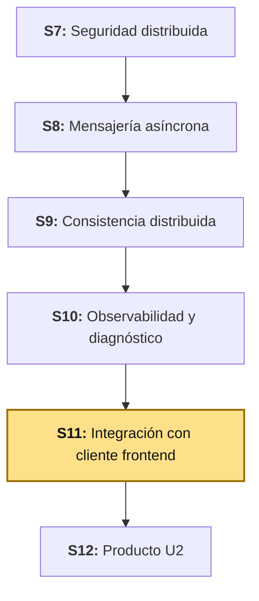
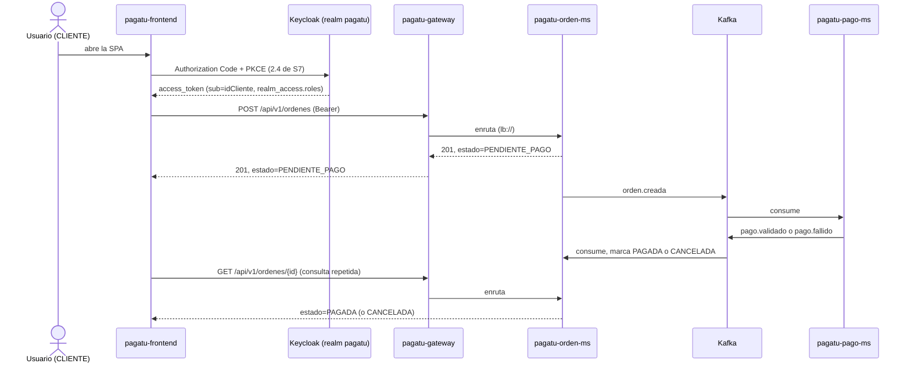

# S11 - Integración con Cliente Frontend: Angular 22 sobre el Gateway, con Keycloak

*Por: Angel Sullon Macalupu @asullom - 2026*

## 1. Introducción

Tiempo: 20 min.

### 1.1 Presentación de la sesión

S7 construyó `pagatu-auth-ms` **a propósito como una pieza temporal** — la Tabla 6 de esa sesión ya dejó escrito, celda por celda, qué reemplaza Keycloak y qué no cambia en el Gateway ni en `pagatu-orden-ms`; la Figura 6 de esa misma sesión ya dibujó el flujo *Authorization Code* + PKCE (*Proof Key for Code Exchange*) "del cliente Angular con Keycloak (S11)"; y 3.27 ya hizo, a mano, el cálculo de `code_challenge` que "reproduce el cálculo que hará el cliente Angular en S11". Ninguna de esas tres cosas era retórica: [S07b](S07b_Seguridad_Distribuida_Keycloak.md) ya ejecutó ese reemplazo —`pagatu-auth-ms` retirado, Keycloak con el realm `pagatu` validado por el Gateway y `pagatu-orden-ms` mediante `issuer-uri`— como paso intermedio entre S7 y esta sesión. Hoy se construye lo que faltaba: el **primer y único cliente frontend del curso** — hasta ahora, `pagatu` solo se probó desde PowerShell, `curl` y Swagger.

**Requisito:** haber completado [S07b](S07b_Seguridad_Distribuida_Keycloak.md) **completa, incluida la sección 7** (Keycloak corriendo, realm `pagatu`, `pagatu-auth-ms` retirado, Gateway/`pagatu-orden-ms` validando por `issuer-uri`, y `idCliente` ya migrado a `sub` — código de `pagatu-orden-ms` y columna de Postgres, 7.3-7.4) — esta sesión parte de ese estado. Sin la migración de 7.3-7.4, `OrdenController.crear` espera un claim `idCliente` que ya no existe (S07b retiró el *protocol mapper* que lo generaba) y falla con `IllegalArgumentException` en cualquier intento de crear una orden.

El reto real no es solo "hacer un login y mostrar una tabla": `pagatu-orden-ms` y `pagatu-pago-ms` se comunican de forma **asíncrona** desde S8 (mensajería con Kafka) y S9 (consistencia distribuida con el patrón Saga) — crear una orden no deja pagada la orden en la misma respuesta HTTP. El cliente Angular tiene que mostrarle a un usuario real una orden que queda `PENDIENTE_PAGO` al crearse, y que **en algún momento posterior**, sin que nadie recargue la página a mano, pasa a `PAGADA` o a `CANCELADA` — la consistencia eventual que S9 resolvió del lado del backend ahora tiene que resolverse también del lado de la interfaz.

### 1.2 Índice

1. Punto de partida: qué dejó S07b, y qué le toca a esta sesión.
2. CORS en el Gateway: el primer cliente que llama desde un origen distinto.
3. Arquitectura mínima de la SPA y login con *Authorization Code* + PKCE.
4. Consistencia eventual en la interfaz: de "pendiente" a "pagada" sin que el usuario recargue nada.

### 1.3 Propósito de aprendizaje

Al concluir la clase, estarás en condiciones de:

- **Ejecutar** el reemplazo de un servidor de autorización propio por Keycloak sin tocar el código de los *resource servers*, **construir** un cliente Angular con *Authorization Code* + PKCE a través de un API Gateway, y **diseñar** una interfaz que refleje con honestidad un estado que todavía no se resolvió, en vez de asumir que una respuesta HTTP exitosa significa que el proceso de negocio completo ya terminó.

### 1.4 Producto de sesión

`pagatu-frontend` (Angular 22), el primer cliente del curso: CORS habilitado en el Gateway, login real con *Authorization Code* + PKCE contra el Keycloak que [S07b](S07b_Seguridad_Distribuida_Keycloak.md) ya dejó corriendo, catálogo de productos, creación de una orden y una pantalla de "Mis pedidos" que muestra el estado real de cada orden — incluida la transición de `PENDIENTE_PAGO` a `PAGADA`/`CANCELADA`, verificada de punta a punta sin recargar la página a mano.

### 1.5 Metodología

**Tabla 1. Metodología de la sesión**

| Actividades a Realizar en el Periodo | Orientaciones generales (Orientaciones Metodológicas) | Material de estudio recomendado |
|---|---|---|
| Revisión previa individual | Completar [S07b](S07b_Seguridad_Distribuida_Keycloak.md) si tu equipo todavía no lo hizo — es prerrequisito, no parte de la clase de hoy. Repasar S7 (2.4 completa, Tabla 6, Figura 6, 3.27) y S9 (el patrón Saga y los estados de `EstadoOrden`). Confirmar que Keycloak, el Gateway, `pagatu-orden-ms`/`pagatu-pago-ms`, Kafka y `obs/` siguen corriendo. Trabajo individual, antes de clase. | S07b completa, S7 (2.4, Tabla 6), S9 (2.2-2.4). |
| Clase presencial | Construcción guiada del cliente Angular, login con PKCE, catálogo, creación de orden y la pantalla de consistencia eventual. Trabajo individual en la propia laptop, siguiendo al docente paso a paso. | Contenedores y servicios corriendo, Pasos 3.1 a 3.9 de esta guía. |
| Evaluación formativa | Revisión en clase del login real, la creación de una orden y su transición observada de `PENDIENTE_PAGO` a su estado final. La evidencia se completa y sustenta de forma individual, fuera del aula, según los criterios mínimos de la sección 4.4. | Indicaciones de entrega (4.3), rúbrica de evaluación (4.6). |

### 1.6 Motivación de la sesión

#### 1.6.1 Caso: dos pestañas, la misma tarjeta, y una condición de carrera que Starbucks tardó más de un mes en admitir

En marzo de 2015, el investigador Egor Homakov encontró que el sistema de recarga y transferencia de saldo entre tarjetas de regalo de Starbucks no serializaba correctamente dos operaciones simultáneas sobre la misma cuenta. Abrió dos sesiones distintas (dos navegadores, dos *cookies* de sesión) y disparó, casi al mismo instante, dos transferencias idénticas desde la misma tarjeta de origen. El sistema procesó **las dos** como válidas — el saldo de la tarjeta de destino terminó duplicado, como si la validación de "hay saldo suficiente" hubiera revisado el mismo número dos veces antes de que la primera transferencia alcanzara a descontarlo. Homakov reportó el hallazgo el 23 de marzo; Starbucks no respondió hasta el 29 de abril (Schneier, 2015).

Fuente: Schneier, B. (2015, 27 de mayo). *Race Condition Exploit in Starbucks Gift Cards*. Schneier on Security. https://www.schneier.com/blog/archives/2015/05/race_condition_.html

El paralelo con `pagatu` no es decorativo: `PagoServiceImpl.procesar` (S8) ya se defiende exactamente de este problema — revisa si el `ordenId` ya tiene un pago registrado **antes** de procesar, y además atrapa `DataIntegrityViolationException` como una segunda línea de defensa para una condición de carrera real (dos eventos casi simultáneos intentando crear el mismo pago). Esa protección existe desde S8 precisamente porque un sistema distribuido con mensajería asíncrona puede entregar —o un cliente puede, sin querer, provocar— el mismo evento más de una vez. Hoy, el lado que todavía no se construyó es el opuesto: la **interfaz** que un usuario ve. Si el cliente Angular asumiera que la respuesta de `POST /api/v1/ordenes` ya significa "pagado", o si volviera a enviar la misma orden porque el usuario, ansioso, hizo doble clic sin ver confirmación, el problema de Starbucks —confiar en que una operación ya terminó cuando en realidad sigue en curso— se repetiría del lado del cliente, no del servidor.

**Preguntas de análisis**

**Activación de conocimientos previos**

1. ¿Qué tendría que haber hecho el sistema de Starbucks para que las dos transferencias simultáneas no se procesaran ambas como válidas?

**Comprensión de consistencia eventual en la interfaz**

1. Si `pagatu-frontend` mostrara "Pedido confirmado" apenas recibe la respuesta `201` de `POST /api/v1/ordenes`, ¿qué información real todavía no tiene en ese momento?
2. ¿Por qué `PagoServiceImpl.procesar` (S8) revisa si el pago ya existe **antes** de crearlo, en vez de confiar en que Kafka nunca entrega un evento duplicado?

### 1.7 Ubicación en el curso

- Unidad: U2 - Sistema distribuido robusto.
- Producto del curso: sistema distribuido de microservicios end-to-end, configurable, escalable, seguro, resiliente, consistente, observable, integrado con frontend y defendido técnicamente.
- Producto de unidad: sistema distribuido seguro, resiliente, consistente, observable e integrado con cliente frontend.
- Avance del producto en esta sesión: el primer cliente Angular del curso, con login real contra Keycloak (ya migrado en S07b), catálogo, creación de orden y consistencia eventual en la interfaz.

**Figura 1. Roadmap del producto de la unidad**



## 2. Explica

Tiempo: 30 min.

### 2.1 Arquitectura de la sesión

**Figura 2. Del login a una orden que todavía no sabe si está pagada**



Lectura del diagrama: hay un instante —entre la respuesta `201` y el momento en que `pagatu-orden-ms` consume el evento de vuelta— en el que la orden existe, tiene un `id`, y **nadie en el sistema sabe todavía si se va a pagar**. Ese instante no es un error ni un caso raro: es el costo normal de la consistencia eventual que S9 ya construyó del lado del backend. 2.5 desarrolla cómo la interfaz debe comportarse durante ese instante, en vez de ignorarlo.

### 2.2 Punto de partida: qué dejó S07b, y qué le toca a esta sesión

[S07b](S07b_Seguridad_Distribuida_Keycloak.md) ya ejecutó, fila por fila, la Tabla 1 de esa guía: `pagatu-auth-ms` retirado, Keycloak con el realm `pagatu`, los roles `CLIENTE`/`ADMIN`, y `idCliente` migrado a `sub` — a diferencia de lo que S7 (3.13) diseñó originalmente (un *user attribute* + *protocol mapper* propios, porque ahí `idCliente` todavía era "un dato de negocio que no coincide por definición con quién inició sesión"), S07b (7.3) cambió de criterio: `idCliente` pasó a ser literalmente `sub`, el mismo patrón que `vendedorId` ya usaba en LP2 (BomERP), evitando que alguien tenga que asignar a mano un identificador único por cada cliente nuevo. El Gateway y `pagatu-orden-ms` ya validan por `issuer-uri`, sin que el conversor de roles ni ninguna regla `hasRole` hayan cambiado una línea.

Lo que **no** dejó resuelto S07b, a propósito —porque es una necesidad del cliente de hoy, no del cambio de proveedor de identidad—, es CORS (2.3) y, por supuesto, el cliente Angular en sí (2.4 en adelante).

### 2.3 CORS en el Gateway: el primer cliente que llama desde un origen distinto

Hasta hoy, cada petición a `pagatu` salió de PowerShell, `curl` o Swagger — ninguno de los tres es un navegador ejecutando JavaScript desde un origen (*origin*: protocolo + dominio + puerto) distinto al del servidor. `pagatu-frontend` sí lo es: corre en `http://localhost:4200` (el puerto por defecto de Angular), y llama a `pagatu-gateway` en `http://localhost:18080` — dos orígenes distintos, por definición (CORS, *Cross-Origin Resource Sharing*, compara los tres componentes, y el puerto ya es suficiente para que difieran). Sin configurar CORS en el Gateway, el navegador bloquea la respuesta **antes** de que el código de Angular la vea, con un error que nunca aparece en Postman/`curl` porque esa política la aplica el navegador, no el servidor ni ninguna herramienta de línea de comandos.

El Gateway es el lugar correcto para esta configuración — no cada microservicio por separado: es el único componente por el que pasa cualquier petición del cliente, y configurarlo ahí una sola vez cubre `pagatu-catalogo-ms`, `pagatu-orden-ms` y `pagatu-pago-ms` a la vez, sin tocar ninguno de los tres. 3.4 lo construye.

### 2.4 Arquitectura mínima de la SPA y login con PKCE

`pagatu-frontend` reutiliza exactamente el mismo mecanismo que S7 (2.4, Figura 6) ya diagramó y que 3.27 de esa sesión ya calculó a mano: generar un `code_verifier`, derivar su `code_challenge` con SHA-256, redirigir a Keycloak, recibir un `code` de un solo uso, y canjearlo por tokens presentando el `code_verifier` original. Esta sesión no repite esa explicación — la ejecuta en TypeScript en vez de en PowerShell/bash.

**Tabla 2. Dónde vive cada pieza de la sesión, según S7 (2.4, línea de "Errores de diseño más comunes")**

| Pieza | Decisión de esta sesión | Por qué (S7, 2.4) |
|---|---|---|
| `access_token`/`refresh_token` | En memoria (un campo privado de un servicio Angular, nunca en `localStorage`) | S7 ya lo advirtió: *"Guardar access tokens en localStorage, vulnerable a XSS"* — es uno de los "errores de diseño más comunes" que esa misma sesión lista para cuando llegara el cliente Angular. |
| `code_verifier` | `sessionStorage`, solo durante la ida y vuelta a Keycloak, borrado tras usarse una vez | La redirección completa recarga la página — el JavaScript en memoria se pierde; el `code_verifier` por sí solo, sin el `code` de esa sesión de login específica, no sirve para nada. |
| `state` (parámetro anti-CSRF) | Generado junto al `code_verifier`, verificado al volver | S7 ya lo advirtió: *"No validar el parámetro state en el redirect, que protege contra CSRF"* — es el segundo "error de diseño común" de esa misma lista. |

La fila de `refresh_token` en una cookie `httpOnly` —la alternativa que S7 (2.4) menciona como "la habitual"— exige un *Backend-for-Frontend* que gestione esa cookie, una pieza que ningún servicio de `pagatu` construye hoy; esta sesión documenta esa limitación con la misma honestidad que S10 documentó el límite de licencia de AWR (*Automatic Workload Repository*) en Oracle Database Free — no es que no se conozca la opción mejor, es que queda fuera del alcance de esta sesión.

### 2.5 Consistencia eventual en la interfaz: de "pendiente" a "pagada" sin recargar

La Figura 2 (2.1) ya mostró el instante en el que una orden existe pero su pago todavía no se resolvió. Una interfaz honesta tiene tres opciones reales frente a ese instante — ninguna de las tres es "asumir que ya terminó":

**Tabla 3. Tres formas de reflejar un estado que todavía no se resolvió**

| Estrategia | Cómo funciona | Costo |
|---|---|---|
| *Polling* (sondeo periódico) | El cliente vuelve a pedir `GET /api/v1/ordenes/{id}` cada pocos segundos, mientras el estado siga `PENDIENTE_PAGO`. | Tráfico adicional, mientras la respuesta no cambie; simple de construir, sin infraestructura nueva. |
| *WebSocket*/*Server-Sent Events* | El servidor empuja la actualización al cliente apenas cambia el estado, sin que el cliente pregunte. | Elimina el tráfico redundante del *polling*, pero exige una conexión persistente y código nuevo en cada microservicio involucrado. |
| Recarga manual | El usuario mismo refresca la pantalla para ver si ya cambió. | El mínimo esfuerzo de construcción, pero traslada el trabajo de "darse cuenta" al usuario — la peor experiencia de las tres. |

Esta sesión construye **polling** (3.8) — no porque sea la opción ideal en términos absolutos (*WebSocket* evita tráfico redundante, y una arquitectura orientada a eventos con `Server-Sent Events` es el camino natural para un sistema que ya es 100% asíncrono del lado del backend), sino porque es la que se puede construir y verificar de punta a punta en una sesión, sin agregar infraestructura nueva a `pagatu-orden-ms`. Queda documentado, igual que el *Backend-for-Frontend* de 2.4, como un límite honesto de alcance, no como una decisión de que *polling* sea la respuesta correcta para cualquier sistema.

## 3. Aplica: actividad práctica guiada

Tiempo: 100 min.

**Actividad:** configuración de CORS en el Gateway y construcción del primer cliente Angular del curso, sobre el Keycloak que [S07b](S07b_Seguridad_Distribuida_Keycloak.md) ya dejó corriendo — login con *Authorization Code* + PKCE, catálogo, creación de una orden y una pantalla de "Mis pedidos" que refleja la consistencia eventual real del sistema (Producto de la sesión en 1.4).

**Propósito de la actividad:** que cada estudiante vea, de punta a punta, que todo lo diseñado en S7 sobre papel (Tabla 6, Figura 6) se ejecuta sin sorpresas cuando llega el momento, y que una interfaz real puede mostrar honestamente un estado que el propio sistema todavía no resolvió.

**Orientaciones metodológicas:** el docente construye la SPA paso a paso frente a la clase, probando cada pieza contra el sistema real (ya migrado a Keycloak en S07b) antes de avanzar; los estudiantes replican cada paso en su propia instancia y provocan ellos mismos el caso de un método de pago rechazado (3.9) para ver la transición a `CANCELADA` en su propia pantalla.

**Actividades para realizar:**

- **3.1** Verificar el punto de partida.
- **3.2** Habilitar CORS en el Gateway.
- **3.3** Crear el proyecto Angular 22 y su arquitectura mínima.
- **3.4** Login con *Authorization Code* + PKCE.
- **3.5** Catálogo de productos, a través del Gateway.
- **3.6** Crear una orden.
- **3.7** Agregar la consulta de pago por orden en `pagatu-pago-ms`.
- **3.8** "Mis pedidos": consistencia eventual con *polling*.
- **3.9** Probar de punta a punta, incluido un pago rechazado.

### 3.1 Verificar el punto de partida

**Producto del paso:** confirmación de que [S07b](S07b_Seguridad_Distribuida_Keycloak.md) ya quedó completa, y de que todo el sistema sigue corriendo sobre Keycloak.

```bash
git clone --branch s07b-keycloak https://github.com/262dist/pagatu.git
```

Si tu equipo no congeló esa rama, clona `s07-seguridad-jwt` y completa [S07b](S07b_Seguridad_Distribuida_Keycloak.md) tú mismo antes de seguir — no continúes con `pagatu-auth-ms` todavía corriendo, ni con `Orden.idCliente` todavía como `Long` (S07b, 7.3-7.4). Levanta `pagatu-config`, `pagatu-eureka`, `pagatu-gateway`, Keycloak (`keycloak/`), los tres microservicios que quedan activos (`pagatu-catalogo-ms`, `pagatu-orden-ms`, `pagatu-pago-ms` — `pagatu-auth-ms` ya está retirado, S07b, sección 8), `kafka/` y `obs/`. Confirma en `http://localhost:19090/targets` que los tres microservicios, Keycloak y el Gateway aparecen `UP`, y que una petición con un token de Keycloak (el mismo procedimiento de S07b, 7.4) sigue devolviendo `200` contra `http://localhost:18080/api/v1/ordenes`.

### 3.2 Habilitar CORS en el Gateway

**Producto del paso:** `pagatu-gateway` aceptando peticiones del navegador desde `http://localhost:4200` (2.3).

**`infra/pagatu-config/config-repo/pagatu-gateway-dev.yml`** — agrega, junto a las rutas que ya existen:

```yaml
spring:
  cloud:
    gateway:
      globalcors:
        cors-configurations:
          '[/**]':
            allowedOrigins: "http://localhost:4200"
            allowedMethods: [GET, POST, PUT, PATCH, DELETE, OPTIONS]
            allowedHeaders: "*"
            allowCredentials: true
```

`globalcors` aplica la misma política a **todas** las rutas del Gateway de una sola vez (2.3) — ninguna de `pagatu-catalogo-ms`, `pagatu-orden-ms` ni `pagatu-pago-ms` necesita su propia configuración de CORS, porque el navegador nunca las llama directamente, siempre a través del Gateway. `allowCredentials: true` es necesario porque la petición incluye el header `Authorization` (no una *cookie*, pero Spring Cloud Gateway trata ambos casos bajo la misma bandera de *credentials* del estándar CORS).

### 3.3 Crear el proyecto Angular 22 y su arquitectura mínima

**Producto del paso:** `pagatu-frontend`, un proyecto Angular 22 con el mismo patrón `core`/`features` que ya conoces de LP2 (S7 de esa guía) — componentes *standalone*, *routing* por `loadComponent`, *change detection* sin zonas.

```bash
npm install -g @angular/cli@22
ng new pagatu-frontend --routing --style=css --zoneless --ssr=false
cd pagatu-frontend
```

Estructura mínima (la misma convención que LP2 ya usa, sin repetirla aquí): `core/auth/` (login, PKCE, decodificación de JWT), `core/layout/` (encabezado y navegación), `core/interceptors/` (adjuntar el token), `core/guards/` (autenticación y rol), `features/catalogo/` (listar productos), `features/pedidos/` (crear orden, "Mis pedidos"). Si no construiste la sesión equivalente de LP2 (S7/S11), replica el mismo patrón: componentes *standalone* con `loadComponent`, servicios con `inject(HttpClient)`, sin módulos de Angular clásicos (`NgModule`).

**`src/environments/environment.ts`**:

```typescript
export const environment = {
  gatewayBaseUrl: 'http://localhost:18080',
  keycloak: {
    issuer: 'http://localhost:18180/realms/pagatu',
    clientId: 'pagatu-frontend',
    redirectUri: 'http://localhost:4200/auth/callback',
    postLogoutRedirectUri: 'http://localhost:4200/',
  },
};
```

Todas las llamadas de negocio apuntan a `gatewayBaseUrl` — ningún componente ni servicio de `pagatu-frontend` conoce la dirección de `pagatu-catalogo-ms`, `pagatu-orden-ms` ni `pagatu-pago-ms` por separado (2.1): el Gateway es el único punto de entrada, exactamente como ya lo es para PowerShell/`curl`/Swagger desde S4.

### 3.4 Login con *Authorization Code* + PKCE

**Producto del paso:** `AuthService`, con el mismo mecanismo de PKCE que S7 (3.27) ya calculó a mano, ahora en TypeScript — token en memoria (Tabla 2, 2.4).

**`src/app/core/auth/pkce.ts`**:

```typescript
function base64UrlEncode(bytes: Uint8Array): string {
  let binario = '';
  bytes.forEach((byte) => (binario += String.fromCharCode(byte)));
  return btoa(binario).replace(/\+/g, '-').replace(/\//g, '_').replace(/=+$/, '');
}

export function generarCodeVerifier(): string {
  return base64UrlEncode(crypto.getRandomValues(new Uint8Array(32)));
}

export async function generarCodeChallenge(verifier: string): Promise<string> {
  const hash = await crypto.subtle.digest('SHA-256', new TextEncoder().encode(verifier));
  return base64UrlEncode(new Uint8Array(hash));
}

export function generarState(): string {
  return base64UrlEncode(crypto.getRandomValues(new Uint8Array(16)));
}
```

Compara este resultado contra el de S7 (3.27): el `Get-Pkce`/`pkce` que calculaste ahí a mano con `[System.Security.Cryptography.SHA256]`/`openssl dgst -sha256` es exactamente el mismo algoritmo que `generarCodeChallenge` ejecuta aquí con la Web Crypto API del navegador — mismo SHA-256, misma codificación Base64 apta para URL, ninguna sorpresa de cálculo.

**`src/app/core/auth/auth-service.ts`** (login + estado en memoria):

```typescript
import { Injectable, computed, signal } from '@angular/core';
import { environment } from '../../../environments/environment';
import { generarCodeChallenge, generarCodeVerifier, generarState } from './pkce';
import { decodeJwtPayload } from './jwt';

interface SesionKeycloak {
  accessToken: string;
  refreshToken: string;
  idToken: string;
  expiraEn: number;
}

const CLAVE_VERIFIER = 'pagatu_pkce_verifier';
const CLAVE_STATE = 'pagatu_pkce_state';
const CLAVE_DESTINO = 'pagatu_pkce_destino';

@Injectable({ providedIn: 'root' })
export class AuthService {
  private readonly sesion = signal<SesionKeycloak | null>(null);

  readonly autenticado = computed(() => {
    const actual = this.sesion();
    return actual !== null && actual.expiraEn > Date.now();
  });

  readonly roles = computed<string[]>(
    () => decodeJwtPayload(this.sesion()?.accessToken ?? '')?.realm_access?.roles ?? [],
  );

  readonly idCliente = computed<string | null>(
    () => decodeJwtPayload(this.sesion()?.accessToken ?? '')?.sub ?? null,
  );

  tieneRol(...rolesPermitidos: string[]): boolean {
    return rolesPermitidos.some((rol) => this.roles().includes(rol));
  }

  accessToken(): string | null {
    return this.sesion()?.accessToken ?? null;
  }

  async iniciarLogin(destino = location.pathname): Promise<void> {
    const verifier = generarCodeVerifier();
    const state = generarState();
    sessionStorage.setItem(CLAVE_VERIFIER, verifier);
    sessionStorage.setItem(CLAVE_STATE, state);
    sessionStorage.setItem(CLAVE_DESTINO, destino);

    const parametros = new URLSearchParams({
      client_id: environment.keycloak.clientId,
      response_type: 'code',
      redirect_uri: environment.keycloak.redirectUri,
      scope: 'openid profile',
      state,
      code_challenge: await generarCodeChallenge(verifier),
      code_challenge_method: 'S256',
    });
    location.href = `${environment.keycloak.issuer}/protocol/openid-connect/auth?${parametros}`;
  }

  async completarLogin(code: string, stateRecibido: string): Promise<void> {
    const stateEsperado = sessionStorage.getItem(CLAVE_STATE);
    const verifier = sessionStorage.getItem(CLAVE_VERIFIER);
    sessionStorage.removeItem(CLAVE_STATE);
    sessionStorage.removeItem(CLAVE_VERIFIER);

    if (!verifier || stateRecibido !== stateEsperado) {
      throw new Error('state o code_verifier invalido: posible CSRF, reinicia el login');
    }

    const cuerpo = new URLSearchParams({
      grant_type: 'authorization_code',
      client_id: environment.keycloak.clientId,
      redirect_uri: environment.keycloak.redirectUri,
      code,
      code_verifier: verifier,
    });
    const respuesta = await fetch(`${environment.keycloak.issuer}/protocol/openid-connect/token`, {
      method: 'POST',
      headers: { 'Content-Type': 'application/x-www-form-urlencoded' },
      body: cuerpo,
    });
    if (!respuesta.ok) throw new Error('No se pudo intercambiar el codigo por un token');

    const datos = await respuesta.json();
    this.sesion.set({
      accessToken: datos.access_token,
      refreshToken: datos.refresh_token,
      idToken: datos.id_token,
      expiraEn: Date.now() + datos.expires_in * 1000,
    });
  }

  destinoPendiente(): string {
    const destino = sessionStorage.getItem(CLAVE_DESTINO) ?? '/';
    sessionStorage.removeItem(CLAVE_DESTINO);
    return destino;
  }

  cerrarSesion(): void {
    const idToken = this.sesion()?.idToken;
    this.sesion.set(null);
    const parametros = new URLSearchParams({
      post_logout_redirect_uri: environment.keycloak.postLogoutRedirectUri,
      ...(idToken ? { id_token_hint: idToken } : {}),
    });
    location.href = `${environment.keycloak.issuer}/protocol/openid-connect/logout?${parametros}`;
  }
}
```

A diferencia de un cliente que solo valida PKCE, este `AuthService` también genera y verifica `state` (Tabla 2) — el segundo "error de diseño común" que S7 (2.4) ya advirtió. `completarLogin` revisa `state` **antes** de confiar en el `code_verifier`: si no coinciden, lanza un error en vez de intentar el intercambio, sin importar si el `code_verifier` guardado era correcto.

`idCliente` lee el claim `sub`, no uno propio (S07b, 7.3 — `idCliente` ya **es** `sub`, el mismo patrón que `vendedorId` en LP2): por eso no hace falta ningún campo extra en `JwtPayload`, ni ninguna configuración adicional de Keycloak para que viaje en el token.

**`src/app/core/auth/jwt.ts`** (decodificación, sin validar firma — igual que LP2 S11 y S7, 3.27):

```typescript
export interface JwtPayload {
  sub: string;
  exp: number;
  realm_access?: { roles: string[] };
}

export function decodeJwtPayload(token: string): JwtPayload | null {
  const partes = token.split('.');
  if (partes.length !== 3) return null;
  try {
    const base64 = partes[1].replace(/-/g, '+').replace(/_/g, '/');
    const json = decodeURIComponent(
      atob(base64).split('').map((c) => '%' + c.charCodeAt(0).toString(16).padStart(2, '0')).join(''),
    );
    return JSON.parse(json) as JwtPayload;
  } catch {
    return null;
  }
}
```

**`src/app/core/auth/auth-callback.ts`** (componente de retorno, verifica `state` antes de completar el login):

```typescript
import { Component, inject } from '@angular/core';
import { ActivatedRoute, Router } from '@angular/router';
import { AuthService } from './auth-service';

@Component({
  selector: 'app-auth-callback',
  template: `<p>Completando inicio de sesion...</p>`,
})
export class AuthCallback {
  constructor() {
    const route = inject(ActivatedRoute);
    const router = inject(Router);
    const auth = inject(AuthService);

    const codigo = route.snapshot.queryParamMap.get('code');
    const state = route.snapshot.queryParamMap.get('state');

    if (!codigo || !state) {
      router.navigateByUrl('/');
      return;
    }

    auth
      .completarLogin(codigo, state)
      .then(() => router.navigateByUrl(auth.destinoPendiente()))
      .catch(() => router.navigateByUrl('/'));
  }
}
```

Agrega la ruta en `app.routes.ts` (`path: 'auth/callback'`, fuera de cualquier *guard*, igual que en LP2 S11) y construye `authGuard`/`rolGuard`/el interceptor que adjunta `Authorization: Bearer` siguiendo exactamente el mismo patrón funcional de LP2 (S11, *guards* `CanActivateFn`, interceptor `HttpInterceptorFn`) — esta sesión no repite ese código, porque ya lo conoces; la única diferencia es que `rolGuard` compara contra `CLIENTE`/`ADMIN`, no contra `VENDEDOR`/`SUPERVISOR`/`ADMIN`.

### 3.5 Catálogo de productos, a través del Gateway

**Producto del paso:** una pantalla simple que lista los productos de `pagatu-catalogo-ms`, llamando siempre a través de `pagatu-gateway`.

```typescript
// catalogo-service.ts
@Injectable({ providedIn: 'root' })
export class CatalogoService {
  private readonly http = inject(HttpClient);

  listarProductos(): Observable<ProductoResponse[]> {
    return this.http.get<ProductoResponse[]>(`${environment.gatewayBaseUrl}/api/v1/productos`);
  }
}
```

No hace falta ningún rol para consultar el catálogo (S7 no restringe `GET /api/v1/productos`) — cualquier usuario autenticado, `CLIENTE` o `ADMIN`, lo ve igual.

### 3.6 Crear una orden

**Producto del paso:** un formulario simple (lista de productos del carrito + método de pago) que llama a `POST /api/v1/ordenes` con el token del usuario, y muestra el estado inicial real — `PENDIENTE_PAGO`, nunca "pagado".

```typescript
// orden-service.ts
@Injectable({ providedIn: 'root' })
export class OrdenService {
  private readonly http = inject(HttpClient);

  crear(request: OrdenRequest): Observable<OrdenResponse> {
    return this.http.post<OrdenResponse>(`${environment.gatewayBaseUrl}/api/v1/ordenes`, request);
  }

  obtener(id: number): Observable<OrdenResponse> {
    return this.http.get<OrdenResponse>(`${environment.gatewayBaseUrl}/api/v1/ordenes/${id}`);
  }
}
```

En la plantilla, al recibir la respuesta de `crear`, muestra el `estado` tal cual llega (`PENDIENTE_PAGO`) — **no** un mensaje genérico de "¡Compra exitosa!". Es la misma disciplina que el caso de 1.6 motivó: la respuesta `201` confirma que la orden se registró, no que el pago se resolvió.

**Error frecuente**: usar `OrdenRequest.metodoPago = "TARJETA_RECHAZADA"` sin querer durante las pruebas. Es el valor exacto que `PagoServiceImpl` (S8) usa para simular un rechazo — útil a propósito en 3.11, pero confuso si aparece sin que lo esperes durante 3.8.

### 3.7 Agregar la consulta de pago por orden en `pagatu-pago-ms`

**Producto del paso:** `GET /api/v1/pagos/por-orden/{ordenId}`, el endpoint que falta para que la SPA pueda mostrar el pago de una orden específica — hoy `PagoController` solo tiene `listar()` (todos los pagos) y `obtener(id)` (por el `id` del propio pago, no por el de la orden).

**`services/pagatu-pago-ms/src/main/java/pe/edu/upeu/pago/repository/PagoRepository.java`** — ya tiene `findByOrdenId` (lo usa `procesar`, S8); solo falta exponerlo.

**`PagoService.java`** y **`PagoServiceImpl.java`** — agrega el método:

```java
Optional<PagoResponse> buscarPorOrden(Long ordenId);
```

```java
@Override
public Optional<PagoResponse> buscarPorOrden(Long ordenId) {
    return pagoRepository.findByOrdenId(ordenId).map(pagoMapper::toResponse);
}
```

**`PagoController.java`** — agrega el endpoint:

```java
@GetMapping("/por-orden/{ordenId}")
public ResponseEntity<PagoResponse> buscarPorOrden(@PathVariable Long ordenId) {
    return pagoService.buscarPorOrden(ordenId)
            .map(ResponseEntity::ok)
            .orElseGet(() -> ResponseEntity.notFound().build());
}
```

`Optional` (no una excepción) es la elección correcta aquí: que una orden todavía no tenga pago registrado **no es un error** — es, precisamente, el estado normal mientras Kafka todavía no entregó el evento (2.1, Figura 2). `404` es la respuesta honesta: "este pago no existe todavía", no "algo falló".

Agrega la ruta en el Gateway, junto a las que ya existen (**`infra/pagatu-config/config-repo/pagatu-gateway-dev.yml`**):

```yaml
            - id: pagatu-pago-consulta
              uri: lb://pagatu-pago-ms
              predicates:
                - Path=/api/v1/pagos/**
```

Es la primera ruta de `pagatu-pago-ms` en el Gateway — hasta hoy, nadie necesitaba llamarlo desde afuera (solo consumía eventos de Kafka).

### 3.8 "Mis pedidos": consistencia eventual con *polling*

**Producto del paso:** una pantalla que lista las órdenes del usuario autenticado y refresca automáticamente cada orden que siga `PENDIENTE_PAGO`, hasta que cambie.

**Filtrado por `idCliente` (UX, no seguridad)**: `GET /api/v1/ordenes` (S7, `hasAnyRole("CLIENTE", "ADMIN")`) no filtra por dueño del lado del servidor — cualquier `CLIENTE` autenticado ve todas las órdenes si llama a ese endpoint sin más. "Mis pedidos" filtra del lado del cliente, comparando `orden.idCliente` contra `auth.idCliente()` (3.4) — exactamente la misma distinción que LP2 (S11, 2.7) ya estableció: ocultar no es asegurar, el backend sigue siendo quien decide de verdad qué puede hacer cada rol; esto solo mejora lo que un usuario normal ve, sin pretender ser un límite de seguridad.

```typescript
// mis-pedidos.ts (fragmento relevante)
export class MisPedidos implements OnInit, OnDestroy {
  private readonly ordenService = inject(OrdenService);
  private readonly pagoService = inject(PagoService);
  protected readonly auth = inject(AuthService);
  protected readonly pedidos = signal<PedidoConPago[]>([]);
  private intervalo?: ReturnType<typeof setInterval>;

  ngOnInit(): void {
    this.cargar();
    this.intervalo = setInterval(() => this.refrescarPendientes(), 4000);
  }

  ngOnDestroy(): void {
    clearInterval(this.intervalo);
  }

  private cargar(): void {
    this.ordenService.listar().subscribe((ordenes) => {
      const propias = ordenes.filter((o) => o.idCliente === this.auth.idCliente());
      this.pedidos.set(propias.map((orden) => ({ orden, pago: null })));
    });
  }

  private refrescarPendientes(): void {
    const pendientes = this.pedidos().filter((p) => p.orden.estado === 'PENDIENTE_PAGO');
    for (const pendiente of pendientes) {
      this.ordenService.obtener(pendiente.orden.id).subscribe((actualizada) => {
        this.pedidos.update((lista) =>
          lista.map((p) => (p.orden.id === actualizada.id ? { ...p, orden: actualizada } : p)),
        );
      });
    }
  }
}
```

`refrescarPendientes` solo vuelve a consultar las órdenes que **siguen** `PENDIENTE_PAGO` — una vez que una orden llega a `PAGADA` o `CANCELADA`, deja de incluirse en el sondeo (2.5, Tabla 3: el costo real del *polling* es tráfico redundante; dejar de preguntar por lo que ya no cambia es la forma más simple de acotarlo). `ngOnDestroy` limpia el intervalo — sin esto, navegar fuera de "Mis pedidos" dejaría el sondeo corriendo en segundo plano indefinidamente.

En la plantilla, muestra el estado con una etiqueta clara por cada valor (`PENDIENTE_PAGO` → "Procesando pago…", `PAGADA` → "Pagado", `CANCELADA` → "Pago rechazado") y, para la orden correspondiente, llama a `GET /api/v1/pagos/por-orden/{id}` (3.7) una vez que el estado ya no es `PENDIENTE_PAGO`, para mostrar el método de pago y la fecha real.

### 3.9 Probar de punta a punta, incluido un pago rechazado

**Producto del paso:** evidencia real de los dos desenlaces posibles — una orden que termina `PAGADA` y una que termina `CANCELADA` — ambas vistas cambiar en pantalla sin recargar la página a mano.

1. Inicia sesión como `cliente1@pagatu.com`.
2. Crea una orden con cualquier `metodoPago` normal (ej. `YAPE_PLIN`). Confirma que aparece de inmediato en "Mis pedidos" como `PENDIENTE_PAGO`, y que en pocos segundos (sin tocar nada) cambia a `PAGADA`.
3. Crea una segunda orden con `metodoPago: "TARJETA_RECHAZADA"` (S8, el valor que `PagoServiceImpl` rechaza a propósito). Confirma que esta sí cambia, también sola, a `CANCELADA`.
4. Verifica en el tablero de Grafana (S10) que ambas transiciones generaron actividad real en `pagatu-pago-ms` y `pagatu-orden-ms` — el mismo tablero de diagnóstico de la sesión anterior, ahora observando tráfico real generado por un cliente de verdad, no por `curl`.

**Error frecuente**: ver que una orden se queda en `PENDIENTE_PAGO` indefinidamente. Antes de sospechar del *polling*, confirma que `pagatu-pago-ms` sigue corriendo y que el *consumer group* de Kafka no quedó atascado (S8, 2.6) — el mismo diagnóstico que esa sesión ya enseñó, aplicado ahora a un síntoma visible en la interfaz en vez de en los logs.

**Evidencia de aprendizaje:**

- CORS habilitado en el Gateway, con la SPA llamando sin error de origen cruzado.
- Login real con *Authorization Code* + PKCE, con `state` verificado.
- Catálogo, creación de orden y "Mis pedidos" funcionando a través del Gateway.
- Las dos transiciones de estado (`PAGADA` y `CANCELADA`) observadas en vivo, sin recargar la página.

## 4. Crea: actividad autónoma

Tiempo: 3h fuera del aula.

### 4.1 Actividad

Extensión del cliente frontend del Proyecto Sello propio del equipo, documentada en evidencia individual.

Completa y evidencia estas tareas, sobre tu propio proyecto:

1. Si tu proyecto todavía no reemplazó su propio servidor de autorización por Keycloak, hazlo siguiendo el mismo criterio de la Tabla 6 de S7 — o, si ya lo hiciste en una sesión anterior, confirma que el cliente de tu propia SPA usa *Authorization Code* + PKCE, sin *Direct access grants*.
2. Decide, para al menos un dato de negocio de tu propio dominio, si de verdad es distinto de "quién inició sesión" o si —como terminó siendo `idCliente` aquí (S07b, 7.3)— puede ser literalmente `sub`. Si es genuinamente distinto, configura un *user attribute* + *protocol mapper* propios en tu realm (el patrón que S07, 3.13, diseñó originalmente para `idCliente`, antes de que S07b decidiera que no hacía falta) para que viaje en el token.
3. Construye al menos una pantalla de tu propio proyecto que dependa de un proceso asíncrono (una cola, un *webhook*, un *batch*) y decida explícitamente cómo reflejar el estado "todavía no se sabe" — *polling*, otra estrategia de la Tabla 3, o una justificación documentada de por qué tu caso no lo necesita.
4. Prueba, con datos reales, el camino feliz y al menos un camino de rechazo/fallo, y documenta ambos con capturas.

### 4.2 Propósito

Que cada estudiante demuestre, de forma individual y fuera del aula, que puede migrar un cliente frontend a un proveedor de identidad externo y diseñar una interfaz que refleje con honestidad el estado real de un proceso asíncrono propio — no solo replicar lo visto en clase sobre `pagatu`.

### 4.3 Indicaciones

Entrega un PDF con el siguiente nombre:

```text
S11_Equipo##_ApellidoNombre.pdf
```

Cada captura de pantalla del informe debe mostrar, sin recortar, el reloj del sistema (fecha y hora) y tu usuario o foto de perfil (Windows, VS Code o navegador) visibles en pantalla.

#### 4.3.1 Estructura del informe

**Datos del estudiante**

- Nombre:
- Equipo:
- Sesión: S11 - Integración con Cliente Frontend: Angular 22 sobre el Gateway, con Keycloak
- Rol o aporte realizado:
- Link de GitHub:

**Evidencia técnica**

Incluye capturas con una breve explicación debajo de cada una, organizadas en los mismos 4 bloques de la rúbrica (4.6):

1. *Migración a Keycloak*
    - Realm, roles y *protocol mapper* de tu propio proyecto, con el login real funcionando.
2. *Cliente con Authorization Code + PKCE*
    - Login completo de punta a punta, con `state` y `code_verifier` verificados.
3. *Proceso asíncrono reflejado en la interfaz*
    - La pantalla que decide cómo mostrar un estado "todavía no resuelto", con la estrategia elegida justificada.
4. *Camino feliz y camino de fallo*
    - Ambos desenlaces probados y documentados con capturas reales.

**Error o hallazgo**

Describe un error real: un `protocol mapper` sin **Add to access token**, un `state` que no coincidía por reusar una pestaña vieja, un *polling* que seguía corriendo después de salir de la pantalla, o un CORS mal configurado que bloqueaba silenciosamente las peticiones.

**Reflexión técnica breve**

Responde en 5 a 8 líneas:

```text
¿Por qué el caso de Starbucks (1.6) es un problema de consistencia y
no solo de seguridad? Relaciona tu respuesta con la decisión de
diseño que tomaste en tu propia pantalla de 4.1.3 para reflejar un
estado que tu sistema todavía no había resuelto.
```

### 4.4 Criterios mínimos de aceptación

- El archivo respeta el nombre solicitado.
- Si corresponde, el servidor de autorización propio fue reemplazado por Keycloak (o ya lo estaba, y se verifica PKCE sin *Direct access grants*).
- Se decidió explícitamente, con justificación, si el dato de negocio elegido podía ser `sub` o necesitaba un *user attribute* + *protocol mapper* propios — y si fue lo segundo, quedó verificado con un token real.
- Existe al menos una pantalla que depende de un proceso asíncrono, con una estrategia explícita y justificada para reflejar su estado pendiente.
- Se probaron y documentaron tanto el camino feliz como un camino de rechazo/fallo real.
- Cada captura de la evidencia técnica muestra el reloj del sistema y el usuario/perfil visible, sin recortar.
- Las fechas y horas de las capturas son coherentes con el historial de commits de su repositorio en GitHub.
- Incluye un error o hallazgo técnico diagnosticado.
- Incluye la reflexión técnica breve solicitada.

### 4.5 Preguntas de defensa

1. ¿Por qué S07b terminó decidiendo que `idCliente` podía ser literalmente `sub`, en vez de usar el *protocol mapper* que S07 (3.13) había diseñado originalmente para ese mismo dato?
2. ¿Qué problema concreto previene verificar `state` al volver de Keycloak, y qué pasaría si tu cliente lo ignorara?
3. ¿Por qué una respuesta `201` de `POST /api/v1/ordenes` no es evidencia de que el pago se resolvió?
4. De las tres estrategias de la Tabla 3 (2.5), ¿cuál elegiste para tu propio proyecto, y qué te hizo descartar las otras dos?
5. ¿Por qué el Gateway es el lugar correcto para configurar CORS, y no cada microservicio por separado?
6. Si `GET /api/v1/ordenes` no filtra por `idCliente` del lado del servidor, ¿qué protege realmente el filtrado que hiciste en el frontend, y qué no protege?

### 4.6 Rúbrica de evaluación

**Tabla 4. Rúbrica de evaluación**

| Criterio | Peso (%) | A (20 pts) | B (15 pts) | C (10 pts) | D (5 pts) | Nivel obtenido |
|---|---:|---|---|---|---|---:|
| 1. Migración a Keycloak* | 25 | Realm, roles y protocol mapper configurados y verificados, con login real funcionando. | Migración funcional, con alguna configuración incompleta (ej. mapper sin "Add to access token"). | Migración parcial, o PKCE no obligatorio. | No presenta migración a Keycloak. | |
| 2. Cliente con Authorization Code + PKCE* | 25 | Login completo verificado de punta a punta, con state y code_verifier validados correctamente. | Login funcional, con alguna verificación (state o PKCE) incompleta. | Login funcional solo con un flujo inseguro. | No presenta login funcional. | |
| 3. Proceso asíncrono en la interfaz* | 25 | Estrategia explícita y bien justificada, verificada con datos reales cambiando de estado sin recargar. | Estrategia presente, con la verificación incompleta. | Estrategia presente solo en el diseño, sin implementación real. | No presenta ninguna estrategia. | |
| 4. Camino feliz y de fallo* | 25 | Ambos caminos probados y documentados con evidencia real y clara. | Ambos presentes, con alguno documentado superficialmente. | Solo el camino feliz probado. | No presenta ninguno de los dos caminos. | |

\* Agregado manual.

Nota final = suma de (`Peso` / 100 × `Puntos del nivel obtenido`) = ____ / 20.

Para usar la rúbrica con IA (inteligencia artificial), solicita:

```text
Evalúa el PDF usando la rúbrica de la sesión.
Para cada criterio selecciona el nivel obtenido usando la escala A=20, B=15, C=10, D=5 puntos.
Justifica brevemente cada nivel asignado.
Verifica que cada captura muestre reloj del sistema y usuario/perfil visible, y que las fechas sean coherentes con el historial de commits de GitHub. Si falta esta evidencia o hay inconsistencias, indícalo explícitamente antes de calificar.
Calcula la nota final con la fórmula: suma de (Peso/100 × Puntos del nivel obtenido), directamente sobre 20.
Indica 2 fortalezas y 2 recomendaciones.
```

## 5. Cierre

Tiempo: 5 min.

**Resumen breve:** hoy `pagatu` dejó de ser un sistema que solo se probaba desde PowerShell y `curl`. Con `pagatu-auth-ms` ya retirado desde S07b —exactamente como la Tabla 6 de S7 lo anticipó, sin tocar el código del Gateway ni de `pagatu-orden-ms`— el primer cliente Angular del curso ya inicia sesión con *Authorization Code* + PKCE contra Keycloak, crea órdenes a través del Gateway, y —la pieza que no tenía precedente en ninguna sesión anterior— refleja con honestidad un estado que el propio sistema todavía no resolvió, hasta que la consistencia eventual que S9 construyó del lado del backend termina su trabajo y la orden pasa, sola, a `PAGADA` o `CANCELADA`.

**Dinámica participativa:** en una ronda rápida, cada estudiante comparte en una frase cuánto tardó, en su propia prueba, en ver una orden pasar de `PENDIENTE_PAGO` a su estado final.

**Metacognición:** ¿qué te costó más entender hoy: por qué `idCliente` terminó siendo `sub` en vez del *protocol mapper* que S07 había diseñado originalmente, o por qué una respuesta `201` no es lo mismo que "el proceso ya terminó"?

**Proyección:** S12 integra todo lo construido en esta unidad —seguridad, mensajería, consistencia, observabilidad y ahora el cliente frontend— en el Producto de Unidad 2: el sistema distribuido robusto completo, sustentado de punta a punta.

## Bibliografía

1. Schneier, B. (2015, 27 de mayo). *Race Condition Exploit in Starbucks Gift Cards*. Schneier on Security. https://www.schneier.com/blog/archives/2015/05/race_condition_.html
2. Sakimura, N., Bradley, J., & Agarwal, N. (2015). *Proof Key for Code Exchange by OAuth Public Clients* (RFC 7636). IETF. https://www.rfc-editor.org/rfc/rfc7636
3. Lodderstedt, T., Bradley, J., Labunets, A., & Fett, D. (2025). *Best Current Practice for OAuth 2.0 Security* (RFC 9700). IETF. https://datatracker.ietf.org/doc/html/rfc9700
4. Spring Cloud Gateway. (2026). *Global CORS Configuration*. https://docs.spring.io/spring-cloud-gateway/reference/spring-cloud-gateway/global-cors-configuration.html
