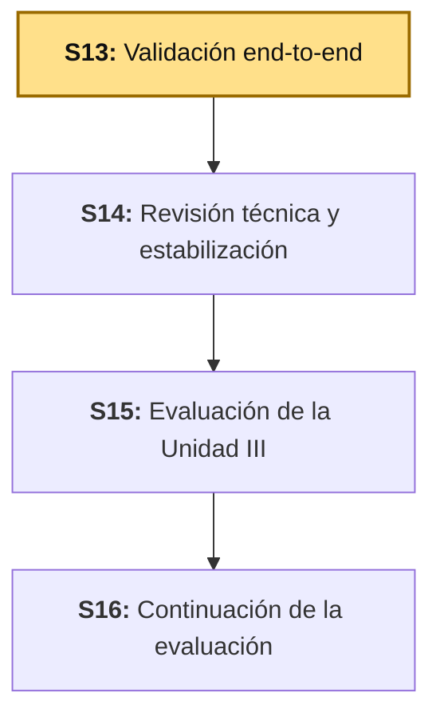
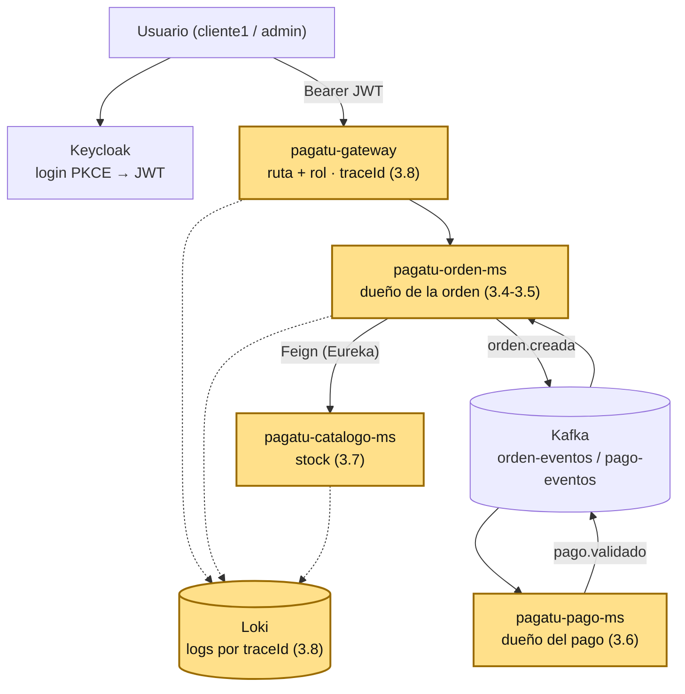

# S13 - Validación End-to-End del Producto del Curso

*Por: Angel Sullon Macalupu @asullom - 2026*

## 1. Introducción

Tiempo: 20 min.

### 1.1 Presentación de la sesión

Once sesiones construyeron `pagatu` pieza por pieza, y cada una cerró con su propia prueba: el Gateway enruta, `pagatu-orden-ms` crea órdenes, Keycloak emite tokens, Kafka entrega eventos, Loki guarda logs. Ninguna prueba recorrió todo junto con **dos usuarios distintos a la vez**, que es la pregunta que un sistema en producción responde todos los días: ¿puede una persona autenticada ver o tocar lo que le pertenece a otra? Esta sesión levanta el sistema completo, ejecuta los flujos principales de punta a punta y registra cada fallo que aparece. Los fallos de esta guía no son hipotéticos: se encontraron, se corrigieron y se volvieron a probar al preparar la sesión (3.4 a 3.8).

### 1.2 Índice

1. Qué significa validar de punta a punta, y en qué se distingue de probar cada pieza.
2. Autorización de ruta frente a autorización de objeto.
3. Endpoints internos expuestos por un punto de entrada público.
4. Trazabilidad: seguir una petición por todos los servicios que toca.
5. Bitácora de hallazgos: diagnóstico, corrección y prueba de no regresión.

### 1.3 Propósito de aprendizaje

Al concluir la clase, estarás en condiciones de: **ejecutar** los flujos principales de un sistema distribuido con usuarios distintos, **diagnosticar** una falla de autorización entre usuarios con evidencia real, **corregirla** en el servicio dueño del dato, **verificar** que la corrección no rompió el flujo legítimo, y **documentar** cada hallazgo en una bitácora reproducible.

### 1.4 Producto de sesión

Sistema `pagatu` completo levantado y recorrido de punta a punta (login PKCE → orden → evento Kafka → pago → orden `PAGADA`), con los hallazgos reales de esta validación corregidos en `pagatu-orden-ms`, `pagatu-pago-ms`, `pagatu-gateway`, `pagatu-catalogo-ms` y `obs/`; trazabilidad de una misma petición visible en Loki a través del Gateway y dos microservicios; y la bitácora de hallazgos con la evidencia de cada corrección.

### 1.5 Metodología

**Tabla 1. Metodología de la sesión**

| Actividades a Realizar en el Periodo | Orientaciones generales (Orientaciones Metodológicas) | Material de estudio recomendado |
|---|---|---|
| Revisión previa individual | Repasar S7b (tokens de `cliente1` y `admin`), S9 (flujo orden→pago→`PAGADA`) y S10 (`X-Trace-ID`, Loki). Confirmar que el sistema completo arranca en tu laptop. Trabajo individual, antes de clase. | S07b (sección 6), S09, S10, `README.md` raíz. |
| Clase presencial | Ejecución guiada de los flujos principales con dos usuarios, diagnóstico de los hallazgos, corrección en cada servicio, y verificación de la trazabilidad en Loki. Trabajo individual en la propia laptop, siguiendo al docente paso a paso. | Todo `pagatu` corriendo (incluido `obs/`), pasos 3.1 a 3.10 de esta guía. |
| Evaluación formativa | Revisión en clase del hallazgo de autorización diagnosticado y corregido, y de la traza correlacionada en Loki. La evidencia se completa y sustenta de forma individual, fuera del aula, según los criterios mínimos de la sección 4.4. | Indicaciones de entrega (4.3), rúbrica de evaluación (4.6). |

### 1.6 Motivación de la sesión

#### 1.6.1 Caso: la API de USPS que dejaba a cualquier usuario leer las cuentas de otros 60 millones (2018)

El 21 de noviembre de 2018, el periodista Brian Krebs publicó que un componente web del Servicio Postal de Estados Unidos (USPS), una API (*Application Programming Interface*) ligada a su iniciativa *Informed Visibility*, tenía una falla que, según el propio reportaje, "let any logged-in usps.com user query the system for account details belonging to any other users" — permitía que cualquier usuario con sesión iniciada consultara los detalles de la cuenta de cualquier otro. Los datos expuestos incluían correo, nombre de usuario, número de cuenta, dirección postal, teléfono y datos de campañas de correo: los de unos 60 millones de usuarios.

Fuente: Krebs, B. (2018, 21 de noviembre). *USPS Site Exposed Data on 60 Million Users*. Krebs on Security. https://krebsonsecurity.com/2018/11/usps-site-exposed-data-on-60-million-users/

El detalle que importa para esta sesión: la API **sí** exigía iniciar sesión. Lo que no hacía era la segunda pregunta — si el dato pedido le pertenecía a quien lo pedía. El investigador Nicholas Weaver lo resumió así: la API "should have validated that the account making the request had permission to read the data requested". Un investigador anónimo declaró haber avisado a USPS más de un año antes sin recibir respuesta; la API se modificó el 20 de noviembre, un día antes de la publicación. `pagatu` tuvo, hasta esta sesión, la misma falla en miniatura: el Gateway exigía un token válido (primera pregunta), pero dos de sus microservicios entregaban cualquier orden o pago a cualquier usuario autenticado (segunda pregunta, sin hacer).

**Preguntas de análisis**

**Activación de conocimientos previos**

1. Cuando un sistema "exige iniciar sesión", ¿qué garantiza exactamente esa exigencia, y qué deja sin garantizar?

**Comprensión del caso**

1. Según el caso, ¿qué verificación faltaba en la API de USPS, si la autenticación ya existía?
2. ¿Por qué una prueba que usa un solo usuario nunca habría encontrado esta falla?
3. En tu propio proyecto, ¿qué endpoint devuelve datos "de alguien" y nunca has probado con la cuenta de otra persona?

### 1.7 Ubicación en el curso

- Unidad: U3 - Validación y consolidación del producto del curso.
- Producto del curso: sistema distribuido de microservicios end-to-end, configurable, escalable, seguro, resiliente, consistente, observable, integrado con frontend y defendido técnicamente.
- Producto de unidad: sistema distribuido de microservicios end-to-end, validado, documentado, estabilizado y defendido técnicamente.
- Avance del producto en esta sesión: el sistema completo probado de punta a punta con dos usuarios, con los hallazgos de autorización, exposición interna, trazabilidad y observabilidad corregidos y documentados en una bitácora.

**Figura 1. Roadmap del producto de la unidad**



## 2. Explica

Tiempo: 40 min.

### 2.1 Arquitectura de la sesión

**Figura 2. Recorrido de punta a punta y los puntos donde se valida cada cosa**



Lectura del diagrama: los cinco componentes marcados son los que esta sesión corrige. Ninguno falla al probarse solo con un usuario: fallan cuando dos usuarios distintos recorren el mismo flujo, o cuando hay que reconstruir una sola petición a través de varios servicios.

### 2.2 Validar de punta a punta frente a probar cada pieza

Una prueba **por pieza** confirma que un componente cumple su contrato aislado (`pagatu-orden-ms` crea una orden si recibe un JWT válido). Una validación **de punta a punta** (*end-to-end*, E2E) recorre el sistema completo con sus piezas reales conectadas, desde el cliente hasta la persistencia y de vuelta, y se hace con la combinación de datos y usuarios que de verdad aparecerá en uso real — no con el camino feliz de un solo usuario.

**Tabla 2. Qué detecta cada tipo de prueba**

| | Prueba por pieza | Validación E2E con dos usuarios |
|---|---|---|
| Qué recorre | Un servicio, con sus dependencias reemplazadas. | Cliente → Gateway → servicios → Kafka → servicios, todo real. |
| Qué detecta | Errores de lógica y de contrato dentro de un componente. | Errores de combinación: autorización entre usuarios, configuración de observabilidad, rutas internas expuestas. |
| Qué no detecta | Que el dato de un usuario sea visible para otro. | — (es el nivel donde aparece). |

### 2.3 Autorización de ruta frente a autorización de objeto

El Gateway de `pagatu` decide **por ruta y por rol** (`/api/v1/ordenes/**` exige `CLIENTE` o `ADMIN`). Eso responde "¿puede esta clase de usuario usar este endpoint?". No responde "¿esta orden concreta le pertenece a quien la pide?" — esa pregunta solo la puede contestar el servicio que guarda el dato, porque solo él sabe quién es el dueño. A la omisión de esa segunda verificación, OWASP (*Open Worldwide Application Security Project*) la clasifica como el riesgo número uno de su lista de seguridad de APIs: *API1:2023 Broken Object Level Authorization* (BOLA, autorización rota a nivel de objeto), también conocida como IDOR (*Insecure Direct Object Reference*, referencia directa e insegura a un objeto). El atacante no necesita romper nada: solo cambia el identificador que viaja en la petición, y la prevención es una sola regla — según OWASP, "the checks should validate that the logged-in user has permissions to perform the requested action on the requested object".

**Tabla 3. Dos preguntas de autorización, dos dueños**

| Pregunta | Quién la responde | Dónde vive en `pagatu` |
|---|---|---|
| ¿Esta clase de usuario puede usar este endpoint? | El Gateway, por ruta y rol. | `SecurityConfig` del Gateway (S7). |
| ¿Este objeto concreto le pertenece a quien lo pide? | El microservicio dueño del dato, comparando el `sub` del JWT con el dueño registrado. | `pagatu-orden-ms` y `pagatu-pago-ms` (3.5, 3.6). |

**Por qué `404` y no `403`.** Si un cliente pide la orden de otro y recibe `403`, el sistema le confirma que esa orden **existe**. Responder `404` ("no encontrada") le entrega la misma respuesta que recibiría con un identificador inventado: no filtra nada.

### 2.4 Endpoints internos expuestos por un punto de entrada público

Algunos endpoints existen solo para que un servicio llame a otro (`descontar-stock` y `restaurar-stock` de `pagatu-catalogo-ms`, que usa `pagatu-orden-ms` por Feign). El Gateway enruta `/api/v1/productos/**` completo hacia el catálogo, así que esos endpoints internos quedan alcanzables desde internet con cualquier token válido, aunque ningún cliente legítimo deba llamarlos. La corrección no es esconderlos: es **negar la ruta en el borde** y dejar que el tráfico servicio-a-servicio siga pasando por dentro, que no atraviesa el Gateway (3.7).

### 2.5 Trazabilidad: dónde nace el `traceId`

Un `traceId` solo sirve si **todos** los saltos de una petición lo comparten y lo registran. En `pagatu`, cada microservicio ya lo registra (`CorrelationIdFilter`, S7) y `pagatu-orden-ms` ya lo propaga por Feign (S10, 3.4). Faltaba el primer salto: el Gateway ni lo generaba ni lo registraba, así que una petición rechazada **en el Gateway** (por ejemplo, un `401`) no dejaba ninguna línea correlacionable en ningún log. El origen de la traza debe ser el primer componente que recibe la petición.

Límite conocido (S10, 3.4): el `traceId` no cruza Kafka, porque el hilo que consume el evento no es el hilo que atendió la petición HTTP. Las líneas de `pagatu-pago-ms` se correlacionan por `ordenId`, no por `traceId`.

### 2.6 Bitácora de hallazgos

Un hallazgo sin evidencia no es un hallazgo. Cada fila de la bitácora lleva cuatro cosas: **qué se observó**, **por qué ocurría** (la causa, no el síntoma), **qué se cambió**, y **qué prueba demuestra que quedó corregido**. La prueba de corrección debe repetir exactamente la acción que reveló el fallo y mostrar el resultado distinto.

## 3. Aplica: actividad práctica guiada

Tiempo: 100 min.

**Actividad:** levantar `pagatu` completo, recorrer sus flujos principales con dos usuarios, diagnosticar y corregir los hallazgos de autorización, exposición interna y trazabilidad, y cerrar con la bitácora.

**Propósito de la actividad:** salir de la sesión con el hábito de probar un sistema con la combinación que usa la vida real —más de un usuario, más de un servicio—, y con una bitácora que prueba, con evidencia, qué se encontró y qué se corrigió.

**Orientaciones metodológicas:** el docente ejecuta cada diagnóstico en vivo frente a la clase; los estudiantes repiten los pasos sobre su propia instancia y, en la sección 4, sobre su propio proyecto, donde los hallazgos concretos pueden ser distintos pero el método es el mismo.

**Punto de partida común:** todo el equipo debe comenzar exactamente desde donde quedó S11 (S12 es una evaluación y no tiene rama). Clona la rama `s11-cliente-angular-seguro` (el snapshot de cierre de S11):

```bash
git clone --branch s11-cliente-angular-seguro https://github.com/262dist/pagatu.git
```

**Actividades para realizar:**

- **3.1** Levantar el sistema completo.
- **3.2** Verificar el registro y una llamada pública por el Gateway.
- **3.3** Recorrer el flujo feliz: login, orden, evento, pago, `PAGADA`.
- **3.4** Diagnosticar: un cliente lee las órdenes de otro.
- **3.5** Corregir la autorización de objeto en `pagatu-orden-ms`.
- **3.6** El mismo defecto en `pagatu-pago-ms`.
- **3.7** Endpoints internos expuestos por el Gateway.
- **3.8** Trazabilidad de punta a punta en Loki.
- **3.9** Verificar el cliente Angular.
- **3.10** Registrar los hallazgos en la bitácora.

### 3.1 Levantar el sistema completo

**Producto del paso:** todos los componentes de `pagatu` corriendo, incluida la observabilidad — a diferencia de S11, esta sesión **sí** necesita `obs/` porque 3.8 busca la traza en Loki.

Sigue el orden del `README.md` raíz: `pagatu-config`, `pagatu-eureka`, `pagatu-gateway` (cada uno con `.\mvnw.cmd spring-boot:run` en su carpeta de `infra/`), luego `kafka/` y `keycloak/` (`docker compose -f compose-dev.yml up -d`), luego la base de datos y la aplicación de `pagatu-catalogo-ms`, `pagatu-orden-ms` y `pagatu-pago-ms`, y por último `obs/`. `pagatu-auth-ms` está retirado (S07b) y `pagatu-cliente-ms` es un ejercicio autónomo de cada equipo (S2): ninguno se levanta.

**Error frecuente**: levantar `pagatu-orden-ms` o `pagatu-pago-ms` antes de que Kafka responda. En DEV el proceso arranca igual (el `README.md` raíz lo tolera), pero sus *listeners* no reciben particiones hasta que Kafka está arriba. Si más adelante una orden se queda en `PENDIENTE_PAGO`, confirma primero que Kafka y Kafka UI (`http://localhost:18085`) responden, y revisa el log de los dos servicios en busca de `partitions assigned`.

### 3.2 Verificar el registro y una llamada pública por el Gateway

**Producto del paso:** los servicios registrados en Eureka y una petición real atravesando el Gateway.

Abre `http://localhost:18761` (Eureka): deben aparecer exactamente `PAGATU-GATEWAY`, `PAGATU-CATALOGO-MS`, `PAGATU-ORDEN-MS` y `PAGATU-PAGO-MS`. Después, una ruta pública:

```powershell
Invoke-WebRequest -Uri "http://localhost:18080/api/v1/categorias" | Select-Object StatusCode, @{n='TraceId';e={$_.Headers['X-Trace-ID']}}
```

```bash
curl -s -i http://localhost:18080/api/v1/categorias | head -n 12
```

Resultado real de esta sesión: `200`, con la cabecera `X-Trace-ID` presente.

### 3.3 Recorrer el flujo feliz: login, orden, evento, pago, `PAGADA`

**Producto del paso:** una orden creada con el token real de `cliente1` que termina `PAGADA` sin que intervengas después.

Obtén `$tokenCliente` y `$tokenAdmin` con el procedimiento de S07b, sección 6 (*Authorization Code* + PKCE, sin *Direct access grants*). Los tokens duran poco: si una llamada responde `401` más adelante, repite el procedimiento. Crea una orden como `cliente1`:

```powershell
Invoke-RestMethod -Method Post -Uri "http://localhost:18080/api/v1/ordenes" `
  -Headers @{ Authorization = "Bearer $tokenCliente" } `
  -ContentType "application/json" `
  -Body '{"metodoPago": "TARJETA", "detalles": [{"idProducto": 1, "cantidad": 1}]}'
```

La respuesta trae `estado: PENDIENTE_PAGO` y el `idCliente` es el `sub` del token (un UUID). Unos segundos después, el evento `orden.creada` ya fue consumido por `pagatu-pago-ms`, que publicó `pago.validado`, que `pagatu-orden-ms` consumió:

```powershell
Invoke-RestMethod -Uri "http://localhost:18080/api/v1/ordenes" -Headers @{ Authorization = "Bearer $tokenCliente" }
```

Resultado real de esta sesión: la orden aparece con `estado: PAGADA`, sin ninguna acción manual entre las dos llamadas. Esa es la consistencia eventual de S9 funcionando de punta a punta.

### 3.4 Diagnosticar: un cliente lee las órdenes de otro

**Producto del paso:** evidencia real de que un usuario autenticado puede leer datos de otro.

Antes de la corrección, `GET /api/v1/ordenes` devolvía **todas** las órdenes del sistema, no solo las del usuario del token. La prueba mínima: pídele a `cliente1` la orden de otro usuario por su identificador (aquí, la `2`, que pertenece a un `idCliente` distinto al `sub` de `cliente1`):

```powershell
Invoke-RestMethod -Uri "http://localhost:18080/api/v1/ordenes/2" -Headers @{ Authorization = "Bearer $tokenCliente" }
```

Resultado real de esta sesión, **antes** de la corrección: `200`, con el contenido completo de una orden cuyo `idCliente` no era el de `cliente1`. Y `GET /api/v1/ordenes` devolvía además todas las órdenes de los demás usuarios.

La causa está en `OrdenController` y `OrdenServiceImpl`: `crear()` sí usaba `jwt.getSubject()` para registrar al dueño, pero `listar()` y `findById()` nunca lo recibían — llamaban a `findAll()` y `findById(id)` sin ninguna condición. El Gateway no puede arreglarlo: solo ve el rol, no el dueño de cada orden.

**Error frecuente**: concluir que "ya está protegido" porque el Gateway rechaza peticiones sin token. Eso confirma la primera pregunta de la Tabla 3; esta prueba confirma (o desmiente) la segunda.

### 3.5 Corregir la autorización de objeto en `pagatu-orden-ms`

**Producto del paso:** `listar()` y `findById()` filtrando por el `sub` del JWT, y la misma prueba de 3.4 devolviendo un resultado distinto.

`OrdenRepository`: una consulta derivada por dueño.

```java
public interface OrdenRepository extends JpaRepository<Orden, Long> {
    List<Orden> findByIdCliente(String idCliente);
}
```

`OrdenService` y `OrdenServiceImpl`: los dos métodos reciben el dueño. `findById` responde con la misma excepción de "no encontrada" tanto si la orden no existe como si existe y es de otro (2.3):

```java
// OrdenService.java
OrdenResponse findById(Long id, String idCliente);
List<OrdenResponse> listar(String idCliente);
```

```java
// OrdenServiceImpl.java
@Override
@Transactional(readOnly = true)
public OrdenResponse findById(Long id, String idCliente) {
    Orden orden = ordenRepository.findById(id)
            .filter(o -> o.getIdCliente().equals(idCliente))
            .orElseThrow(() -> new ResourceNotFoundException("Orden no encontrada: " + id));
    return toResponse(orden);
}

@Override
@Transactional(readOnly = true)
public List<OrdenResponse> listar(String idCliente) {
    return ordenRepository.findByIdCliente(idCliente).stream()
            .map(this::toResponse)
            .collect(Collectors.toList());
}
```

`OrdenController`: pasa el `sub` del token, igual que ya hace `crear()`.

```java
@GetMapping
public List<OrdenResponse> listar(@AuthenticationPrincipal Jwt jwt) {
    return ordenService.listar(jwt.getSubject());
}

@GetMapping("/{id}")
public OrdenResponse findById(@PathVariable Long id, @AuthenticationPrincipal Jwt jwt) {
    return ordenService.findById(id, jwt.getSubject());
}
```

Antes de esta corrección, `findById` lanzaba una `RuntimeException` genérica en vez de `ResourceNotFoundException` — la única que `GlobalExceptionHandler` convierte en `404` — así que una orden inexistente terminaba en un `500`. Usar `ResourceNotFoundException` corrige ese defecto de paso.

Reinicia `pagatu-orden-ms` (ver el error frecuente de abajo) y repite **exactamente** la prueba de 3.4. Resultado real de esta sesión, **después**:

```text
GET /api/v1/ordenes     [cliente1]  ->  200   []                      (cliente1 no tenía órdenes propias)
GET /api/v1/ordenes/2   [cliente1]  ->  404   "Orden no encontrada: 2"
```

Y la prueba de no regresión — que el flujo legítimo sigue funcionando: `cliente1` crea una orden, la lista, y aparece **solo esa**, ya `PAGADA`:

```text
POST /api/v1/ordenes    [cliente1]  ->  201   idCliente = <sub de cliente1>
GET  /api/v1/ordenes    [cliente1]  ->  200   [ { "id": 12, "estado": "PAGADA", ... } ]
```

Decisión de diseño que esta corrección fija: **todos** los roles ven solo sus propias órdenes por estos endpoints, incluido `ADMIN`. Si una pantalla de administración necesita ver todas, es un endpoint aparte, con su propia regla de rol — no se reutiliza este.

**Error frecuente**: editar un `.java` y que `pagatu-orden-ms` nunca vuelva a estar disponible. DevTools reinicia la aplicación al detectar el cambio, pero el reinicio con el *listener* de Kafka activo puede quedar colgado sin ningún error (sin la línea `Started ...` en el log). Si pasa, detén el proceso con `Ctrl+C` y vuelve a ejecutar `.\mvnw.cmd spring-boot:run`.

### 3.6 El mismo defecto en `pagatu-pago-ms`

**Producto del paso:** el mismo patrón de 3.4-3.5 aplicado a los pagos, con una migración de base de datos.

Un hallazgo corregido en un servicio obliga a preguntar si el mismo patrón existe en los demás. Con una orden creada por `admin`, `cliente1` pudo leer su pago por las dos rutas (`/api/v1/pagos/por-orden/{ordenId}` y `/api/v1/pagos/{id}`) y obtuvo `200`. La causa tiene una capa más que en `orden-ms`: la tabla `pagos` **ni siquiera guardaba quién era el dueño** — el evento `orden.creada` ya traía `idCliente`, pero `PagoServiceImpl` lo descartaba.

Como `ddl-auto: validate` no crea columnas, el cambio empieza por una migración de Flyway nueva, `V2__add_id_cliente_pagos.sql`:

```sql
ALTER TABLE pagos ADD COLUMN id_cliente VARCHAR(36);
```

La misma longitud que `ordenes.id_cliente` (S07b): el `sub` de Keycloak es un UUID. Después, la entidad y el servicio:

```java
// Pago.java
@Column(name = "id_cliente", length = 36)
private String idCliente;
```

```java
// PagoServiceImpl.java -- procesar(): guarda el dueño que ya viene en el evento
pago = pagoRepository.save(Pago.builder()
        .ordenId(orden.getOrdenId())
        .idCliente(orden.getIdCliente())
        .monto(orden.getTotal())
        // ... resto sin cambios
        .build());

// las dos consultas filtran por dueño; "no es tuyo" y "no existe" dan lo mismo
public PagoResponse obtener(Long id, String idCliente) {
    return pagoRepository.findById(id)
            .filter(p -> idCliente.equals(p.getIdCliente()))
            .map(pagoMapper::toResponse)
            .orElseThrow(() -> new ResourceNotFoundException("Pago no encontrado: " + id));
}

public Optional<PagoResponse> buscarPorOrden(Long ordenId, String idCliente) {
    return pagoRepository.findByOrdenId(ordenId)
            .filter(p -> idCliente.equals(p.getIdCliente()))
            .map(pagoMapper::toResponse);
}
```

`PagoService` cambia sus dos firmas igual, y `PagoController` recibe `@AuthenticationPrincipal Jwt jwt` y pasa `jwt.getSubject()`, como en 3.5. `GET /api/v1/pagos` (todos los pagos) se mantiene sin filtrar: el Gateway ya lo restringe a `ADMIN` (S11, 3.6).

Al reiniciar `pagatu-pago-ms`, el log muestra a Flyway aplicando la migración: `Migrating schema "public" to version "2 - add id cliente pagos"`. Resultado real de esta sesión, con una orden nueva de `admin` y otra de `cliente1`:

```text
GET /api/v1/pagos/por-orden/<orden de admin>  [admin]    ->  200   pago propio
GET /api/v1/pagos/por-orden/<orden de admin>  [cliente1]  ->  404
GET /api/v1/pagos/<id del pago de admin>      [cliente1]  ->  404   "Pago no encontrado"
GET /api/v1/pagos/por-orden/<orden de cliente1> [cliente1] ->  200   pago propio
```

Límite de esta corrección: los pagos creados **antes** de la migración quedan con `id_cliente` vacío, así que ningún usuario los ve por estas dos rutas (el frontend ya tolera ese `404`, S11, 3.6). No se pueden completar desde `pagatu-pago-ms`: el dueño vive en la base de otro servicio. Con datos de prueba es aceptable; en un sistema con pagos reales exigiría una migración de datos coordinada.

### 3.7 Endpoints internos expuestos por el Gateway

**Producto del paso:** la ruta externa de los endpoints internos negada, y el flujo legítimo —que usa esos mismos endpoints por dentro— sin romperse.

`PATCH /api/v1/productos/{id}/descontar-stock` y `/restaurar-stock` existen para `pagatu-orden-ms`, pero el Gateway los enruta como cualquier otra ruta de productos. Diagnóstico con el token de `cliente1`:

```powershell
Invoke-RestMethod -Uri "http://localhost:18080/api/v1/productos/1" | Select-Object nombre, stock

Invoke-RestMethod -Method Patch -Uri "http://localhost:18080/api/v1/productos/1/descontar-stock?cantidad=1" `
  -Headers @{ Authorization = "Bearer $tokenCliente" }

Invoke-RestMethod -Uri "http://localhost:18080/api/v1/productos/1" | Select-Object nombre, stock
```

Resultado real de esta sesión, **antes** de la corrección: el `PATCH` respondió `200` y el `stock` bajó de 22 a 21 — un cliente con rol `CLIENTE` modificó inventario sin crear ninguna orden. El Gateway solo restringía `POST`/`PUT`/`DELETE` de productos a `ADMIN`; el `PATCH` caía en `anyRequest().authenticated()`.

La corrección es una regla de **denegación** en `SecurityConfig` del Gateway, antes de las demás:

```java
.requestMatchers("/api/v1/productos/*/descontar-stock", "/api/v1/productos/*/restaurar-stock").denyAll()
.requestMatchers("/api/v1/auth/**").permitAll()
```

Reinicia `pagatu-gateway`. Resultado real, **después**: los dos `PATCH` externos responden `403`; y crear una orden normal (que descuenta el stock por dentro, de `pagatu-orden-ms` a `pagatu-catalogo-ms` vía Eureka, sin pasar por el Gateway) sigue respondiendo `201` y el `stock` baja en 1 como antes.

Límite que debes conocer: esta regla protege la **ruta externa**. En DEV, `pagatu-catalogo-ms` publica su puerto en la laptop (`8080`) y quien llegue a ese puerto no pasa por el Gateway; en PROD local, su `compose.yml` no publica ese puerto, y la red de Docker es la que lo protege. La autorización de objeto de 3.5-3.6 no depende de esto: se aplica en cada servicio, llegue la petición por donde llegue.

**Error frecuente**: probar la corrección con un `PATCH` directo al puerto `8080` del catálogo y concluir que "no funcionó" porque responde `200`. Esa ruta no atraviesa el Gateway; la prueba válida es contra `18080`.

### 3.8 Trazabilidad de punta a punta en Loki

**Producto del paso:** una misma petición visible en Loki con el mismo `traceId` en el Gateway, `pagatu-orden-ms` y `pagatu-catalogo-ms`.

Este paso arregló tres cosas, en este orden de descubrimiento.

**El Gateway no tenía `traceId`.** Búscalo en el código del Gateway: no hay ningún filtro de correlación, y su `logback-spring.xml` no imprime `%X{traceId}` como los otros servicios. Crea `pe.edu.upeu.gateway.filter.CorrelationIdFilter` y cambia el patrón del log:

```xml
<!-- infra/pagatu-gateway/src/main/resources/logback-spring.xml -->
<property name="LOG_PATTERN" value="%d{yyyy-MM-dd HH:mm:ss.SSS} [%X{traceId}] %-5level %logger{36} - %msg%n"/>
```

```java
// pe/edu/upeu/gateway/filter/CorrelationIdFilter.java
@Component
@Order(Ordered.HIGHEST_PRECEDENCE)
public class CorrelationIdFilter extends OncePerRequestFilter {

    private static final Logger log = LoggerFactory.getLogger(CorrelationIdFilter.class);
    public static final String TRACE_ID_HEADER = "X-Trace-ID";
    public static final String MDC_KEY = "traceId";

    @Override
    protected void doFilterInternal(HttpServletRequest request, HttpServletResponse response,
                                    FilterChain filterChain) throws ServletException, IOException {
        String header = request.getHeader(TRACE_ID_HEADER);
        String traceId = (header == null || header.isBlank()) ? UUID.randomUUID().toString() : header;
        long inicio = System.currentTimeMillis();
        try {
            MDC.put(MDC_KEY, traceId);
            response.setHeader(TRACE_ID_HEADER, traceId);
            filterChain.doFilter(new TraceIdRequest(request, traceId), new TraceIdResponse(response));
        } finally {
            if (!request.getRequestURI().startsWith("/actuator")) {   // Prometheus raspa cada pocos segundos
                log.info("method={} path={} status={} durationMs={}",
                        request.getMethod(), request.getRequestURI(), response.getStatus(),
                        System.currentTimeMillis() - inicio);
            }
            MDC.remove(MDC_KEY);
        }
    }
    // TraceIdRequest y TraceIdResponse: ver las dos clases internas abajo
}
```

Las dos clases internas resuelven dos problemas reales de un *proxy* basado en Servlet (`spring-cloud-starter-gateway-server-webmvc`, a diferencia de un Gateway reactivo no usa `GlobalFilter` ni `Mono`):

- `TraceIdRequest` (un `HttpServletRequestWrapper`) hace que `getHeader`/`getHeaders`/`getHeaderNames` incluyan el `X-Trace-ID`, porque el *proxy* reenvía las cabeceras **de la petición entrante**: sin este envoltorio, el microservicio de destino no recibe el `traceId` del Gateway y genera uno distinto.
- `TraceIdResponse` (un `HttpServletResponseWrapper`) descarta la cabecera `X-Trace-ID` que devuelve el microservicio: sin esto, el cliente recibía el encabezado **dos veces** (el del Gateway y el que el destino repite).

Los dos envoltorios completos están en el repositorio, en `infra/pagatu-gateway/src/main/java/pe/edu/upeu/gateway/filter/CorrelationIdFilter.java`. Prueba con un `traceId` conocido:

```powershell
Invoke-WebRequest -Uri "http://localhost:18080/api/v1/categorias" -Headers @{ 'X-Trace-ID' = 's13-prueba-0001' } | Select-Object StatusCode, @{n='TraceId';e={$_.Headers['X-Trace-ID']}}
```

Resultado real de esta sesión: una sola cabecera `X-Trace-ID: s13-prueba-0001` en la respuesta, y la misma línea con ese valor tanto en `infra/pagatu-gateway/logs/gateway.log` como en `services/pagatu-catalogo-ms/logs/catalogo.log`. También un `401` (petición sin token) queda ahora registrado en el Gateway con su `traceId` — antes no dejaba ninguna línea.

**Promtail nunca estuvo leyendo ningún log.** Con el filtro funcionando, Loki no devolvía **nada** para ese `traceId`. La causa no estaba en el filtro: `docker logs pagatu-promtail-dev` repetía un único mensaje, `found multiple scrape configs with job name "pagatu-pago-ms"` — el contenedor reiniciaba en bucle porque `obs/promtail/promtail-config-dev.yml` definía ese `job_name` dos veces, y `obs/compose-dev.yml` montaba el mismo volumen dos veces. Elimina el duplicado en los dos archivos y recrea el contenedor:

```powershell
cd obs
docker compose -f compose-dev.yml up -d --force-recreate pagatu-promtail
docker logs --tail 5 pagatu-promtail-dev
```

El log de Promtail ya muestra `tail routine: started` por cada archivo. Este es el tipo de hallazgo que solo aparece al validar de punta a punta: cada servicio *escribía* sus logs correctamente, y por eso ninguna prueba por pieza lo habría revelado.

**Las rutas críticas no registraban nada dentro de la petición.** Aun con Promtail funcionando, una orden mostraba solo la línea del Gateway: ni `descontar-stock` en el catálogo ni `crear()` en `pagatu-orden-ms` escribían ninguna línea de log durante la petición (solo los eventos de Kafka, que no llevan `traceId`). Agrega una línea en cada uno:

```java
// ProductoController.java (agrega @Slf4j a la clase)
log.info("component=controller idProducto={} cantidad={} operacion=descontar-stock status=ok", id, cantidad);

// OrdenServiceImpl.crear(), justo después de ordenRepository.save(orden)
log.info("component=service ordenId={} estado={} total={} status=created",
        guardada.getId(), guardada.getEstado(), guardada.getTotal());
```

Ahora crea una orden con un `traceId` que tú elijas y búscalo en Loki (Grafana → *Explore* → datasource Loki, el mismo panel de logs de S10):

```powershell
Invoke-RestMethod -Method Post -Uri "http://localhost:18080/api/v1/ordenes" `
  -Headers @{ Authorization = "Bearer $tokenCliente"; 'X-Trace-ID' = 's13-traza-orden-0002' } `
  -ContentType "application/json" `
  -Body '{"metodoPago": "TARJETA", "detalles": [{"idProducto": 1, "cantidad": 1}]}'
```

```text
{application=~".+"} |= "s13-traza-orden-0002"
```

Resultado real de esta sesión (las tres líneas de la petición; si es la primera orden desde que arrancó `pagatu-orden-ms`, Loki devuelve además varias líneas `ProducerConfig`/`KafkaProducer`, porque el cliente de Kafka se crea dentro de esa misma petición):

```text
pagatu-orden-ms     | [s13-traza-orden-0002] INFO  OrdenServiceImpl    - component=service ordenId=14 estado=PENDIENTE_PAGO total=89.90 status=created
pagatu-catalogo-ms  | [s13-traza-orden-0002] INFO  ProductoController  - component=controller idProducto=1 cantidad=1 operacion=descontar-stock status=ok
pagatu-gateway      | [s13-traza-orden-0002] INFO  CorrelationIdFilter - method=POST path=/api/v1/ordenes status=201 durationMs=809
```

Tres servicios, una sola petición, un solo `traceId`. Como se explicó en 2.5, la línea de `pagatu-pago-ms` no aparece aquí: se busca por `ordenId` (`ordenId=14`).

**Error frecuente**: buscar el `traceId` en Loki unos segundos después de crear la orden y concluir que "no llegó". Promtail lee los archivos con un pequeño retraso; espera unos 15 segundos antes de repetir la consulta.

### 3.9 Verificar el cliente Angular

**Producto del paso:** confirmar, desde el navegador, que lo corregido en el backend no cambió lo que ve un usuario normal.

Levanta el cliente (`cd clients/pagatu-frontend` → `ng serve`, `http://localhost:4200`), inicia sesión como `cliente1`, crea una orden desde **Nueva orden** y abre **Mis pedidos**. Resultado esperado: solo aparecen las órdenes de `cliente1`, y la orden recién creada pasa de "Procesando pago…" a su estado final sin recargar (S11, 3.7).

`MisPedidos` conserva el filtro por `idCliente` que S11 construyó. Con la corrección de 3.5 ese filtro ya no es la única barrera: pasa a ser **defensa en profundidad** — redundante para el usuario normal, y la razón por la que S11 lo documentó como "UX, no seguridad".

Esta sesión verificó el frontend compilándolo (`ng build`, sin errores) y comprobando por API cada llamada que hace; la prueba visual en el navegador, con las capturas de la sección 4.3, es parte de tu evidencia.

### 3.10 Registrar los hallazgos en la bitácora

**Producto del paso:** la bitácora de esta validación, una fila por hallazgo, con la prueba que demuestra cada corrección.

**Tabla 4. Bitácora de hallazgos de la validación end-to-end**

| # | Hallazgo | Causa | Corrección | Prueba de corrección |
|---|---|---|---|---|
| 1 | `cliente1` leía órdenes ajenas (`GET /ordenes`, `GET /ordenes/{id}`). | `listar()`/`findById()` no recibían ni comparaban al dueño (`findAll()`). | Filtro por `sub` del JWT; "ajena" responde `404` (3.5). | `GET /ordenes/2` como `cliente1`: `200` → `404`. |
| 2 | `cliente1` leía el pago de una orden de `admin`. | `pagos` no guardaba el dueño; el consumidor descartaba `idCliente` del evento. | Migración `V2`, columna `id_cliente`, filtro en las dos consultas (3.6). | `GET /pagos/por-orden/{orden de admin}` como `cliente1`: `200` → `404`. |
| 3 | `cliente1` descontaba stock sin crear una orden. | El Gateway enrutaba `PATCH` de productos con solo `authenticated()`. | `denyAll()` para las rutas internas (3.7). | `PATCH …/descontar-stock` externo: `200` → `403`; orden normal sigue `201`. |
| 4 | El Gateway no dejaba rastro por petición. | Sin filtro de correlación ni `%X{traceId}` en su log. | `CorrelationIdFilter` + patrón de log (3.8). | Un `401` y un `200` del Gateway aparecen con su `traceId`. |
| 5 | Loki no recibía ningún log de los servicios. | `job_name` y volumen de `pagatu-pago-ms` duplicados en `obs/`: Promtail reiniciaba en bucle. | Duplicados eliminados; contenedor recreado (3.8). | `docker logs` de Promtail muestra `tail routine: started`; Loki devuelve líneas. |
| 6 | Una orden no dejaba logs dentro de la petición. | `descontar-stock` y `crear()` no registraban nada. | Una línea de log en cada uno (3.8). | La consulta de 3.8 devuelve las tres líneas con el mismo `traceId`. |

**Evidencia de aprendizaje:**

- Sistema completo levantado y registrado en Eureka (3.1-3.2).
- Flujo feliz recorrido: orden creada con token real que termina `PAGADA` (3.3).
- El hallazgo de autorización diagnosticado con dos usuarios, con el resultado **antes** y **después** de la corrección (3.4-3.6).
- La exposición interna diagnosticada y negada en el Gateway, con la prueba de no regresión (3.7).
- Una misma petición visible en Loki a través del Gateway y dos microservicios (3.8).
- Bitácora de hallazgos (Tabla 4) con la prueba de corrección de cada fila.

## 4. Crea: actividad autónoma

Tiempo: 2h fuera del aula.

### 4.1 Actividad

Validación end-to-end del Proyecto Sello propio del equipo, documentada en evidencia individual.

Completa y evidencia estas tareas:

1. Levanta tu sistema completo y ejecuta su flujo principal de punta a punta con **al menos dos usuarios de roles o dueños distintos**, documentando el resultado de cada paso.
2. Para **cada endpoint de tu propio proyecto que devuelva o modifique datos de un usuario concreto**, prueba si otro usuario autenticado puede alcanzarlo cambiando el identificador. Documenta el resultado de cada uno, aunque sea correcto.
3. Revisa qué endpoints de **servicio a servicio** de tu proyecto quedan alcanzables desde tu punto de entrada público, y documenta cuáles negaste y cómo comprobaste que el flujo legítimo siguió funcionando.
4. Demuestra, con una consulta de tu propio sistema de logs, que **una sola petición** deja el mismo identificador de correlación en al menos dos servicios; si no lo logras, documenta dónde se rompe la cadena.
5. Corrige **al menos un hallazgo real** de los que encontraste, con su prueba de corrección (antes y después), y regístralo en tu propia bitácora.

### 4.2 Propósito

Que cada estudiante demuestre, de forma individual y fuera del aula, que puede validar un sistema distribuido propio con más de un usuario, encontrar fallos de autorización y de trazabilidad con evidencia, corregirlos en el servicio correcto y probar que la corrección no rompió el flujo legítimo.

### 4.3 Indicaciones

Entrega un PDF con el siguiente nombre:

```text
S13_Equipo##_ApellidoNombre.pdf
```

Cada captura de pantalla del informe debe mostrar, sin recortar, el reloj del sistema (fecha y hora) y tu usuario o foto de perfil (Windows, VS Code o navegador) visibles en pantalla — es lo que permite verificar que la evidencia es tuya y que corresponde al momento real de tu trabajo.

#### 4.3.1 Estructura del informe

**Datos del estudiante**

- Nombre:
- Equipo:
- Sesión: S13 - Validación end-to-end del producto del curso
- Rol o aporte realizado:
- Link de GitHub:

**Evidencia técnica**

Incluye capturas con una breve explicación debajo de cada una, organizadas en los mismos 4 bloques de la rúbrica (4.6):

1. *Flujo principal validado de punta a punta*
    - El recorrido completo de tu sistema con al menos dos usuarios, con el resultado de cada paso.
2. *Autorización entre usuarios*
    - La prueba de cada endpoint de datos de un usuario con la cuenta de otro, con el resultado antes y después de cualquier corrección.
3. *Hallazgo corregido*
    - Un hallazgo real de tu propio sistema: qué observaste, la causa, el cambio y la prueba de que quedó corregido.
4. *Trazabilidad correlacionada*
    - La consulta de tus logs mostrando el mismo identificador en al menos dos servicios (o dónde se rompe la cadena).

**Error o hallazgo**

Describe un error real distinto del hallazgo del bloque 3: una prueba que parecía correcta y no lo era, un servicio que no volvió a arrancar tras tu cambio, un log que nunca llegó a tu herramienta de observabilidad, o cualquier otro obstáculo real de esta sesión.

**Reflexión técnica breve**

Responde en 5 a 8 líneas:

```text
Relaciona el caso de USPS (1.6) con tu propio sistema: ¿qué endpoint
tuyo habría sido el equivalente de la API de USPS si nadie lo hubiera
probado con la cuenta de otra persona, y por qué una prueba con un
solo usuario no lo habría detectado?
```

**Anexo: Feedback de la sesión**

Pega esta página como la última hoja del PDF, con tus respuestas.

1. ¿Cuál es el aprendizaje más importante que te llevas de la clase de hoy?
2. ¿Qué punto de la clase te resultó más confuso o te dejó con dudas?
3. ¿Tienes alguna pregunta que te gustaría que sea respondida la siguiente clase?
4. Sobre tu nivel de comprensión de la clase de hoy, marca una opción:
    - ¡Entendido! - Lo domino y podría explicarlo.
    - Más o menos. - Entendí la idea general, pero tengo dudas.
    - Necesito ayuda. - Me siento perdido/a con este tema.
5. ¿Cómo puedo ayudarte a comprender mejor el tema?
6. Pensando en tu participación y esfuerzo en la clase de hoy, ¿cómo te autoevaluarías? Marca una opción:
    - Muy Comprometido/a: Me esforcé al máximo.
    - Comprometido/a: Sé que podría haberme esforzado un poco más.
    - Poco Comprometido/a: Hoy no di mi mejor esfuerzo.
7. Mi satisfacción con la clase fue... (califica del 1 al 10, donde 1 es insatisfecho y 10 es muy satisfecho).

### 4.4 Criterios mínimos de aceptación

- El archivo respeta el nombre solicitado.
- El flujo principal de tu sistema se ejecuta de punta a punta con al menos dos usuarios distintos, con el resultado de cada paso.
- Cada endpoint que devuelve o modifica datos de un usuario concreto está probado con la cuenta de otro usuario, con el resultado documentado (también los que resultaron correctos).
- Los endpoints de servicio a servicio alcanzables desde el punto de entrada público están revisados y documentados.
- Hay al menos un hallazgo real corregido, con la prueba de corrección que repite la misma acción que lo reveló.
- La corrección está acompañada de una prueba de que el flujo legítimo sigue funcionando.
- Una consulta de logs muestra el mismo identificador de correlación en al menos dos servicios, o documenta dónde se rompe la cadena.
- Cada captura de la evidencia técnica muestra el reloj del sistema y el usuario/perfil visible, sin recortar.
- Las fechas y horas de las capturas son coherentes con el historial de commits de su repositorio en GitHub.
- Incluye un error o hallazgo técnico diagnosticado.
- Incluye la reflexión técnica breve solicitada.
- Incluye el Anexo de feedback de la sesión respondido, como última página del PDF.

### 4.5 Preguntas de defensa

1. ¿Qué pregunta de autorización responde el Gateway y cuál solo puede responder el microservicio dueño del dato? ¿Por qué no puede delegarse la segunda al Gateway?
2. ¿Por qué se responde `404` y no `403` cuando un usuario pide un objeto ajeno?
3. ¿Qué detectó la validación con dos usuarios que una prueba con un solo usuario nunca habría detectado?
4. En tu propio hallazgo, ¿cuál fue la causa (no el síntoma), y qué prueba demuestra que quedó corregido y no solo "parece que funciona"?
5. ¿Por qué negar `descontar-stock` en el Gateway no rompe la creación de órdenes, y qué dejaría sin proteger esa regla?
6. Si un servicio escribía sus logs correctamente pero Loki no recibía nada, ¿en qué parte de la cadena buscarías la causa, y por qué una prueba por pieza nunca la habría revelado?
7. ¿Por qué el `traceId` no cruza Kafka, y cómo correlacionarías igualmente la línea de `pagatu-pago-ms` con la petición original?

### 4.6 Rúbrica de evaluación

**Tabla 5. Rúbrica de evaluación**

| Criterio | Peso (%) | A (20 pts) | B (15 pts) | C (10 pts) | D (5 pts) | Nivel obtenido |
|---|---:|---|---|---|---|---:|
| 1. Flujo principal validado de punta a punta* | 25 | Flujo completo recorrido con al menos dos usuarios, con el resultado real de cada paso. | Flujo completo con un solo usuario, o con algún paso sin evidencia. | Flujo parcial, o solo descrito sin ejecutarse. | No presenta validación de punta a punta. | |
| 2. Autorización entre usuarios* | 25 | Cada endpoint de datos de un usuario probado con la cuenta de otro, con resultado documentado y corrección verificada si hizo falta. | Probados, con alguno sin documentar o sin verificar la corrección. | Probado solo un endpoint, o solo con un usuario. | No presenta pruebas entre usuarios. | |
| 3. Hallazgo corregido* | 25 | Hallazgo real con causa, cambio y prueba antes/después, más prueba de que el flujo legítimo sigue funcionando. | Hallazgo corregido, sin la prueba de no regresión. | Hallazgo descrito sin la prueba de corrección. | No presenta ningún hallazgo. | |
| 4. Trazabilidad correlacionada* | 25 | Mismo identificador visible en al menos dos servicios con una consulta real, o dónde se rompe la cadena, documentado. | Visible en un servicio, con la propagación sin evidencia clara. | Logs sin identificador de correlación. | No presenta evidencia de trazabilidad. | |

\* Agregado manual.

Nota final = suma de (`Peso` / 100 × `Puntos del nivel obtenido`) = ____ / 20.

Para usar la rúbrica con IA (inteligencia artificial), solicita:

```text
Evalúa el PDF usando la rúbrica de la sesión.
Para cada criterio selecciona el nivel obtenido usando la escala A=20, B=15, C=10, D=5 puntos.
Justifica brevemente cada nivel asignado.
Verifica que cada captura muestre reloj del sistema y usuario/perfil visible, y que las fechas sean coherentes con el historial de commits de GitHub. Si falta esta evidencia o hay inconsistencias, indícalo explícitamente antes de calificar.
Calcula la nota final con la fórmula: suma de (Peso/100 × Puntos del nivel obtenido), directamente sobre 20.
Indica 2 fortalezas y 2 recomendaciones.
```

## 5. Cierre

Tiempo: 5 min.

**Resumen breve:** hoy `pagatu` pasó de "cada pieza funciona" a "el sistema completo funciona con más de una persona usándolo". Una validación con dos usuarios encontró lo que once sesiones de pruebas con uno solo no habían encontrado: dos servicios que entregaban órdenes y pagos de cualquier dueño a cualquier usuario autenticado —la misma falla de la API de USPS, a menor escala—, dos endpoints internos de inventario alcanzables desde el punto de entrada público, un Gateway que no dejaba rastro de lo que rechazaba, y un Promtail que no estaba leyendo ningún log, sin que ningún servicio lo notara. Cada hallazgo se corrigió en el servicio dueño del problema, se probó repitiendo exactamente la acción que lo reveló, y se registró en una bitácora con su evidencia.

**Dinámica participativa:** en una ronda rápida, cada estudiante comparte en una frase qué endpoint de su propio proyecto le dio más desconfianza al probarlo con la cuenta de otra persona.

**Metacognición:** ¿qué te costó más entender hoy: por qué el Gateway no puede resolver la autorización de objeto aunque ya valide el token, o por qué un servicio que escribe sus logs bien puede no aparecer nunca en Loki?

**Proyección:** S14 estabiliza lo validado hoy: documentación, evidencias, configuración y despliegue local reproducibles, para que otra persona pueda levantar y verificar `pagatu` desde el repositorio sin acompañamiento.

## Bibliografía

1. Krebs, B. (2018, 21 de noviembre). *USPS Site Exposed Data on 60 Million Users*. Krebs on Security. https://krebsonsecurity.com/2018/11/usps-site-exposed-data-on-60-million-users/
2. OWASP. (2023). *API1:2023 Broken Object Level Authorization*. OWASP API Security Top 10 2023. https://owasp.org/API-Security/editions/2023/en/0xa1-broken-object-level-authorization/
