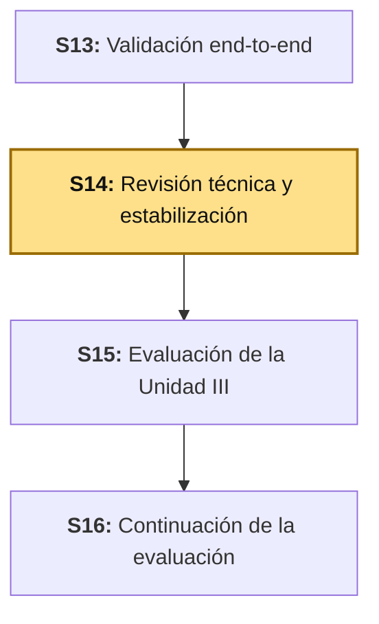
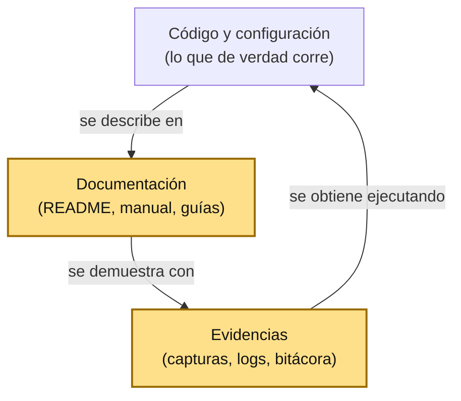

# S14 - Revisión Técnica y Estabilización del Producto

*Por: Angel Sullon Macalupu @asullom - 2026*

## 1. Introducción

Tiempo: 20 min.

### 1.1 Presentación de la sesión

S13 dejó `pagatu` funcionando de punta a punta y corregido. Pero un sistema que solo funciona en la laptop de quien lo construyó no es un producto: es una demostración. Esta sesión pregunta lo que pregunta quien recibe el repositorio por primera vez: ¿puedo levantarlo siguiendo solo lo que está escrito? ¿lo que está escrito sigue siendo verdad? Al preparar la guía, seguir el `README.md` raíz tal como estaba escrito encontró tres afirmaciones que el código ya no cumplía (3.2). Esas son el material real de la sesión.

### 1.2 Índice

1. Estabilizar: de "funciona" a "se puede reproducir".
2. Documentación que describe el código, no el recuerdo del código.
3. El manual de ejecución y sus problemas conocidos.
4. El guion de demostración y las evidencias.
5. El repositorio final y la explicación técnica de la arquitectura.

### 1.3 Propósito de aprendizaje

Al concluir la clase, estarás en condiciones de: **verificar** que un repositorio se puede levantar siguiendo solo su documentación, **detectar y corregir** afirmaciones de la documentación que el código ya no cumple, **redactar** un manual de ejecución con sus problemas conocidos, **preparar** un guion de demostración con plan alternativo, y **explicar** las decisiones de arquitectura con lo que cada una cuesta.

### 1.4 Producto de sesión

El `README.md` raíz corregido y verificado contra el repositorio real, un manual de ejecución con verificación por componente y tabla de problemas conocidos, el guion de demostración con tiempos y plan alternativo, la lista de comprobación del repositorio final, la explicación técnica de la arquitectura, y la bitácora de estabilización con los hallazgos de esta revisión.

### 1.5 Metodología

**Tabla 1. Metodología de la sesión**

| Actividades a Realizar en el Periodo | Orientaciones generales (Orientaciones Metodológicas) | Material de estudio recomendado |
|---|---|---|
| Revisión previa individual | Releer el `README.md` raíz y `services/README.md` como si fueras alguien que nunca vio el proyecto, sin ejecutar nada todavía. Anotar cada comando, ruta y puerto que citan. Trabajo individual, antes de clase. | `README.md`, `services/README.md`, `obs/README.md`, S13 (bitácora, 3.10). |
| Clase presencial | Seguir la documentación paso a paso contra el repositorio real, corregir lo que ya no es cierto, construir el manual de ejecución y el guion de demostración. Trabajo individual en la propia laptop, siguiendo al docente paso a paso. | Todo `pagatu` clonado en una carpeta limpia, pasos 3.1 a 3.9 de esta guía. |
| Evaluación formativa | Revisión en clase de las correcciones a la documentación y del guion de demostración. La evidencia se completa y sustenta de forma individual, fuera del aula, según los criterios mínimos de la sección 4.4. | Indicaciones de entrega (4.3), rúbrica de evaluación (4.6). |

### 1.6 Motivación de la sesión

#### 1.6.1 Caso: GitLab (2017), cuatro mecanismos de respaldo y ninguno probado

El 31 de enero de 2017, GitLab.com sufrió una caída mayor. Un ingeniero intentaba reparar la replicación de la base de datos y, "errantly thinking" que lo hacía en el servidor secundario, borró los datos del primario: unos 300 GB, hasta que lo detuvieron. La compañía tenía cuatro mecanismos de protección — copias con `pg_dump`, *snapshots* de LVM, *snapshots* de disco en Azure y replicación — y el informe posterior dice que "the process of both finding and using backups failed completely": el *bucket* de S3 con las copias de `pg_dump` estaba vacío (se ejecutó la versión 9.2 de `pg_dump` contra PostgreSQL 9.6), y los *snapshots* de Azure no estaban habilitados en los servidores de base de datos. Terminaron restaurando desde un *snapshot* de LVM de seis horas antes, y el propio informe resume la causa de fondo: "nobody was responsible for testing this procedure". Se perdieron, como mínimo, 5000 proyectos, 5000 comentarios y unos 700 usuarios.

Fuente: GitLab. (2017, 10 de febrero). *Postmortem of database outage of January 31*. https://about.gitlab.com/blog/postmortem-of-database-outage-of-january-31/

El detalle que importa para esta sesión: los procedimientos **existían y estaban documentados**; lo que no existía era alguien que los hubiera ejecutado de verdad. Un manual que nadie ha seguido al pie de la letra es, hasta que alguien lo sigue, una hipótesis. Es exactamente lo que le pasó al `README.md` de `pagatu`: describía un arranque que ya no coincidía con el repositorio.

**Preguntas de análisis**

**Activación de conocimientos previos**

1. Si alguien más tuviera que levantar tu proyecto mañana, ¿qué parte de tu documentación crees que sigue siendo cierta sin haberla comprobado?

**Comprensión del caso**

1. Según el caso, ¿qué diferencia hay entre "tener un procedimiento de respaldo" y "tener un procedimiento de respaldo que funciona"?
2. ¿Por qué el informe señala que nadie era responsable de probar el procedimiento, y no solo el error técnico de las versiones de `pg_dump`?
3. En tu propio proyecto, ¿quién es responsable de que el manual de ejecución se pruebe, y cuándo fue la última vez que se siguió completo?

### 1.7 Ubicación en el curso

- Unidad: U3 - Validación y consolidación del producto del curso.
- Producto del curso: sistema distribuido de microservicios end-to-end, configurable, escalable, seguro, resiliente, consistente, observable, integrado con frontend y defendido técnicamente.
- Producto de unidad: sistema distribuido de microservicios end-to-end, validado, documentado, estabilizado y defendido técnicamente.
- Avance del producto en esta sesión: documentación verificada contra el código, manual de ejecución, guion de demostración, repositorio final y explicación técnica de la arquitectura.

**Figura 1. Roadmap del producto de la unidad**



## 2. Explica

Tiempo: 40 min.

### 2.1 Arquitectura de la sesión

**Figura 2. Tres cosas que deben decir lo mismo**



Lectura del diagrama: el código es la única fuente de verdad. La documentación y las evidencias derivan de él, y cada una se comprueba contra él. Cuando divergen, la que está equivocada casi siempre es la documentación — porque el código se ejecuta todos los días y la documentación no.

### 2.2 Estabilizar: de "funciona" a "se puede reproducir"

**Estabilizar** no es agregar funcionalidad: es reducir la dependencia de quien construyó el sistema. Un sistema está estabilizado cuando otra persona, con solo el repositorio y su documentación, obtiene el mismo resultado sin preguntarle nada al autor. El criterio de salida es una prueba concreta: **seguir la documentación al pie de la letra, en un entorno limpio, y registrar cada punto donde hubo que adivinar**.

### 2.3 Documentación que describe el código, no el recuerdo del código

La documentación envejece de una forma específica: cada afirmación se escribe cuando es cierta y deja de serlo cuando el código cambia, sin que nada falle. Las afirmaciones que más rápido envejecen son las que nombran **estados** ("pendiente", "todavía no existe"), **rutas** (`cd services/…`), **puertos** y **comandos**, porque el código cambia alrededor de ellas.

**Tabla 2. Qué envejece, y cómo se comprueba**

| Tipo de afirmación | Ejemplo | Cómo se comprueba |
|---|---|---|
| Estado | "Keycloak (pendiente)" | Existe la carpeta y arranca. |
| Ruta | `cd services/pagatu-cliente-ms` | `ls` de esa ruta. |
| Puerto | "Eureka en `18761`" | Se abre la URL. |
| Comando | `docker compose -f compose-dev.yml up -d` | Se ejecuta en una carpeta limpia. |

### 2.4 El manual de ejecución y sus problemas conocidos

Un manual de ejecución no es el `README.md`: el README responde "qué es esto"; el manual responde "cómo lo levanto, cómo sé que funciona, y qué hago cuando no". Tiene cinco partes: requisitos, orden de arranque, **verificación por componente** (cómo sé que cada pieza está sana), cómo detener, y **problemas conocidos** — cada uno con su síntoma y su causa, porque quien los vive a las 11 de la noche no tiene al autor al lado. Los problemas conocidos no se inventan: salen de lo que falló de verdad al ejecutar el sistema (3.4).

### 2.5 El guion de demostración y las evidencias

Una demostración falla por tres motivos: demasiado por mostrar, un paso que depende de otro que no está listo, y ningún plan cuando algo falla en vivo. El guion resuelve los tres: cada paso tiene su tiempo, su comando exacto, el resultado que debe verse y un **plan alternativo** (una captura, un log, un video corto) para cuando ese paso falle. Las evidencias son lo que respalda cada paso si alguien duda: la salida real, con fecha, de haberlo ejecutado.

### 2.6 El repositorio final y la explicación técnica

El repositorio final es lo único que otra persona recibe. Se revisa como un producto: una rama por sesión cerrada, nada que no deba versionarse (registros, dependencias, claves reales), y el historial de *commits* coherente con las fechas de las evidencias. La **explicación técnica de la arquitectura** no describe qué hace cada componente (eso ya lo dicen los diagramas); describe **qué decisiones se tomaron, por qué, y qué se pierde con cada una**. Una decisión sin su costo es una preferencia.

## 3. Aplica: actividad práctica guiada

Tiempo: 100 min.

**Actividad:** verificar la documentación de `pagatu` contra el repositorio real, corregir lo que ya no es cierto, construir el manual de ejecución, el guion de demostración y la lista del repositorio final, y registrar los hallazgos.

**Propósito de la actividad:** salir de la sesión con un repositorio que otra persona pueda levantar y defender sin acompañamiento, y con el hábito de comprobar la documentación contra el código en vez de confiar en ella.

**Orientaciones metodológicas:** el docente sigue la documentación en vivo frente a la clase, sin saltarse ningún paso, y corrige cada divergencia a medida que aparece; los estudiantes repiten el procedimiento sobre su propio proyecto en la sección 4.

**Punto de partida común:** todo el equipo debe comenzar exactamente desde donde quedó S13. Clona la rama `s13-validacion-end-to-end` (el snapshot de cierre de S13) en una carpeta **nueva y vacía** — la prueba de 3.2 no vale sobre una copia donde ya levantaste el sistema antes:

```bash
git clone --branch s13-validacion-end-to-end https://github.com/262dist/pagatu.git
```

**Actividades para realizar:**

- **3.1** Preparar un entorno limpio.
- **3.2** Seguir el README al pie de la letra y registrar lo que falla.
- **3.3** Corregir la documentación contra el código.
- **3.4** Verificar cada componente y redactar el manual de ejecución.
- **3.5** Comprobar la deriva con un método repetible.
- **3.6** Preparar el guion de demostración.
- **3.7** Revisar el repositorio final.
- **3.8** Redactar la explicación técnica de la arquitectura.
- **3.9** Registrar los hallazgos en la bitácora.

**Presentación de referencia:** el producto final de `pagatu` está presentado en [pagatu_U3_producto_final_integrado.pptx](../presentaciones/pagatu_U3_producto_final_integrado.pptx), un ejemplo del docente. Estas son las láminas que corresponden a esta sesión:

- **3.2 y 3.3:** lámina 13, de «funciona» a «se puede reproducir».
- **3.4:** láminas 14 y 15, manual de ejecución y problemas conocidos.
- **3.6:** lámina 16, demo end-to-end.
- **3.7:** lámina 18, repositorio y documentación.
- **3.8:** láminas 5 y 19, arquitectura y limitaciones; la lámina 11 muestra una decisión propia con su costo.
- **3.9:** lámina 8, hallazgos de la validación end-to-end.

La validación, la estabilización, el manual y la demo son comunes a todo el grupo: se presentan una sola vez, y cada integrante debe saber explicarlos. Las presentaciones de las unidades anteriores son [la de la Unidad I](../presentaciones/pagatu_U1_servicio_base.pptx) y [la de la Unidad II](../presentaciones/pagatu_U2_sistema_distribuido.pptx).

### 3.1 Preparar un entorno limpio

**Producto del paso:** una copia del repositorio en la que nada se ha ejecutado antes, y la lista de lo que ya tienes instalado.

Usa una carpeta nueva (la del `git clone` anterior) y detén lo que tengas corriendo de `pagatu` (`docker stop (docker ps --filter "name=pagatu-" -q)`, y `Ctrl+C` en cada terminal de `mvnw`). Verifica los requisitos que declara el `README.md`: JDK 21 y Docker Desktop.

```powershell
java -version
docker --version
```

**Error frecuente**: probar sobre la copia donde ya funcionaba "porque ya estaba levantado". Esa copia tiene estado que el README no menciona (contenedores creados, dependencias descargadas, tokens en el navegador) y oculta exactamente lo que esta prueba busca.

### 3.2 Seguir el README al pie de la letra y registrar lo que falla

**Producto del paso:** una lista de cada punto donde hubo que adivinar, corregir o saltarse una instrucción.

Sigue la sección "Arranque rápido en DEV" del `README.md` raíz, en orden, ejecutando cada bloque tal como está escrito y **sin corregir nada sobre la marcha**: solo anota. Resultado real de esta sesión, sobre el repositorio tal como quedó al cerrar S13:

1. **Paso 4, `cd services/pagatu-cliente-ms`:** el bloque falla con `No such file or directory`. El README lo incluía junto a los otros tres microservicios, pero esa carpeta no existe en el repositorio: `pagatu-cliente-ms` es el ejercicio autónomo de cada equipo (S2), no parte de la referencia.
2. **Estructura del repositorio:** el README marcaba `keycloak/` como "(S07b, pendiente)" y `pagatu-frontend/` como "S11, pendiente". Las dos carpetas existen y funcionan desde S07b y S11.
3. **`CLAUDE.md`:** decía que S11 "todavía no existe" y que solo S01-S10 estaban desarrolladas.

Ninguna de las tres rompe el sistema: todas rompen la confianza de quien sigue el documento, porque la primera línea que falla le enseña que el resto tampoco es fiable.

**Error frecuente**: corregir el comando "en tu cabeza" y seguir. Un error que corriges sin registrarlo vuelve a aparecer para la siguiente persona.

### 3.3 Corregir la documentación contra el código

**Producto del paso:** el `README.md` y el `CLAUDE.md` coincidiendo con lo que existe en el repositorio.

Para cada afirmación de 3.2, el cambio es el mínimo que la vuelve cierta. El estado de las dos carpetas:

```text
├── keycloak/    # Keycloak + su Postgres (S07b) — sustituye a pagatu-auth-ms como servidor de autorización
└── clients/     # Frontends que consumen la API — uno por carpeta (pagatu-frontend/, Angular con login PKCE contra Keycloak, S11; ...)
```

El bloque del paso 4 que fallaba se elimina, y la nota que lo acompañaba pasa a decir exactamente lo que es:

> `pagatu-cliente-ms` es el ejercicio autónomo de cada equipo (S2): no existe en este repositorio de referencia, así que no hay nada que levantar; si tu equipo lo construyó, súbelo igual que los demás.

En `CLAUDE.md`, el estado real pasa a "S01-S11 y S13 desarrolladas; S12 y S15 son evaluaciones". Verifica el resultado repitiendo la prueba de 3.2 sobre el README ya corregido: el paso 4 ahora ejecuta solo tres microservicios, los tres existen.

Un detalle que la corrección deja a propósito: la tabla de puertos de DEV sigue listando `pagatu-cliente-ms` (`8084`) como puerto reservado — es el puerto que usa el equipo que sí lo construya, y no induce a ejecutar nada que falle.

### 3.4 Verificar cada componente y redactar el manual de ejecución

**Producto del paso:** el manual de ejecución, con una verificación por componente y los problemas conocidos de esta unidad.

Con el sistema levantado según el README corregido, recorre cada componente con una comprobación concreta. Los puertos son los de la tabla de DEV del README:

**Tabla 3. Verificación por componente**

| Componente | Cómo verificarlo | Resultado esperado |
|---|---|---|
| `pagatu-config` | Abrir `http://localhost:18888/pagatu-catalogo-ms/dev` | JSON con la configuración del servicio. |
| `pagatu-eureka` | Abrir `http://localhost:18761` | Gateway, catálogo, orden y pago registrados. |
| `pagatu-gateway` | `GET http://localhost:18080/api/v1/categorias` | `200`, con la cabecera `X-Trace-ID`. |
| Microservicios | `http://localhost:8080/actuator/health` (también `8082`, `8086`) | `{"status":"UP"}`. |
| Keycloak | `http://localhost:19000/health/ready` | `{"status": "UP"}`. |
| Kafka | Kafka UI en `http://localhost:18085` | Clúster `pagatu-dev` conectado. |
| Observabilidad | Grafana en `http://localhost:13000` | Tablero de S10 con datos. |

Y el recorrido funcional mínimo, que es el que cierra la verificación: login PKCE → crear una orden → verla pasar a `PAGADA` (S13, 3.3). Si ese recorrido funciona, los componentes de la tabla están sanos entre sí, no solo cada uno por su lado.

Los problemas conocidos del manual salen de lo que falló de verdad al ejecutar el sistema en S13, no de una lista teórica:

**Tabla 4. Problemas conocidos de `pagatu` en DEV**

| Síntoma | Causa | Qué hacer |
|---|---|---|
| Una llamada con token responde `401` aunque funcionaba hace minutos. | El token de Keycloak expira en pocos minutos. | Repetir el procedimiento de S07b, sección 6. |
| Tras editar un `.java`, el servicio no vuelve y el log no muestra `Started …`. | El reinicio de DevTools queda colgado cuando el servicio tiene un *listener* de Kafka. | `Ctrl+C` y `.\mvnw.cmd spring-boot:run` de nuevo. |
| Una orden se queda en `PENDIENTE_PAGO`. | Kafka no estaba arriba cuando arrancó el servicio, o `pagatu-pago-ms` no está corriendo. | Confirmar Kafka UI y buscar `partitions assigned` en el log de `orden-ms` y `pago-ms`. |
| Loki no devuelve ninguna línea de un servicio. | Promtail no arrancó (un `job_name` duplicado en su configuración lo reinicia en bucle). | `docker logs pagatu-promtail-dev` y buscar el error de configuración. |
| Un `traceId` recién creado no aparece en Loki. | Promtail lee los archivos con un pequeño retraso. | Esperar unos 15 segundos y repetir la consulta. |

Reúne los tres elementos —requisitos, orden de arranque y Tabla 3, y la Tabla 4— en un solo archivo `docs/manual-ejecucion.md` de tu proyecto. Ese archivo es el que 3.2 vuelve a probar en la siguiente revisión.

### 3.5 Comprobar la deriva con un método repetible

**Producto del paso:** una comprobación que puedes repetir cada vez que cambies el repositorio, sin depender de leer el README con atención.

Para cada ruta que el README cita, comprueba que existe:

```powershell
foreach ($ruta in "infra/pagatu-config","infra/pagatu-eureka","infra/pagatu-gateway","services/pagatu-catalogo-ms","services/pagatu-orden-ms","services/pagatu-pago-ms","kafka","keycloak","obs","clients/pagatu-frontend") {
  "{0,-34} {1}" -f $ruta, (Test-Path $ruta)
}
```

```bash
for r in infra/pagatu-config infra/pagatu-eureka infra/pagatu-gateway services/pagatu-catalogo-ms services/pagatu-orden-ms services/pagatu-pago-ms kafka keycloak obs clients/pagatu-frontend; do
  [ -d "$r" ] && echo "OK   $r" || echo "FALTA $r"
done
```

Y busca en la documentación las palabras que delatan un estado envejecido:

```bash
git grep -n -i -E "pendiente|todavía no|aún no|próxima sesión" -- README.md CLAUDE.md docs/index.md
```

Cada coincidencia no es un error — puede ser una afirmación todavía cierta —, pero cada una exige comprobar contra el código si sigue siéndolo. El método solo sirve si lo repites: córrelo antes de cada entrega.

### 3.6 Preparar el guion de demostración

**Producto del paso:** el guion de la demostración de S15, con tiempos, comandos exactos y plan alternativo.

Usa como base la secuencia de S12 (sección 4) y agrega los dos pasos que S13 incorporó. Cada fila lleva lo que muestras, el comando exacto, lo que debe verse y qué haces si falla:

**Tabla 5. Guion de demostración (plantilla con el ejemplo de `pagatu`)**

| Min. | Qué muestras | Comando o URL | Qué debe verse | Plan alternativo |
|---:|---|---|---|---|
| 0-2 | Sistema levantado. | Eureka `:18761` | Los cuatro componentes registrados. | Captura de Eureka con fecha y hora. |
| 2-4 | Resiliencia. | Detener una instancia de `catalogo-ms` y pedir una orden. | Respuesta controlada (*fallback*), no un error en cascada. | Log del `fallback` de S6. |
| 4-6 | Seguridad entre usuarios. | `GET /ordenes/{id}` de otro usuario con el token de `cliente1`. | `404`, no los datos de otro. | Tabla de la bitácora (S13, 3.10). |
| 6-8 | Evento y consistencia. | Crear una orden y consultar su estado. | `PENDIENTE_PAGO` → `PAGADA`, sola. | Kafka UI con el evento publicado y consumido. |
| 8-10 | Trazabilidad. | Consulta de Loki por un `traceId`. | La misma línea en Gateway, `orden-ms` y `catalogo-ms`. | Captura de la consulta (S13, 3.8). |
| 10-12 | Cliente real. | Login y "Mis pedidos" en `:4200`. | Solo las órdenes del usuario. | Video corto del recorrido. |

Reglas del guion: **ensáyalo completo con el cronómetro** y recorta lo que no entra; cada paso depende solo de lo anterior que ya mostraste; y **todo plan alternativo debe existir antes de la demostración**, no improvisarse cuando falla. Una captura de plan alternativo sin fecha y hora no demuestra nada.

**Error frecuente**: dejar para el día de la demostración la prueba de que cada comando del guion funciona. Un comando con una comilla mal copiada consume el tiempo del paso siguiente.

### 3.7 Revisar el repositorio final

**Producto del paso:** la lista de comprobación del repositorio final, cada punto con su resultado.

**Tabla 6. Lista de comprobación del repositorio final**

| Punto | Cómo comprobarlo |
|---|---|
| Una rama por sesión cerrada | `git branch -a`: cada sesión construida tiene su `sXX-nombre-tema`; las evaluaciones no. |
| No se versiona lo que no debe | `git status --short` limpio tras ejecutar el sistema (el `.gitignore` de `pagatu` ya excluye `logs/`, `dist/` y `node_modules/`). |
| Sin secretos reales | `git grep -n -i -E "password\|secret\|apikey"`; cada coincidencia debe ser un valor de DEV documentado como tal, nunca una clave real. |
| Historial coherente con las evidencias | Las fechas de tus capturas no son anteriores al *commit* que las respalda. |
| El README se sigue sin ayuda | La prueba de 3.2, repetida sobre la versión final. |

**Error frecuente**: dar por bueno el repositorio porque `git status` está limpio en tu laptop. Lo que cuenta es lo que hay en el remoto: clónalo de nuevo y repite la prueba de 3.2 sobre esa copia.

### 3.8 Redactar la explicación técnica de la arquitectura

**Producto del paso:** una explicación técnica de media página que nombra decisiones, no componentes.

El formato por decisión: **qué se decidió, por qué, y qué se pierde**. Ejemplo con decisiones reales de `pagatu`:

**Tabla 7. Decisiones de arquitectura y su costo**

| Decisión | Por qué | Qué se pierde |
|---|---|---|
| Cada microservicio valida el JWT y comprueba el dueño del dato. | El Gateway solo ve la ruta y el rol; el dueño de un objeto solo lo conoce su servicio (S13, 2.3). | Cada servicio repite la validación; un olvido en uno es un hueco (S13, 3.4-3.6). |
| `idCliente` es el `sub` de Keycloak. | El token ya lo trae y es único por persona. | La base de órdenes depende del identificador de otro sistema (Keycloak). |
| Orden y pago se coordinan por eventos (Saga coreografiada). | Cada servicio sigue funcionando aunque el otro esté caído (S8-S9). | La consistencia es eventual: la orden pasa un tiempo en `PENDIENTE_PAGO`. |
| Una base de datos por microservicio. | Cada servicio es dueño de su dato y se despliega solo. | El dueño de una orden no se puede completar desde `pago-ms`: hay que viajar en el evento (S13, 3.6). |
| Ocultar un objeto ajeno con `404` y no `403`. | No confirma que el objeto existe (S13, 2.3). | El diagnóstico de un fallo legítimo de permisos es menos explícito. |

Para tu propio proyecto, elige tres o cuatro decisiones reales y completa las tres columnas sin dejar ninguna vacía; si no puedes escribir "qué se pierde", todavía no entiendes la decisión.

### 3.9 Registrar los hallazgos en la bitácora

**Producto del paso:** la bitácora de estabilización de esta revisión, una fila por hallazgo.

**Tabla 8. Bitácora de estabilización de la revisión técnica**

| # | Hallazgo | Causa | Corrección | Prueba de corrección |
|---|---|---|---|---|
| 1 | El paso 4 del README fallaba al ejecutarse (`cd services/pagatu-cliente-ms`). | Se documentó un servicio que es ejercicio autónomo y no existe en el repositorio de referencia. | Bloque eliminado; la nota explica que no hay nada que levantar. | Repetir el paso 4 del README corregido: los tres servicios arrancan. |
| 2 | El README declaraba `keycloak/` y `pagatu-frontend/` como "pendientes". | El README no se actualizó al cerrar S07b y S11. | Las dos líneas describen lo que existe. | `Test-Path` de las dos carpetas (3.5) y apertura del frontend. |
| 3 | `CLAUDE.md` decía que S11 "todavía no existe". | Estado escrito en octubre y no actualizado. | Estado real actualizado (S01-S11 y S13). | `git grep -n "todavía no existe" CLAUDE.md` sin coincidencias. |

**Evidencia de aprendizaje:**

- Prueba de reproducibilidad (3.2) sobre una copia limpia, con la lista de puntos donde falló.
- Documentación corregida y verificada de nuevo contra el repositorio (3.3, 3.5).
- Manual de ejecución con verificación por componente y problemas conocidos (3.4).
- Guion de demostración con tiempos, comandos y plan alternativo (3.6).
- Lista de comprobación del repositorio final completada (3.7).
- Explicación técnica con decisiones y su costo (3.8).
- Bitácora de estabilización con la prueba de corrección de cada fila (3.9).

## 4. Crea: actividad autónoma

Tiempo: 2h fuera del aula.

### 4.1 Actividad

Estabilización del Proyecto Sello propio del equipo, documentada en evidencia individual.

Completa y evidencia estas tareas:

1. Clona tu propio repositorio en una carpeta limpia y sigue tu propia documentación al pie de la letra. Registra cada punto donde hubo que adivinar, corregir o saltarse una instrucción.
2. Corrige tu documentación hasta que la prueba anterior pase sin ninguna intervención, y repítela para demostrarlo.
3. Redacta el manual de ejecución de tu proyecto (requisitos, orden de arranque, verificación por componente, cómo detener, problemas conocidos con su causa).
4. Prepara el guion de tu demostración con tiempos, comando exacto, resultado esperado y plan alternativo por paso, y ensáyalo con cronómetro.
5. Revisa tu repositorio final con la lista de 3.7 y completa cada punto.
6. Redacta la explicación técnica de tu arquitectura: al menos tres decisiones propias, cada una con su porqué y lo que se pierde.

### 4.2 Propósito

Que cada estudiante demuestre, de forma individual y fuera del aula, que su proyecto se puede levantar y defender por otra persona solo con el repositorio y su documentación, y que conoce el costo de cada decisión de su arquitectura.

### 4.3 Indicaciones

Entrega un PDF con el siguiente nombre:

```text
S14_Equipo##_ApellidoNombre.pdf
```

Cada captura de pantalla del informe debe mostrar, sin recortar, el reloj del sistema (fecha y hora) y tu usuario o foto de perfil (Windows, VS Code o navegador) visibles en pantalla — es lo que permite verificar que la evidencia es tuya y que corresponde al momento real de tu trabajo.

#### 4.3.1 Estructura del informe

**Datos del estudiante**

- Nombre:
- Equipo:
- Sesión: S14 - Revisión técnica y estabilización del producto
- Rol o aporte realizado:
- Link de GitHub:

**Evidencia técnica**

Incluye capturas con una breve explicación debajo de cada una, organizadas en los mismos 4 bloques de la rúbrica (4.6):

1. *Reproducibilidad del manual de ejecución*
    - La prueba sobre una copia limpia: los puntos donde falló al principio y la repetición final sin intervención.
2. *Documentación fiel al código*
    - Cada afirmación corregida, con la comprobación contra el repositorio (ruta, puerto, comando o estado).
3. *Guion de demostración*
    - El guion con tiempos, comando exacto, resultado esperado y plan alternativo por paso, y evidencia de haberlo ensayado.
4. *Repositorio final y explicación técnica*
    - La lista de comprobación completada y la explicación de al menos tres decisiones con su costo.

**Error o hallazgo**

Describe un error real: una instrucción de tu documentación que fallaba al ejecutarla, un plan alternativo que no funcionó cuando lo probaste, un secreto o archivo que casi llegó al repositorio, o cualquier otro obstáculo real de esta sesión.

**Reflexión técnica breve**

Responde en 5 a 8 líneas:

```text
Relaciona el caso de GitLab (1.6) con tu propio manual de ejecución:
¿qué parte de tu documentación nunca has ejecutado completa, quién
sería responsable de probarla, y qué pasaría el día de la demostración
si esa parte estuviera equivocada?
```

**Anexo: Feedback de la sesión**

Pega esta página como la última hoja del PDF, con tus respuestas.

1. ¿Cuál es el aprendizaje más importante que te llevas de la clase de hoy?
2. ¿Qué punto de la clase te resultó más confuso o te dejó con dudas?
3. ¿Tienes alguna pregunta que te gustaría que sea respondida la siguiente clase?
4. Sobre tu nivel de comprensión de la clase de hoy, marca una opción:
    - ¡Entendido! - Lo domino y podría explicarlo.
    - Más o menos. - Entendí la idea general, pero tengo dudas.
    - Necesito ayuda. - Me siento perdido/a con este tema.
5. ¿Cómo puedo ayudarte a comprender mejor el tema?
6. Pensando en tu participación y esfuerzo en la clase de hoy, ¿cómo te autoevaluarías? Marca una opción:
    - Muy Comprometido/a: Me esforcé al máximo.
    - Comprometido/a: Sé que podría haberme esforzado un poco más.
    - Poco Comprometido/a: Hoy no di mi mejor esfuerzo.
7. Mi satisfacción con la clase fue... (califica del 1 al 10, donde 1 es insatisfecho y 10 es muy satisfecho).

### 4.4 Criterios mínimos de aceptación

- El archivo respeta el nombre solicitado.
- La documentación se probó siguiéndola al pie de la letra sobre una copia limpia, con los puntos de fallo registrados.
- La prueba se repitió después de corregir y pasó sin ninguna intervención.
- El manual de ejecución incluye verificación por componente y problemas conocidos con su causa.
- El guion de demostración tiene tiempos, comando exacto, resultado esperado y plan alternativo por paso, y fue ensayado.
- La lista de comprobación del repositorio final está completada punto por punto.
- La explicación técnica incluye al menos tres decisiones propias con su porqué y lo que se pierde.
- Cada captura de la evidencia técnica muestra el reloj del sistema y el usuario/perfil visible, sin recortar.
- Las fechas y horas de las capturas son coherentes con el historial de commits de su repositorio en GitHub.
- Incluye un error o hallazgo técnico diagnosticado.
- Incluye la reflexión técnica breve solicitada.
- Incluye el Anexo de feedback de la sesión respondido, como última página del PDF.

### 4.5 Preguntas de defensa

1. ¿Por qué la prueba de reproducibilidad debe hacerse sobre una copia limpia, y qué oculta una copia donde el sistema ya funcionaba?
2. ¿Qué tipos de afirmación envejecen más rápido en una documentación, y cómo se comprueba cada una?
3. En tu manual de ejecución, ¿qué problema conocido tiene una causa que no es obvia por el síntoma?
4. ¿Por qué cada paso del guion necesita un plan alternativo preparado antes de la demostración?
5. Elige una decisión de tu arquitectura: ¿qué se perdió al tomarla, y por qué sigue valiendo la pena?
6. ¿Qué comprobarías en el repositorio remoto —no en tu laptop— para estar seguro de que otra persona lo puede levantar?
7. Relaciona el caso de GitLab (1.6) con tu propio proceso: ¿quién prueba tu manual, y con qué frecuencia?

### 4.6 Rúbrica de evaluación

**Tabla 9. Rúbrica de evaluación**

| Criterio | Peso (%) | A (20 pts) | B (15 pts) | C (10 pts) | D (5 pts) | Nivel obtenido |
|---|---:|---|---|---|---|---:|
| 1. Manual de ejecución reproducible* | 25 | Probado sobre copia limpia, corregido y repetido sin intervención; con verificación por componente y problemas conocidos con causa. | Probado y corregido, con la repetición o los problemas conocidos incompletos. | Manual escrito sin probarse sobre una copia limpia. | No presenta manual de ejecución. | |
| 2. Documentación fiel al código* | 25 | Cada afirmación (estado, ruta, puerto, comando) comprobada contra el repositorio, con las divergencias corregidas. | Comprobada en su mayoría, con alguna sin verificar. | Corrección sin comprobar contra el repositorio. | No presenta revisión de la documentación. | |
| 3. Guion de demostración* | 25 | Con tiempos, comando exacto, resultado esperado y plan alternativo por paso, ensayado con cronómetro. | Completo, sin evidencia de ensayo o con algún plan alternativo ausente. | Lista de pasos sin tiempos ni plan alternativo. | No presenta guion. | |
| 4. Repositorio final y arquitectura explicada* | 25 | Lista de comprobación completa y al menos tres decisiones con su porqué y su costo. | Lista completa, o decisiones con el costo incompleto. | Lista parcial, o decisiones sin costo. | No presenta ninguno de los dos. | |

\* Agregado manual.

Nota final = suma de (`Peso` / 100 × `Puntos del nivel obtenido`) = ____ / 20.

Para usar la rúbrica con IA (inteligencia artificial), solicita:

```text
Evalúa el PDF usando la rúbrica de la sesión.
Para cada criterio selecciona el nivel obtenido usando la escala A=20, B=15, C=10, D=5 puntos.
Justifica brevemente cada nivel asignado.
Verifica que cada captura muestre reloj del sistema y usuario/perfil visible, y que las fechas sean coherentes con el historial de commits de GitHub. Si falta esta evidencia o hay inconsistencias, indícalo explícitamente antes de calificar.
Calcula la nota final con la fórmula: suma de (Peso/100 × Puntos del nivel obtenido), directamente sobre 20.
Indica 2 fortalezas y 2 recomendaciones.
```

## 5. Cierre

Tiempo: 5 min.

**Resumen breve:** hoy `pagatu` dejó de depender de que su autor esté presente. Seguir su propio README al pie de la letra encontró tres afirmaciones que el código ya no cumplía — un comando que fallaba y dos estados que seguían marcados como "pendientes" cuando ya estaban hechos —, se corrigieron y se volvió a probar. El sistema ganó un manual de ejecución con verificación por componente y problemas conocidos salidos de fallos reales, un guion de demostración con plan alternativo por paso, una lista para el repositorio final, y una explicación de la arquitectura que dice lo que cada decisión cuesta. El caso de GitLab lo resume: un procedimiento que nadie ha ejecutado de verdad es solo una hipótesis.

**Dinámica participativa:** en una ronda rápida, cada estudiante comparte en una frase la primera instrucción de su propia documentación que falló al seguirla al pie de la letra.

**Metacognición:** ¿qué te costó más hoy: aceptar que tu documentación estaba equivocada en algo que "sabías" que funcionaba, o decidir qué plan alternativo preparar para cada paso de la demostración?

**Proyección:** S15 es la evaluación de la Unidad III: resolverás la evaluación teórico-práctica y sustentarás el sistema distribuido completo, con el repositorio, el manual y el guion que preparaste hoy.

## Bibliografía

1. GitLab. (2017, 10 de febrero). *Postmortem of database outage of January 31*. https://about.gitlab.com/blog/postmortem-of-database-outage-of-january-31/
